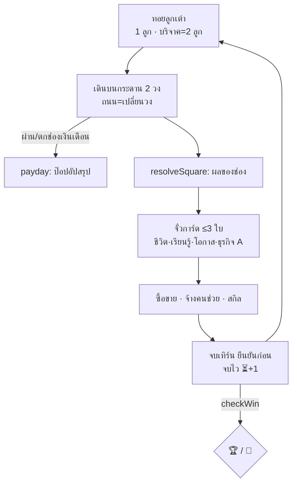
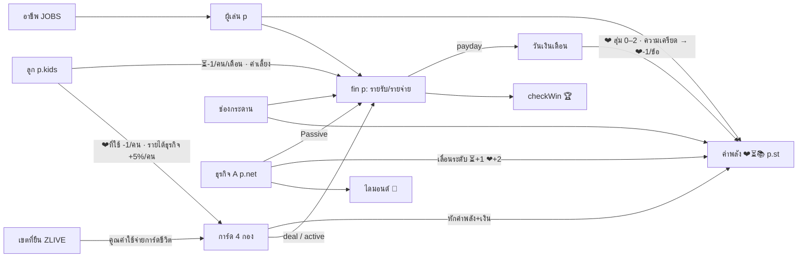

# graphify.md — แผนที่ระบบ "เกมอิสรภาพทางการเงิน"

> เอกสารนี้คือ "กราฟความรู้" ของเกม: ระบบอะไรต่อกับอะไร ฟังก์ชันอยู่บรรทัดไหน ตัวเลขสมดุลมาจากไหน
> ใช้อ่านก่อนแก้เกมทุกครั้ง (ทั้งทีมงานและ AI) จะได้ไม่ต้องไล่โค้ด 1,800 บรรทัดใหม่
> อัปเดตล่าสุด: 14 พ.ย. 2026 · ไฟล์หลัก `index.html` (ไฟล์เดียว) + โฟลเดอร์ `img/`

---

## 1. ภาพรวมเกม (1 นาที)

- บอร์ดเกมบนเว็บ 6 ผู้เล่น (คน + บอท เล่นเครื่องเดียว) ผสม **เศรษฐี + Cashflow + ตลาดหุ้น/สินค้า + ธุรกิจเครือข่าย (ธุรกิจ A)**
- ทุกคนสุ่มได้ **อาชีพ** (8 อาชีพ) → เงินเดือน เงินเก็บ รายจ่าย หนี้ ค่าเลี้ยงลูก ค่าพลังเริ่มต้นต่างกัน
- **ชนะ Lv.1 🏆** Passive > รายจ่ายรวม (เกมเล่นต่อ) · **ชนะ Lv.2 💎** ธุรกิจ A ถึงไดมอนด์ (จบเกม สรุปอันดับ)
- 1 เทิร์น = 3 นาที: ทอยเต๋า → เดิน → ผลช่อง → จั่วการ์ด ≤3 ใบ จาก 4 กอง → ซื้อขาย/จัดการเงิน → จบเทิร์น (ยืนยันก่อน)

---

## 2. กราฟระบบ (อะไรส่งผลต่ออะไร)

---

## 3. แผนที่โค้ด (index.html) — หมวด → ฟังก์ชันสำคัญ (เลขบรรทัดโดยประมาณ)

| หมวด | บรรทัด | ฟังก์ชัน / ค่าคงที่หลัก |
|---|---|---|
| CSS ธีม Storybook + FX | 1–510 | `.board` `.cell` `.tok.pic` `.modal.cardflip` `.bigdie` `.fxb` `.endbtn` |
| DATA | 512 | `JOBIMG` `ZONES` `ZPROPS` `SQ_MAP` `RING_LEN` `ASSETS` `LIVING` `ZLIVE` `lifeCost()` `netCard()` `NEWS` |
| ฐานข้อมูลแก้ได้ | 634 | `DEFAULT_DB` `DBCOLS` `netNeedDef` `oppNeedDef` `EFFTXT` สกิล `skV` `skHas` |
| สมดุล + migration | 667 | `STATVAL` `statCost` `balanceDB` `lifeNoDrain` `loadDB` `applyDB` `lifeApply` |
| HELPERS | 743 | `B()` จัดรูปเงิน · `TURN_MS` · `cp()` `log()` `toast()` `save()` `draw(k)` |
| การเงิน + ธุรกิจ A | 767 | `NET_RANKS` `NET_BRACKETS` `netRankCheck` `kidBoost` `dealCf` **`fin(p)`** `settle` `pay` **`adj(p,d)`** |
| MODAL | 846 | **`ask()`** / `choose()` (บอทข้ามป๊อปอัป → log อย่างเดียว) |
| FX | 868 | `diceAnim` `fxFloat` `fxBanner` `fxCoins` `FXT` (trail/hop) |
| SETUP | 885 | `showSetup` `RULES` (ข้อความกติกา) `newGame` `resume` |
| TURN FLOW | 949 | `confirmEndTurn` `rollTurn` `pickPile` `hireHelp` `endTurn` `timeUp` **`payday(p)`** `checkWin` `endGame` |
| SQUARES | 1141 | `needBox` (ตารางมี/ต้องใช้) **`buyFlow()`** (ซื้อ+กู้+หักค่าพลัง) `resolveSquare` |
| ตลาดกลาง | 1203 | `assetsOf` `moveAsset` `bankOffers` `marketSquare` `joblessHit` `forcedPay` (กู้/ขาย 50%) |
| CARDS | 1299 | `KIDMAX=4` `lifePreview` `lifeCard` `learnCard` `oppCard` |
| ตลาดหุ้น/สินทรัพย์ | 1388 | `trade` `loan` `payDebt` `sellBank` `tradeUI` |
| BOTS | 1453 | `botWants` `botRoad` `botPile` `botInvest` |
| RENDER | 1474 | **`render()`** `cellBody` `cellInfo` `renderFin` `statPanel` `renderNet` `renderMkt` `renderPlayers` |
| SETTINGS (แก้ DB) | 1697 | `renderSettings` `dbMove` (ย้ายการ์ดข้ามกอง) `dbImport/Export` CSV |

**จุดศูนย์กลาง (แก้ตรงนี้กระทบทั้งเกม):** `fin()` · `adj()` · `buyFlow()` · `payday()` · `ask()` · `render()` · `balanceDB()`

---

## 4. ข้อมูลหลัก

### State `S` (localStorage `ffgame-v8`)
`jobs` `players[]` `round` `cur` `phase`(roll/card/free/busy) `props{cell:{o,l}}` `prices` `hist` `decks` `listings` `log` `dice` `winner` `turnEnd` `ann`

### ผู้เล่น `p`
`job` `salary` `cash` `exp{tax,home,car,card,living,extra}` `debt` `loan` `dep`(เงินฝากประจำ) `active` `deals[{t,ty,cost,cf,act}]` `stocks` `skills`
`kids` `kidCost` `net{on,rank,legs{A..F},ppv,pas}` `ring`(o/i) `pos` `jobless` `charity` `st{h,t,k}` `badge1` `badge2` `hired`

### ฐานข้อมูลการ์ด `DB` (localStorage `ffdb-v1`, `DB.ver`=11)
| กอง | คอลัมน์สำคัญ |
|---|---|
| jobs | n sal cash tax home car card living **kc**(ค่าเลี้ยงลูก/คน) h t k |
| life | t cash cpct spct mexp kid h tt k act pas **opt acc perkid** nt nh nk sp |
| learn | t ty cost nt nh nk kg (ความรู้ = เกณฑ์ขั้นต่ำ ไม่หัก) |
| opp | t ty(re/biz/fund/scam/ipo/gold/netinv/buyer/refi) cost **cf(Passive) act(Active)** nt nh nk |
| net (ธุรกิจ A) | t leg pv cost cat A P nt nh nk |
| skills | key name kind(passive/active) eff val uses |

---

## 5. กติกาตัวเลข & สมดุล

- **สูตรสมดุลการ์ด:** ผลตอบแทน/เดือน = 10% × (เงินลงทุน + มูลค่าค่าพลัง) · ⏳=฿10,000 ❤=฿10,000 📚=฿5,000
- **ธุรกิจ A ง่ายกว่า 20%:** การ์ดสร้างสายงานใช้เงินน้อย (10% ของ P, ฿200–3,000) แต่ใช้ค่าพลังมาก (⏳≤4 ❤≤3 📚≤6)
- **การหักค่าพลัง:** ชีวิต/โอกาส/ธุรกิจ A/ทอง/IPO หัก ⏳❤📚 จริง · การ์ดเรียนรู้ + อสังหาฯบนกระดาน 📚 = เกณฑ์ขั้นต่ำ
- **กองชีวิต:** แหล่งเติม ❤⏳ ไม่หักค่าพลัง จ่ายเงินแทน · ไม่บังคับ ยกเว้น `acc=1` (อุบัติเหตุ) และลูกคนที่ 1–2
- **ค่าครองชีพเขต (`ZLIVE`)** คูณค่าใช้จ่ายการ์ดชีวิต: เกษตร .7 · อุตสาหกรรม .8 · ชุมชน .85 · ท่องเที่ยว 1.0 · การเงิน 1.3 · ธุรกิจ 1.4 · ช้อปปิ้ง 1.5 · ที่พักหรู 1.7
- **วันเงินเดือน:** รายรับ − รายจ่าย · ❤ สุ่ม −1..+1 −1/ความเครียด (รายรับไม่พอ, หนี้>3×เงินเดือน, ⏳≤2, ตกงาน) · ⏳ +1..3 −1/ลูก + โบนัส Passive · 📚 −0..1
- **ตกงาน:** ❤−2 + สถานะ 2 เดือน (ได้แค่ Passive − รายจ่าย ไม่พอ → กู้/ขาย 50%)
- **แหล่ง ⏳:** ช่องพักผ่อน 🌿 (6 ช่อง) · การ์ดชีวิต · จ้างคนช่วย ฿10,000=+1/เทิร์น · Passive% · เลื่อนระดับธุรกิจ A · จบเทิร์นไว
- **ลูก:** สูงสุด 4 · ค่าเลี้ยงตามอาชีพ (~7% เงินเดือน) · ⏳−1/คน/เดือน · ❤ที่การ์ดใช้ −1/คน · รายได้ธุรกิจ +5%/คน
- **เงินกู้:** ดอกเบี้ย 2%/เดือน (`LOAN_R`, เดิม 10%) · กู้ได้ทุกการ์ดที่ซื้อ แต่ค่าพลังต้องครบ · เพดาน `loanLim(p)` = max(฿400,000, 12×เงินเดือน) เกิน = ล้มละลาย · บอทกู้ซื้อเมื่อ cf > ดอกเบี้ย×2
- **ฝากประจำ:** ดอกเบี้ย 0.25%/เดือน (`DEP_R`) นับเป็น Passive (`fin().depI`) · เงินสดติดลบ `settle()` ถอนเงินฝากก่อน แล้วค่อยกู้ (มี `ruleNote`)
- **กองทุนรวม** (`ASSETS` k:'fund', 1 ล็อต = 1,000 หน่วย, NAV เริ่ม ฿10, ปัด 2 ตำแหน่ง `roundP`, ค่าธรรมเนียม 1% เท่าหุ้น): MMF v.002 d.0015 · BOND v.008 d.0025 · DIVF v.035 d.002 ปันผล ฿0.04/หน่วย · SET50 v.045 d.005 · GLOB v.055 d.006 · GOLDF v.04 d.003 — `d` = ผลตอบแทนเฉลี่ย/รอบ (สินทรัพย์อื่นใช้ .004) · ซื้อขายในแท็บธนาคาร ไม่แสดงในแท็บเทรด

---

## 6. ประวัติ migration ฐานข้อมูล (`loadDB`)
| ver | การเปลี่ยนแปลง |
|---|---|
| 4 | `balanceDB` สูตร 10% + เติมช่องว่าง |
| 5 | การ์ดโอกาสแยก Active/Passive + การ์ดใหม่ 3 ใบ |
| 6 | การ์ดชีวิตเพิ่มเวลา 6 ใบ |
| 7 | การ์ดธุรกิจกองโอกาสใช้ ❤1 |
| 8 | ธุรกิจ A: เงินน้อย ค่าพลังมาก |
| 9 | กองชีวิตไม่หักค่าพลัง (`LIFE_FIX`, `lifeNoDrain`) |
| 10 | ช่อง `acc` (อุบัติเหตุบังคับรับ) |
| 11 | การ์ดค่าใช้จ่ายลูก 5 ใบ (`perkid`) + `jobs.kc` |

> เพิ่ม migration ใหม่: ต่อบล็อก `if(!(DB.ver>=N)){…;DB.ver=N;save}` ไว้**หลัง**บล็อกก่อนหน้าเสมอ และเปลี่ยน `DEFAULT_DB.ver=N`

---

## 7. ภาพ (โฟลเดอร์ `img/` — สร้างจาก Canva)
| ไฟล์ | ใช้ที่ |
|---|---|
| `back-life/learn/opp/net.webp` | หลังการ์ดตอนพลิก + รูปกองการ์ด — ฉากเมืองยุคใหม่ ไม่มีคน ไม่มีตัวหนังสือ, โลโก้ทีมวางบนป้ายวงกลมในฉาก (life=กระจกร้านกาแฟ, learn=ผนัง, opp=ยอดตึก, net=ผนังห้อง coworking) — โลโก้สีเทากลาง #80848a ทุกภาพ, วางด้วย tools/logofit.py (หาวงรีป้ายจริง + ตามมุมมอง + เงาแสงป้าย) |
| `center.webp` | พื้นหลังกลางกระดาน |
| `zone-o0..o3, i0..i3.webp` | ไอคอนเขตในช่อง + ภาพในป๊อปอัปช่อง |
| `head-0..7.webp` / `pawn-0..7.webp` | หน้าตัวหมาก / ตัวเต็มตามอาชีพ (ลำดับ = `JOBIMG`) — ตัดจากภาพยืนตรงมองกล้อง |
| `npc-std.webp` | NPC ยืนตรงมองกล้อง (สำรองไว้ใช้) |
| โลโก้ทีม | ฝังใน CSS `--logo` (สีเปลี่ยนได้ รูปทรงห้ามเปลี่ยน) |

| `c{0-7}-{happy,shock,sad,work,thumb,think,angry,wave}.webp` | ตัวละคร 8 อาชีพ × 8 ท่า พื้นใส (ตัดจากภาพ Canva) |

**ท่าทาง ↔ เหตุการณ์** (`ask({pose})` แสดงตัวละครมุมขวาบนของป๊อปอัป เฉพาะผู้เล่นคน):
วันเงินเดือนบวก=happy / ติดลบ=sad · การ์ดอุบัติเหตุ=shock · ลูก=happy · ช่องฟุ่มเฟือย=sad · ซื้อได้=thumb / ค่าพลังไม่พอ=think · ตกงาน=sad · เงินไม่พอต้องกู้/ขาย=angry · ยืนยันจบเทิร์น=wave · แบนเนอร์ "ตาของ…"=wave · หน้าตัวหมาก=head จากท่า thumb
**NPC เจ้าหน้าที่ธนาคาร** `npc-{pose}.webp` — `ask({npc})` แสดงในป๊อปอัปที่ไม่มีท่าผู้เล่น: ข้อมูลช่อง/แจ้งเตือนทั่วไป=work · ตลาดกลาง=thumb · ข่าวตลาด=shock · กติกา=wave · สุ่มอาชีพ/ชนะ=happy · หมดเวลา=think · `npc:false` = ไม่แสดง
**สไตล์ตัวละคร (v2, 14 พ.ย.)**: anime วาดมือ สัดส่วนจริง ออก manhwa นิดๆ (ไม่ใช่ chibi/Ghibli) · NPC = เจ้าหน้าที่ธนาคารหญิง ผมบ็อบ เบลเซอร์แดง #be1e2d · ชาย: ส่งของ วิศวกร นักบิน แพทย์ ผู้จัดการ · หญิง: ครู พยาบาล ทนาย · ผิวขาวทุกตัว · script ตัด/แยกท่า: `tools/chars2.py` (แยกตาม component; ถ้าท่าติดกันใช้แบ่งกริด 4×2) · วางโลโก้: `tools/logoput.py` · ไฟล์ต้นฉบับที่เลิกใช้ใน Downloads ตั้งชื่อนำหน้า `bin_`

---

## 8. วิธีทดสอบ
- `node --check` สคริปต์ที่ดึงจาก `<script>` สุดท้าย
- Playwright + Chrome: `sim3.py` (บอทล้วน 10 รอบ ต้องได้ `errors []`), `sim2.py` (จนมีคนได้ 🏆)
- ทดสอบป๊อปอัปด้วย `void lifeCard(...)` (ต้องมี `void` ไม่งั้นค้างรอ modal)

## 9. ข้อควรระวัง
- `render()` สร้างกระดานใหม่ทุกครั้ง → แอนิเมชันที่ต้องต่อเนื่องใช้ `FXT` + `animation-delay` ติดลบ
- บอทไม่เห็นป๊อปอัป: `ask()` คืนค่า `bot` ทันที → ทุก `choose()` ต้องใส่ `bot:` ที่สมเหตุสมผล
- ชื่อการ์ดที่มีตัวเลขเงิน: อย่าใส่ราคาในชื่อ (ราคาจริงคูณค่าครองชีพเขต)
- กลางกระดานบนมือถือแคบ: `.center` ใช้ `justify-content:safe center` + scroll

## 10. UI v3 (14 พ.ย.) — มือถือเป็นหลัก
- **ป๊อปอัป**: ตัวละคร/NPC ตัวใหญ่ยืนทับขอบบนป๊อปอัปแบบ JRPG (`#ovfig` ใน `.mwrap`, `.ov.withfig`, สูง `--fh` = 40vh, ทับ `--ovl` 70px) · จอแนวนอนเตี้ย ยืนข้างป๊อปอัป
- **ชิปค่า**: ไม่มีกรอบวงกลมแล้ว — แผงขาวแบ่งช่องเส้นบาง (`.chips`), วันเงินเดือนเป็นบัญชีแนวตั้ง (`chips(a,'ledger')`) + แถว "คงเหลือเดือนนี้", ค่าพลัง 3 ช่อง (`'stats'`)
- **กระดาน**: `.board` เป็น container (cqw) · หมากเป็นหน้าตัวละครขนาด ~7.6cqw (ช่องละ ~8.3cqw) ซ้อนกันได้ · ช่องขอบซ้าย/ขวาจัดหมากเข้าด้านใน · ขนาดกระดาน = min(760, 100dvh−96)
- **จอแนวนอนเตี้ย (≤620px สูง)**: กระดานซ้าย แท็บข้อมูลขวา
- **ตรงกลาง**: `.center.ph-{phase}` · ช่วงจั่วการ์ด ตรงกลางขยายทับวงใน (`ph-card`) กองการ์ดใหญ่ขึ้น · ปุ่มทอยใหญ่ (`.rollbtn`) · container query ซ่อนบรรทัดรองเมื่อพื้นที่เตี้ย
- **หัวใจหมด** = ป่วยหนัก (ค่ารักษา 30% เงินเดือน, ⏳−2, ❤→3) ไม่ใช่ตกงาน (`p._sick` → แสดงในวันเงินเดือน)
- DB ver 12: แทนคำ "แอมเวย์/Amway" → "A"
- **กติกาเสริม** `GRULE={sickAtZeroHeart:false}` — ปิด "หัวใจหมด=ป่วยหนัก" ไว้ก่อน (โค้ดยังอยู่ เปิดได้เมื่อทำโหมดยาก)
- **กล่องแจ้งกติกาอัตโนมัติ** `ruleNote(p,หัวข้อ,สาเหตุ)` → `#rnotes` มุมบน แตะปิด/หายเอง 9 วิ · ใช้กับ: กู้อัตโนมัติ (settle), ค่ารักษา ❤≤2, ล้มละลาย, ป่วยหนัก(ถ้าเปิด) — เพิ่มกติกาอัตโนมัติใหม่ให้เรียก ruleNote ทุกครั้ง
- **เข็มระดับธุรกิจ A** `img/rank-0..7.webp` (สมาชิก=ทองแดง, ซิลเวอร์, โกลด์, แพลทินัม=ดาว, รูบี้=แดง(ย้อมจากมรกต), เพิร์ล=ชมพูมุก(ย้อมจากแพลทินัม), เอเมอรัลด์, ไดมอนด์) โลโก้เทา #80848a กลางเข็ม · `rankPin(p)` แสดงข้างชื่อผู้เล่น (ผ่าน badges) + แท็บธุรกิจ A
- โลโก้ทุกภาพใช้ mask ขอบนุ่ม (anti-alias) สร้างจากไฟล์โลโก้ต้นฉบับ
- **ฉากสนทนาแบบ JRPG/VN** (แทนตัวละครเต็มตัวเดี่ยว): ใน `ask()` สร้าง `.duo` = ภาพครึ่งตัว `.bust.L` ผู้เล่น (กลับซ้าย-ขวาให้หันขวา, ท่า=pose หรือ think) + `.bust.R` เจ้าหน้าที่ธนาคาร (npc ตามกติกาเดิม) · คนพูด `.spk` สว่าง อีกคนหรี่+ย่อ · ถ้ามี pose = ผู้เล่นพูด ไม่งั้น NPC พูด · ป้ายชื่อใต้ภาพ · จอแนวนอนเตี้ย: ภาพอยู่ซ้าย/ขวาของป๊อปอัป
- **ซูมกระดาน 2 นิ้ว** (`#bwrap` + `BZ`, `boardZoom(s,cx,cy)`): 100–300% · ซูมแล้วลากนิ้วเดียวเลื่อนได้ · แตะสองครั้ง/ปุ่ม ⟲ กลับ 100% · คอมพิวเตอร์ Ctrl+ล้อเมาส์บนกระดาน · ลากแล้วไม่นับเป็นการแตะช่อง · viewport อนุญาตซูมทั้งหน้า (max-scale 5)
- **ขนาดตัวอักษร** ปุ่ม A−/A+ (85/100/115/130/150%) เก็บใน localStorage `ff-tz` · ใช้ CSS `zoom:var(--tz)` กับแผงข้อมูล เนื้อหาป๊อปอัป กล่องแจ้ง หน้าตั้งค่า + ชื่อช่องบนกระดาน · คีย์ลัด Ctrl+Alt+= / Ctrl+Alt+-
- **ปุ่มเต็มจอ** `#btnFS` (Fullscreen API, iPhone แนะนำ "เพิ่มไปยังหน้าจอโฮม")
- **กล้องซูมตามตัวหมาก** (`CAM`, `camOn/camFollow/camOff`, ปุ่ม `#btnCam` เก็บ `ff-cam`): ตอนเดินใน `rollTurn` ซูมให้ช่องกว้าง ~74px (1.35–2.6 เท่า) กลางจอที่ตัวหมาก เลื่อนตามทีละก้าว (transition .32s) · เดินจบค้าง 0.55 วิ แล้วถอยกลับภาพรวมก่อน `resolveSquare` · ไม่ทำงานเมื่อย่อแผนที่/reduced-motion/autopilot · ช่องมี `data-k`
- **กล้องซูมตาม: ปิดแล้ว** (`CAM.on=false`, ซ่อน `#btnCam`) — ผู้เล่นเวียนหัว
- **ช่องวงนอกแนวยาว** แบบเกมเศรษฐี: แทร็กแถว/คอลัมน์นอกสุด 1.75fr ที่เหลือ 1fr → ช่องวงนอกยาวขึ้น ~37% ชื่อได้ 3 บรรทัด, วงในเล็กลง ~11%
- **เลย์เอาต์ 2 คอลัมน์ (≥900px กว้าง)**: กระดาน = min(760, 100dvh−96, 100%−370) แผงข้อมูลขวา ≥350px เลื่อนในตัวเอง (sticky) → จอ 4:3 เช่น Fold8 จอใน แนวนอน ไม่ตกขอบ
- **มุมมองกึ่ง 3D** (`V3`, `v3Update/toggleV3`, ปุ่ม `#btnV3`, เก็บ `ff-3d`, ค่าเริ่มต้น=เปิด): กระดานเอียง rotateX 52° หมุน rotateZ ให้ฝั่งที่ผู้เล่นอยู่มาใกล้ (หมุนเฉพาะตอนเปลี่ยนตา/เปลี่ยนฝั่ง ไม่หมุนระหว่างเดิน) · scale 1.6 + เลื่อนแนวนอน `--tx` ให้ช่องผู้เล่นอยู่กลาง · แผง HUD แบนลอยด้านบน (`#hud`) แทนกล่องกลางกระดาน · ช่วงจั่วการ์ด HUD ขยายเต็มเป็นโต๊ะการ์ด (`.cardtime`) · หมากเป็นภาพเต็มตัว `pawn-*.webp` ยืนตั้งฉาก + ฐานสีผู้เล่น · ช่องวงนอก 2.3fr ชื่อ/ไอคอนหมุนหันออกด้านนอก (`data-side`)
- ภาพประกอบช่องในอนาคต: ทำเป็นไดโอรามาไอโซเมตริกมองจากบน (ดูได้ทุกทิศเมื่อกระดานหมุน) ไม่มีตัวหนังสือ สัดส่วนช่องวงนอก ≈ 1:2.3
- **3D v8 (ช่องจัตุรัส)**: ใน 3D ใช้กริดเท่ากันทุกแถว (ทุกช่องจัตุรัส) · กระดานวาดใหญ่จริง `width = --S × กว้างกรอบ` (S = clamp(1.35, 760/กว้างกรอบ, 2.1) → ช่องฝั่งใกล้ ~55–80px) แทนการ scale() เพื่อให้ตัวอักษรคม · เลื่อนแนวนอนตามช่องผู้เล่นด้วยการหมุนเวกเตอร์ (dx,dy) ตามมุม `--ang` · `--ty:-27%`
- ภาพประกอบช่อง: **สัดส่วน 1:1 (จัตุรัส)** ทุกช่อง ไดโอรามาไอโซเมตริก ไม่มีตัวหนังสือ
- หมาก 3D v9: ขนาดตามช่อง (cqmin) ยืนบนฐานวงรีสีผู้เล่น · คนที่ถึงตาใหญ่ขึ้น ~1.4 เท่า + แสงทอง + ฐานเรืองแสง
- 3D v10: หมากใหญ่ขึ้น (คนอื่น ~1.5×ช่อง, คนถึงตา ~2.1×ช่อง) · ตัวละครวาดเป็น ::before ทับฐานสี (::after) ฐานไม่ทับขาแล้ว · เลื่อนตามผู้เล่นไม่จำกัดขอบ (มุมกระดานไม่ตกขอบ) · ลากนิ้ว/เมาส์เลื่อนกระดาน 3D ได้ (--ux/--uy) ดับเบิลคลิกกลับกลาง · รีเซ็ตเมื่อหมากย้าย/เปลี่ยนตา
- กันจอกระพริบ: `setBoard()` เทียบ HTML ทีละช่องแล้วแทนเฉพาะช่องที่เปลี่ยน (เดิน 4 ก้าวแทน ~11 โหนด แทนที่จะสร้างทั้งกระดานใหม่ทุกก้าว) · ตอนเดินใน 3D หมากคนถึงตายังขนาดใหญ่ (คง .cur ระหว่าง hop)
- เดินลื่น 60fps (3D, ผู้เล่นคน): `walkStart/walkTo/walkEnd` ใช้ตัวละคร .walker ลอยในกระดานเลื่อน left/top แบบ linear ช่องละ STEP_MS=640ms + ท่าเดินโยกตัว · กล้องเลื่อนตามด้วยความเร็วเดียวกัน (linear) · ซ่อนหมากในช่องระหว่างเดิน · บอทยังเดินเร็วเหมือนเดิม
- 3D v11: `v3Center()` วัดตำแหน่งช่องผู้เล่นบนจอจริง (หลังแปลงมุมมอง) แล้วเลื่อนให้อยู่กึ่งกลางแนวนอน และ 62% ของพื้นที่ใต้แผงบน (secant 3 รอบ) — ค่าเริ่มต้นตามภาพตัวอย่างผู้ใช้ · บอทเดิน กล้องตามเร็ว (.fastcam 0.22s) · ภาพครึ่งตัวในป๊อปอัปเล็กลง ~30% (--fh 22vh) ให้คมชัด
- หน้าเลือกกองการ์ด: `cardInfo(p)` ตัวละครเต็มตัว (ท่า thumb / think ถ้าเงินติดลบ / sad ถ้าเวลา≤2) + เงินสด คงเหลือ/เดือน หนี้ธนาคาร + แถบ Passive/รายจ่าย + ❤⏳📚 · โหมด 2D ซ่อนตัวละครและแถบเป้าหมายเพราะพื้นที่เล็ก
- กล้อง 3D v12: `v3Center` คำนวณจากสมการภาพฉาย (perspective, perspective-origin, rotateZ, rotateX) ไม่วัดจากจอระหว่างแอนิเมชันแล้ว (ตัวเก่าวัดตอนกำลังเลื่อน → กล้องมั่ว) · บอทเดินช่องละ 240ms กล้อง .2s ease-out ตามทัน
- **ROI ธุรกิจ/อสังหาฯ ตามเขต** `ZROI` (ต่อเดือน): o0 6 · o3 6.5 · o1 7 · o2 7.5 · i0 6.5 · i1 7 · i2 7.5 · i3 8 — ช่องบนกระดาน cf = ดาวน์×ROI (mkProp) · การ์ดโอกาส re/biz คิดรายได้ตอนจั่ว = ทุน×ROI ของเขตที่ผู้เล่นยืน (แบ่ง Active/Passive ตามสัดส่วนเดิม) · ความรู้ที่ต้องใช้ `bizNeedK(cost,roi)` = clamp(ceil(cost/60000),1,3) × (1 + (ROI−6)/2×1.5) (×1–2.5) สูงสุด 10 · fund/scam/ipo/gold ไม่เปลี่ยน · ฐานหมาก 3D อยู่เหนือระนาบกระดานแล้ว (ไม่ถูกตัดครึ่ง)
- **เต็มจอพอดีหน้าจอจริง** (`body.fs`, ตั้งใน `fsSync()` ทั้ง Fullscreen API และ `pseudofs`): หน้าเว็บสูง = 100dvh ไม่มีเลื่อนทั้งหน้า · header เตี้ยลง · เลิกจำกัด 760px · จอแนวนอน: กระดานกินพื้นที่ที่เหลือทั้งหมด แผงข้อมูลขวา clamp(300px,30vw,480px) เลื่อนในตัว (`.panel` overflow auto) · จอแนวตั้ง: กระดานบน 1.4 ส่วน แผงล่าง 1 ส่วน · ซ่อน legend · 2D = จัตุรัสใหญ่สุดที่พอดี (`container-type:size` ที่ section แรก, `min(100cqw,100cqh-40px)`) · 3D = `#bwrap` เต็มพื้นที่ (ไม่ล็อก aspect-ratio) และ `perspective` โตตามขนาดกระดาน (820px × กว้างกระดาน/1026) ภาพเหมือนเดิมแต่ใหญ่ขึ้น · `fitScreen()` วาดกระดานใหม่ (debounce 180ms) เมื่อเข้า/ออกเต็มจอ หมุนจอ หรือ resize (ข้ามถ้ากำลังเดิน `WALK`) · โหมดย่อแผนที่ (`.mapmin`) ในเต็มจอใช้เลย์เอาต์เดิม + เลื่อนได้

## โหมดออนไลน์ (Firebase) — เฟส 1–3
- ตั้งค่า: `FB_CONFIG` (ค่าจาก Firebase console รวม `databaseURL`) · `FB_FACEBOOK` เปิดเมื่อตั้งค่า Facebook แล้ว · SDK โหลดจาก gstatic เวอร์ชัน `FBV`
- ปุ่ม "เล่นออนไลน์" โผล่เมื่อมี `FB_CONFIG` หรือเปิดด้วย `?mock=1` (backend จำลองใน localStorage ใช้ทดสอบหลายแท็บ)
- ล็อกอิน: Google · Facebook · อีเมล/รหัสผ่าน (สมัคร/ลืมรหัส) · แขก (ผูก Google ทีหลังได้) · `localStorage fg-online=1` = เปิดเว็บแล้วเข้าโหมดออนไลน์ทันที
- ข้อมูล: `users/{uid}{name,room}` · `rooms/{5หลัก}{host,status:lobby|play|end,n(2–6),seats{i:{t:h|b,uid,name}},mem{uid:seat},on{uid}(presence),left{uid},st{z,v,by},q/a(ถามข้ามเครื่อง),win{name,job,rank}}` · กฎ: `database.rules.json`
- กลับเข้าห้อง: ล็อกอิน → อ่าน `users/{uid}/room` → ห้องยังเล่นอยู่ = เข้าต่อ · ห้องจบแล้ว = แจ้งผลแล้วล้าง · ลิงก์เชิญ `?room=12345`
- ซิงก์: เครื่องที่ "ถือตา" (`onDriverUid`: ผู้เล่นที่ถึงตาถ้าออนไลน์ / ไม่งั้นเจ้าของห้อง / ไม่งั้นคนแรกที่ออนไลน์) รันกติกา แล้ว `save()` → `onSave` ส่ง S (ตัด view, log เหลือ 40, gzip+base64) ขึ้น `st` · เครื่องอื่น `onState` รับมาแสดง · `canAct()` ต้อง `onMine()` · บอทและการหมดเวลาของคนที่หลุดรันที่เครื่องถือตา (`onDrive`, `iDrive`) · ผู้เล่นกด "ออกจากเกม" → บอทเล่นแทน
- `choose({actor})` ที่ actor เป็นคนอีกเครื่อง → `onRemoteChoose` ส่งคำถามไปเครื่องนั้น (รอ 90 วิ / ออฟไลน์ = ตอบปฏิเสธแทน)
- คุยด้วยเสียง: ตัดออก ใช้ Discord แทน (เจ้าของตัดสิน 2026-11-14) · ยังไม่ทำ: การ์ด/ป๊อปอัปของคนอื่นยังไม่แสดงบนเครื่องผู้ดู (เห็นผ่านบันทึกเกม)

## ออนไลน์: เล่นพร้อมกัน (S.par=1)
- รอบ = `S.rp`: `'h'` ผู้เล่นคนทุกคนเล่นพร้อมกัน คนละ 3 นาที (`q.tEnd`) → `'b'` บอท + คนที่ติดสถานะ Bot เล่นทีละตัวที่เครื่องหัวห้อง (`S.bq`) → `parRoundEnd` (ข่าวมีผล, คืนการ์ด, `endRound`) → `parStartRound`
- หัวห้อง = `parMasterUid()` (เจ้าของห้อง ถ้าออนไลน์ / ไม่งั้นคนแรกที่ออนไลน์) · `parCheck` ทุกคน done/หลุด/เกินเวลา 15 วิ → `parBots`
- ระหว่าง 'h': เครื่องตัวเองตั้ง `S.cur`=ตัวเอง (`parLocalTurn`) · ส่งตัวละครขึ้น `p/{idx}` (`parPushMe` เก็บ ph/pk/fc ไว้กลับเข้าห้องกลางรอบ) · ที่ดิน `pr/{ช่อง}` จองด้วย transaction ใครยืนยันก่อนได้ (`parClaim` ผ่าน `buyFlow({pre})`) · ค่าผ่านทาง/ซื้อขายกับคนอื่น → `led/{id}` เครื่องเจ้าของตัวละครผู้รับเป็นคนบวก (`parApplyLed`) · ข่าว (mnews + ช่องข่าว) → `nq` มีผลตอนจบรอบ (`parApplyNews`) · บันทึก `lg`
- การ์ด: หัวห้องแจกเข้ามือ `q.hand` ตอนเริ่มรอบจากกองเดียวกัน (`PAR_HAND`) ไม่ซ้ำกัน · `draw()` หยิบจากมือก่อน · ใบที่เหลือคืนก้นกอง
- สถานะ Bot: หมด 3 นาทีโดยไม่ได้ทอย (`q.acted`) → `q.afk` + `afk/{uid}` · ช่วงบอทใส่ `q._afkb` (ทอยให้ ตอบ "ไม่" ทุกคำถาม ไม่จั่วการ์ด) · หน้าจอเทา `#afkov` ปุ่ม "ปลดสถานะ Bot" (`parUnafk` ทันรอบนี้ถ้ายังเหลือเวลา)
- จบเกม Lv.2: หัวห้องตัดสิน (`checkWin` เครื่องอื่นไม่จบเกมเอง)
- กฎ Firebase เพิ่ม p, pr, led, nq, lg, afk (ต้องกด Publish ใหม่)

## NPC · แท็บตลาด · แท็บข่าวสาร · ศูนย์เรียนรู้
- `npcDraw()` เรียกตอนเริ่มเกม (newGame) และท้าย `endRound()` ทุกรอบ: NPC จั่วการ์ดโอกาส 2 ใบจากกองเดียวกับผู้เล่น (`parDeck('opp')`)
- `NPC_MK` = re, biz, scam, buyer, refi, netinv → `S.mk` (แท็บตลาด · re/biz ใช้ `oppPrep(c,เขตสุ่ม)` กำหนด ROI ไว้ตั้งแต่เปิด) · ที่เหลือ (mnews, ipo, gold, fund) → `S.nw` (แท็บข่าวสาร) · ข่าวที่มี e ใช้ `parApplyNews` มีผลกับราคาและทุกคนทันทีต้นรอบ
- อยู่ 2 รอบ (`exp = รอบที่เปิด + 1`) · ซื้อผ่าน `npcTake(id)` ตอน `canAct()` → `oppCard(p,{...c,_pre})` (re/biz/scam/fund จองก่อนจ่ายผ่าน buyFlow `pre`) · ออนไลน์จองที่ `rooms/{code}/mk/{id}` (ใครยืนยันก่อนได้) · บอทซื้อได้เฉพาะตาของบอท (`botNpc` ใน rollTurn)
- แท็บตลาด (`renderNpcMarket`) = โอกาสจาก NPC + ป้ายประกาศขาย + ปุ่มเปิด `marketSquare` (ตลาดซื้อขายเดิม: ติดป้าย/ซื้อจากป้าย/ขายธนาคาร) · ป้ายขายย้ายออกจากแท็บเทรด
- ช่อง "ตลาดกลาง" 6 ช่อง (o7,o17,o27,o37,i6,i22) → ช่อง `study` ศูนย์เรียนรู้ (`studySquare`: ความรู้ +2–4 + สกิลการ์ด Active สุ่ม 1 ฟรี ไม่เสียหัวใจ/เวลา · ruleNote)

## บันทึกการแก้ไข
| วันที่ | ใคร | แก้อะไร |
|---|---|---|
| 14 พ.ย. 2026 16:30 | Claude (บัญชีแก๊ง) | เต็มจอให้เกมพอดีขนาดหน้าจอจริง (ดูหัวข้อ "เต็มจอพอดีหน้าจอจริง" ข้อ 10) · ทดสอบ 1920×1080, 1440×900, 1106×835, 1280×720, 844×390, 390×844 · sim3 errors [] |
| 14 พ.ย. 2026 16:45 | Claude (บัญชีแก๊ง) | **แผงข้อมูลเป็นหลัก**: จอแนวนอนแบ่งคอลัมน์ แผนที่ 1 : แท็บข้อมูล 1.5 (โหมด 3D = 1 : 1.9 ด้วย `.layout:has(.bwrap.v3d)`) ทั้งหน้าปกติ ≥900px, มือถือแนวนอนเตี้ย และเต็มจอ · เต็มจอแนวตั้ง แผนที่ 1 : แผง 1.15 · `#panel` เป็น container `panel`: ≥620px รายชื่อผู้เล่น/รายการหุ้นเป็นกริดหลายคอลัมน์, ≥960px งบการเงินแบ่ง 2 คอลัมน์ (การ์ดทรัพย์สิน/หนี้สินคู่กัน) · `.tiles` `.stp` ใช้ auto-fit ไม่ล้นเมื่อขยายตัวอักษร · `.mi1/.mi2` ตัดบรรทัดได้ · สแกนข้อความซ้อน/ล้นทุกแท็บ × ตัวอักษร 85/100/150% × 9 ขนาดจอ = ไม่พบ · sim3 errors [] |
| 14 พ.ย. 2026 18:45 | Claude (บัญชีแก๊ง) | จอแนวนอน: แผนที่กว้างขึ้น 20% (สัดส่วนแผนที่ 1 → 1.2 · 3D = 1.2 : 1.9 · 2D = 1.2 : 1.5 · ความกว้างต่ำสุดแผนที่ ×1.2: 312/240/288px) ทั้งหน้าปกติ มือถือแนวนอน และเต็มจอ · สแกนข้อความซ้อน/ล้นไม่พบ · sim3 errors [] |
| 14 พ.ย. 2026 19:20 | Claude (บัญชีแก๊ง) | **แท็บธนาคาร** (`renderBank`, `bankDo`, `TAB='bank'`): สรุปเงินสด/หนี้/เงินฝาก/ดอกเบี้ยสุทธิ · เงินกู้ กรอกจำนวนเองได้ + ปุ่มลัด (10k/50k/100k/สูงสุด) · ชำระคืนตามจำนวนที่กรอก/ครึ่งหนึ่ง/เท่าเงินสด/ปิดหนี้ทั้งหมด · แถบใช้วงเงินเทียบเพดานล้มละลาย · ฝากประจำ 0.25%/เดือน ฝาก/ถอน/ถอนทั้งหมด · ตารางกองทุนรวม 6 กอง (ใช้ `mrow()` ร่วมกับตลาดหุ้น) · ดอกเบี้ยเงินกู้ 10% → 2%/เดือน · ปุ่มกู้ +10k/คืน 10k ในงบการเงินเปลี่ยนเป็นลิงก์ไปแท็บธนาคาร · งบการเงินแสดงเงินฝาก/กองทุนแยกหมวด · เซฟเก่า `resume()` เติมราคากองทุน + `dep:0` · ทดสอบ: ธุรกรรมทุกแบบ, ถอนเงินฝากอัตโนมัติ, สแกนข้อความซ้อน 7 แท็บ × 3 ขนาดตัวอักษร × 6 จอ, sim3 errors [] |
| 14 พ.ย. 2026 20:30 | Claude (บัญชีแก๊ง) | **แท็บ "ตลาดหุ้นและสินค้า" → "เทรด"** · เลิกซื้อเป็นล็อต: แตะชื่อหุ้น/สินค้า/กองทุน (`.mi1.tap` → `tradeDlg(s)`) → เลือกซื้อ/ขาย → กดปุ่มจำนวนหน่วย +100,000 / +10,000 / +1,000 / +100 (สินค้าโภคภัณฑ์ +100/+10/+1, `TSTEP`) · ล้าง · ขายทั้งหมด → คำนวณสด มูลค่า + ค่าธรรมเนียม 1% = รวมจ่าย/ได้รับสุทธิ เงินสดก่อน→หลัง กำไร/ขาดทุน → กดยืนยัน · ซื้อเกินเงินสดกู้อัตโนมัติได้ แต่ห้ามเกินเพดานหนี้ (ปุ่มยืนยันปิด) · ใช้กับกองทุนในแท็บธนาคารด้วย · **ธนาคาร: กู้/ชำระไม่ให้กรอกเอง** ใช้ปุ่ม +100,000/+10,000/+1,000/+100 สะสมยอด (`BK`, `bkAdd`) จำกัดไม่เกินวงเงิน (กู้) / หนี้คงเหลือและเงินสด (ชำระ) แล้วกดยืนยัน · ฝาก/ถอนยังกรอกเองได้ · `trade()` เดิมยังอยู่ (ไม่มีปุ่มเรียกแล้ว) · sim3 errors [] |
| 14 พ.ย. 2026 21:10 | Claude (บัญชีแก๊ง) | **เพิ่มเหล็ก + คริปโต 4 ตัว** · STEEL (ตัน, ฿22,000, v.07) ในหมวดสินค้าโภคภัณฑ์ · คริปโต `k:'cry'` BTC/ETH/SOL/DOGE หน่วย "เหรียญ" ซื้อเป็นเศษได้ (`st` ปุ่มต่อเหรียญ เช่น BTC +1/+0.1/+0.01/+0.001, `QR()` ปัด 6 ตำแหน่ง) ไอคอนเหรียญวาดด้วย CSS (`MICO`, `.cico`) · **ราคาคริปโตใช้ราคาจริง** ปิดสิ้นเดือน ต.ค. 2016 → ต.ค. 2026 (`CRY`, USD × `CRY_FX`=35 บาท; BTC/ETH/SOL จาก digrin.com, DOGE จากผลตอบแทนรายเดือน PortfoliosLab + ค่าก่อนปี 2021 โดยประมาณ) · เริ่มเกม `cryInit()` สุ่มเดือนเริ่ม `S.cm0` (มีข้อมูลจริงต่ออย่างน้อย 60 เดือน) · จบรอบ `S.cmo++` = เดือนถัดไป (1 รอบ = 1 เดือน) · ข้อมูลหมดแล้วสุ่มเดินต่อด้วย v/d · SOL ก่อน เม.ย. 2020 = ยังไม่เข้าตลาด (กดซื้อไม่ได้ + log ตอนเข้าตลาด) · ไม่บอกปีจริงระหว่างเล่น เฉลยใน log ตอนจบเกม (`cryReveal`) · ป้าย "ตั้งแต่เริ่ม ×N/±%" เทียบ `S.cryBase` · แท็บเทรดแบ่งหัวข้อ หุ้น / สินค้าโภคภัณฑ์ / คริปโต · เซฟเก่า `resume()` เรียก `cryInit()` · ทองคำหน่วย "บาท" · sim3 errors [] |
| 14 พ.ย. 2026 22:30 | Claude (บัญชีแก๊ง) | **หุ้น + สินค้าโภคภัณฑ์อิงราคาจริง** ช่วงเวลาเดียวกับคริปโต (`S.cm0`/`S.cmo`, 1 รอบ = 1 เดือน) · ชื่อในเกมยังเป็นชื่อสมมติ จับคู่ (`MKT_REAL`): ไทยเทค=Apple · พลังงานไทย=ExxonMobil · ธนาคารสยาม=JPMorgan · อาหารไทย=McDonald's · กองทรัสต์อสังหาฯ=Realty Income · สตาร์ทอัพโกรว์=Tesla · ทอง=COMEX · น้ำมัน=WTI · ข้าว=ข้าวขาวไทย 5% (IMF) · เหล็ก=PPI Iron&Steel สหรัฐ · ราคาในเกม = `a.p` × ราคาจริงเดือนนี้ ÷ ราคาจริงเดือนเริ่มเกม × `S.adj` (ข่าวตลาดสะสม) (`MKT`, `mktP`) — คงราคาเริ่มเดิมของเกมไว้เพื่อสมดุล · ปันผลต่อหุ้นโตตามราคา (yield คงที่ = ค่าเดิม, `a.d0`, `syncDiv()`) · ข้อมูลหมดแล้วสุ่มเดินต่อ (GROW ล้มละลายได้เฉพาะช่วงสุ่ม) · เฉลยคู่ชื่อจริง + ช่วงเวลาใน log ตอนจบเกม · เซฟเก่า: `S.mkOn` ไม่มี → ตั้ง `S.adj` ให้ราคาต่อเนื่อง · กองทุนรวมยังสุ่มเหมือนเดิม · แหล่ง: digrin.com (หุ้น adjusted close), officialdata.org (ทอง ต้นเดือน→เลื่อนเป็นสิ้นเดือนก่อน), FRED (MCOILWTICO, PRICENPQUSDM, WPU101) · sim3 errors [] |
| 14 พ.ย. 2026 23:20 | Claude (บัญชีแก๊ง) | **แก้บั๊ก**: กองทุนรวม 6 กองหายจาก `ASSETS` ตั้งแต่ตอนเพิ่มคริปโต (21:10) — ใส่กลับแล้ว · **กองทุนอิงราคาจริง** (อยู่ใน `MKT` เหมือนหุ้น): ตลาดเงิน=BIL · ตราสารหนี้=AGG · หุ้นปันผล=VYM · ดัชนี SET50=THD (iShares MSCI Thailand) · หุ้นโลก=ACWI · ทองคำ=GLD (adjusted close รายเดือน digrin.com) · **ข่าวตลาดในกองโอกาส** `OPP_NEWS` 40 ใบ (หุ้น/กองทุน/คริปโต/สินค้า อย่างละ 10 = ดี 5 ร้าย 5, `ty:'mnews'`) ต่อท้าย `OPP` ตอนโหลด (ไม่อยู่ใน DB จึงไม่ต้อง migration และไม่โผล่ในหน้าตั้งค่า) · `oppCard` → `mnewsCard`: `shockPrices(e)` เปลี่ยนราคา % และเก็บใน `S.adj` (คริปโตด้วย: `cryP` × adj) ราคาข่าวจึงติดไปกับราคาจริงเดือนต่อไป · ป๊อปอัปแสดงผลกระทบพอร์ตของผู้เล่นทุกคน · การ์ดสินค้า 4 ใบมี `cash` ทุกคนได้/จ่าย ±฿1,000–2,000 (จ่ายผ่าน `pay()` + `ruleNote`) · สินทรัพย์ที่ยังไม่เข้าตลาด (SOL) ข้าม · กองโอกาสตอนนี้ 23+40 = 63 ใบ · ทดสอบเปิดครบ 40 ใบด้วยบอท + sim3 errors [] |
| 14 พ.ย. 2026 23:50 | Claude (บัญชีแก๊ง) | **ใบเตือน 🟨**: หยุดช่องตกงานในรอบที่ 1–5 (`S.round<=5`) ไม่ตกงาน แต่ติดสถานะ `p.warn=2` → `fin()` เงินเดือน ×0.5 ในวันเงินเดือน 2 ครั้งถัดไป (payday ลด `warn` ทีละ 1) · ไม่หักหัวใจ · สกิลประกันรายได้ยังใช้กันได้ก่อน · `ruleNote` แจ้งเหตุผล · ไอคอนใบเหลืองที่ `badges()` + ป้าย "🟨 โดนใบเตือน N" ในแท็บผู้เล่น/งบการเงิน + บรรทัดเงินเดือนขีดฆ่าเต็ม→ครึ่ง · รอบที่ 6 ขึ้นไปตกงานตามเดิม · กติกาในหน้ากติกาอัปเดตแล้ว · sim3 errors [] |
| 2026-11-14 | Claude (กนก) | จอแนวตั้ง: ตัวละคร 3D ย่อตามพื้นที่ใต้ HUD (`--fs` คำนวณใน v3Center, ใช้กับ standee + walker) ไม่ล้น/ไม่โดนแถบบัง · fullscreen แนวตั้งให้แผนที่สูงขึ้น (แถวแผนที่ min(100vw+30px, 64dvh)) · ช่วงจั่วการ์ด กองการ์ด/รูปตัวละครจำกัดตามความสูงแผนที่ (`--bh`) และ HUD เลื่อนได้ถ้าล้น |
| 2026-11-14 | Claude (กนก) | แท็บข้อมูลไม่สลับตามบอท: `viewFollow()` ตอนเปลี่ยนตา — ตาคน → ดูคนนั้น, ตาบอท → คงผู้เล่นคนไว้ · ผู้เล่นกดดูบอท/คนอื่นเอง (`S.viewPick=1`) จะค้างไว้จนถึงตาคนถัดไป · เริ่มเกมดูผู้เล่นคนแรกที่ไม่ใช่บอท |
| 2026-11-14 | Claude (กนก) | โหมดออนไลน์เฟส 1–3: ล็อกอิน (Google/Facebook/อีเมล/แขก) · ล็อบบี้เลขห้อง 5 หลัก 2–6 ที่นั่ง คน/บอท · กลับเข้าห้องเดิม/แจ้งห้องจบ · ซิงก์เกมแบบเครื่องถือตา · ถามข้อเสนอซื้อขายข้ามเครื่อง · `database.rules.json` · ซ่อนปุ่มจนกว่าจะใส่ `FB_CONFIG` (ทดสอบด้วย `?mock=1`) · แก้ #gameView ที่โผล่ใต้หน้าตั้งค่า |
| 2026-11-14 | Claude (กนก) | ใส่ `FB_CONFIG` โปรเจกต์ financegame-5f97e (databaseURL สิงคโปร์) → ปุ่มเล่นออนไลน์เปิดใช้ · ตัดแผนระบบไมค์ ใช้ Discord แทน |
| 2026-11-14 | Claude (กนก) | แจ้งเตือน (toast) ย้ายไปกลางบนจอ ตัวใหญ่ขึ้นตามขนาดจอ แตะเพื่อปิด แสดง 3.2 วิ · หน้าออนไลน์: บันทึกชื่อแล้วคำทักทายเปลี่ยนตาม |
| 2026-11-14 | Claude (กนก) | แก้เข้าห้องแล้วขึ้น "เต็มแล้ว": transaction ของ Firebase เรียกครั้งแรกด้วยค่า null (ยังไม่มีแคช) โค้ดเดิมยกเลิกทันที → ตอนนี้คืน null ให้มันอ่านค่าจริงแล้วเรียกซ้ำ · ตรวจผลจองที่นั่ง/สร้างห้องจากค่าที่บันทึกจริง · backend จำลองเลียนพฤติกรรมนี้ด้วย |
| 2026-11-15 | Claude (กนก) | แก้ออนไลน์: จบเทิร์นแล้วอีกเครื่องเล่นไม่ได้จนหมด 3 นาที — สาเหตุน่าจะเป็นสถานะออนไลน์หายตอนมือถือสลับแอป/เน็ตกระตุก (onDisconnect ลบแล้วไม่ตั้งกลับ) ทำให้อีกเครื่องคิดว่าเจ้าของห้องหลุดแล้วยึดตาไปจับเวลาเอง → ตั้งสถานะใหม่ทุกครั้งที่ต่อกลับ (`.info/connected`) · หลุดไม่เกิน 25 วิยังถือว่าออนไลน์ (`onLive`) · ตาของเราไม่รับสถานะตาเดิมจากเครื่องอื่น (`st.h`) · ตรวจผู้ถือตาทุก 4 วิ |
| 2026-11-15 | Claude (กนก) | ออนไลน์เล่นพร้อมกัน: ผู้เล่นคนทุกคนเล่นพร้อมกันคนละ 3 นาที → รอผู้เล่นอื่น → รอ Bot → แจ้งเริ่มรอบใหม่ · ที่ดินใครยืนยันก่อนได้ · ข่าวมีผลตอนจบรอบ · การ์ดแจกจากกองเดียวไม่ซ้ำ · สถานะ Bot + หน้าจอเทา + ปุ่มปลด · โอนเงินข้ามเครื่องผ่าน led · กลับเข้าห้องกลางรอบได้ · แก้หมดเวลาตอนมีป๊อปอัปแล้วค้าง · ป๊อปอัปข่าวไม่ขึ้นหัว "จบเกม" |
| 2026-11-15 | Claude (กนก) | ภาพใหม่จาก Gemini (ตัดพื้นหลัง rembg → 256px webp): `sq-news` (ช่องข่าวบนกระดาน + ป๊อปอัปข่าวดี), `sq-crisis` (ป๊อปอัปข่าวร้าย), `sq-net` (แท็บธุรกิจ A ก่อนสมัคร) · `newsImg()` |
| 2026-11-15 | Claude (กนก) | ไอคอนสินทรัพย์ใหม่จาก Gemini: `as-oil`, `as-rice`, `as-steel` (แถวในแท็บเทรด), `as-crypto` (หัวหมวดคริปโต — แถวคริปโตยังใช้เหรียญสีของแต่ละตัว) · หัวหมวดหุ้น/สินค้า/คริปโตใช้ภาพแทนอีโมจิ (`.mghi`) |
| 2026-11-15 | Claude (กนก) | หลังการ์ดข่าว `back-news.webp` (ภาพ Gemini ห้องข่าวการเงิน, 560×840, โลโก้ทีมสีเทา #80848a วางด้วย logoput.put, เบลอตัวหนังสือจิ๋วบนจอ) · ป๊อปอัปข่าว (kind news) พลิกการ์ดเหมือนกองอื่น |
| 2026-11-15 | Claude (กนก) | พื้นหลังหน้าออนไลน์ (ล็อกอิน/หน้าหลัก/ล็อบบี้): `online-hero.webp` 1920px (แนวนอน) + `online-hero-tall.webp` (มือถือแนวตั้ง) ภาพ Gemini · กล่องโปร่งแสง+เบลอ · header อยู่เหนือพื้นหลัง |
| 2026-11-15 | Claude (กนก) | พื้นหลังออนไลน์เพิ่ม `online-hero-43.webp` (ครอปจากภาพแนวนอน ใช้จอแนวนอน ≤3:2 เช่น iPad 4:3) และ `online-hero-34.webp` (ครอปจากภาพแนวตั้ง ใช้จอแนวตั้ง ≥2:3 เช่น iPad/Fold จอใน) เลือกด้วย aspect-ratio media query |
| 2026-11-15 | Claude (กนก) | พื้นหลังออนไลน์เพิ่ม 21:9: `online-hero-219.webp` (จอแนวนอน ≥20:9) · `online-hero-921.webp` (มือถือแนวตั้ง ≤9:20) |
| 2026-11-15 | Claude (กนก) | ภาพข่าวตามหมวด 8 ภาพ `news-{st,fd,cy,cm}-{g,b}.webp` (ป๊อปอัปข่าวในกองโอกาส เลือกตาม c.cat/c.tone · `newsImg(bad,cat)` · ช่องข่าวตลาดใช้ sq-news/sq-crisis เดิม · news-st-b กลับซ้ายขวาให้แท่งกราฟลดลง) · ไอคอนใบเหลือง `ic-warn.webp` แทน 🟨 (ป้ายข้างชื่อ, ป๊อปอัปใบเตือน, แท็บผู้เล่น/งบ · `.icw`) |
| 2026-11-15 | Claude (กนก) | ช่องบนกระดานไม่แสดงชื่อแล้ว (กดช่องดูเอง · มี title/aria-label) · ภาพฉากอยู่ส่วนบนของช่อง ตัวละครยืนส่วนล่าง (2D: บน/ล่าง · 3D: ฝั่งเข้าหากลางกระดาน/ฝั่งขอบนอก ตาม data-side) · เตรียม `PROPIMG` สำหรับภาพประจำช่อง `img/prop-<รหัสช่อง>.webp` (ยังไม่มี ใช้ภาพเขตไปก่อน) |
| 2026-11-15 | Claude (กนก) | ภาพประจำช่องชุดแรก (เขตเกษตรกรรม): `prop-o1` นาข้าว · `prop-o3` สวนยางพารา · `prop-o4` ไร่มันสำปะหลัง · `prop-o6` ฟาร์มไก่ (ภาพ Gemini 2×2 ตัดแยก+ตัดพื้นหลัง ครอปพอดีวัตถุ ไม่เติมเป็นสี่เหลี่ยม) · `.pimgc` กว้าง 94% ของช่อง สูงไม่เกิน 60% · ยังขาด o8 สวนทุเรียน |
| 2026-11-15 | Claude (กนก) | ปุ่มตั้งค่าแบ่ง 3 แท็บ (`SET_MAIN`): 👤 บัญชี (ชื่อในเกม, ห้องปัจจุบัน+ออกจากห้อง, ผูก Google สำหรับแขก, ออกจากระบบ / เข้าสู่ระบบ) · 🖥️ การแสดงผลหน้าจอ (ขนาดตัวอักษร, 3D/2D, ขนาดแผนที่, เต็มจอ) · 🗂️ ฐานข้อมูล (ของเดิม · ออนไลน์มีหมายเหตุว่ามีผลเฉพาะเครื่องนี้) · `onLogout()` ตัวละครยังอยู่ในห้อง ล็อกอินกลับมาเล่นต่อได้ · ปุ่มออกจากระบบในล็อบบี้ด้วย |
| 2026-11-15 | Claude (กนก) | แท็บตลาด + แท็บข่าวสาร · NPC เปิดการ์ดโอกาส 2 ใบทุกต้นรอบ (ธุรกิจ/อสังหาฯ → ตลาด, หุ้น/คริปโต/สินค้า/กองทุน → ข่าวสาร มีผลกับราคาทันที) อยู่ 2 รอบ ใครยืนยันก่อนได้ บอทซื้อเฉพาะตาตัวเอง · ตลาดซื้อขายเดิมย้ายเข้าแท็บตลาด · ช่องตลาดกลาง 6 ช่อง → ศูนย์เรียนรู้ · ตัวเลขแท็บ (`.tabn`) · กฎ Firebase เพิ่ม mk · scan.py เคลียร์ป๊อปอัปตอนเริ่ม |
| 2026-11-15 | Claude (แก๊ง) | มุมมอง 3D → isometric กล้องตายตัว (หมุน 45° เอียง 40° ให้ตรงมุมภาพ) ช่องกริดเท่ากันทุกช่อง · ภาพช่องสไตล์ manhwa isometric `img/prop-<k>.webp` (o1 นาข้าว, o3 ยาง, o4 มัน, o6 ฟาร์มไก่, o8 ทุเรียน) วางแบบแบนบนกระดานด้วยการกลับมุมกล้อง (rotate(-45) scaleY(1/cos40)) จุดยึด = กึ่งกลางพื้นข้าวหลามตัดของภาพ เก็บใน `PROPIMG` (% จากบน) · ตัวละครยืนทับภาพเสมอ · ภาพใหม่ต้องเป็นมุม isometric แบบเดียวกัน (พื้นขาว) แล้ววัดค่า --b ใหม่ |
| 2026-11-15 | Claude (แก๊ง) | isometric: เอียงกล้อง 53° · ภาพทุกภาพยืดแนวตั้งด้วย `--s = 1/r` (r = สัดส่วนข้าวหลามตัดของภาพนั้น) จึงใช้ภาพที่มุมต่างกันเล็กน้อยได้ · ภาพถนนฐาน `img/tile-road.webp` (c 43.9%, r .601) วางใต้ช่องวงนอกทุกช่องที่ยังไม่มีภาพ (`tileBase()`) ถนนแนว `\` · ด้านที่ 1,3 พลิกซ้ายขวา (`--m:-1`) · ช่องว่างวงนอกตรงแถบกลาง 8 จุด เติมถนน (`.gapt`) ให้ถนนต่อกันครบวง · แถบกลางกว้าง 1 ช่อง (`--band`) มีหญ้า + แม่น้ำ + ทางรถไฟชั่วคราว (`.landring`) รอภาพตกแต่ง · ยังขาดภาพทางโค้งมุม 3 แบบ + สามแยกเข้าเมือง 2 แบบ |
| 2026-11-15 | Claude (แก๊ง) | ถนนย้ายไปเป็นแนวถนนเล็กเลียบขอบนอกของแถบกลาง (`.lr-road` + เส้นประ `.lr-line` ใน `.landring`) ต่อกันครบวงโดยไม่ต้องใช้ภาพ · ปิดภาพถนนฐานกลางช่อง (`TILE_BASE_ON=false`, `.gapt` ซ่อน) รอภาพพื้นหญ้าเปล่าแทน · ภาพช่องที่ดินไม่ต้องมีถนนในภาพ |
| 2026-11-15 | Claude (แก๊ง) | ภาพพื้นหญ้าเปล่า P001 `img/tile-grass.webp` (c 44%, r .603) เป็นพื้นใต้ช่องวงนอกที่ยังไม่มีภาพของตัวเอง + ช่องว่างหัวมุม 8 จุด (`TILE_BASE_ON=true`) · ไอคอนช่องพิเศษยังตั้งอยู่บนหญ้า · `tile-road.webp` เลิกใช้แต่ยังเก็บไว้ · คลัง prompt ภาพช่องอยู่ใน Project doc `claude/image-prompts.md` (P001–P021) |
| 2026-11-15 | Claude (แก๊ง) | ภาพช่อง P007 ลานจอดรถบรรทุก → `img/prop-o11.webp` (c 44.4, r .603 ใน `PROPR`) · สคริปต์ตัดภาพช่อง: `/home/claude/shots/tile.py` (ตัดพื้นขาว ย่อกว้าง 420) — ภาพจาก Gemini กรอบเดียวกับ P001 ใช้ r .603 / c ≈44 ได้เลย |
| 2026-11-15 | Claude (แก๊ง) | ภาพช่อง P008 ห้องเช่าคนงาน → `img/prop-o13.webp` (c 47.4) · สคริปต์ `shots/addtile.py` ลงทะเบียนภาพ, `shots/deploy.sh` ทดสอบ+commit |
| 2026-11-15 | Claude (แก๊ง) | ภาพช่อง P009 โกดังสินค้า → `img/prop-o14.webp` (c 47.2) |
| 2026-11-15 | Claude (แก๊ง) | ภาพช่อง P010 โรงงานแปรรูปอาหาร → `img/prop-o16.webp` (c 47.2) |
| 2026-11-15 | Claude (แก๊ง) | ภาพช่อง P011-v3 นิคมอุตสาหกรรม (สูงกว่าช่องอื่น) → `img/prop-o18.webp` (c 64.5) · เขตอุตสาหกรรมครบ 5 ช่อง |
| 2026-11-15 | Claude (แก๊ง) | isometric: ลำดับวาดช่องตามความลึก (`--d` = แถว+คอลัมน์ในกริด 13 ช่อง, `z-index:calc(10+d)` ทุกช่องรวมช่องที่ยืนอยู่ `.here`) — เดิมช่อง .here z-index 7 ลอยทับภาพสูงของช่องหน้า (นิคม o18) |
| 2026-11-15 | Claude (แก๊ง) | ภาพช่อง P012-v2 ร้านของฝาก (แนวปริมณฑล) → `img/prop-o21.webp` (c 49.2) · prompt เขตท่องเที่ยว/ชุมชนเปลี่ยนเป็นแนวปริมณฑล, P014–P016 ริมทะเล (ทะเลอยู่ขอบนอกกระดาน) — ดู Project doc image-prompts.md |
| 2026-11-15 | Claude (แก๊ง) | ตัดพื้นหลังภาพช่องใหม่: พื้นขาวที่ถูกล้อม (ช่องระหว่างสายไฟ เสา รั้ว) ถ้าขาวจัดและใหญ่ (>400px) ถือเป็นพื้นหลัง — แก้ P012-v2 (o21) + ตัดซ้ำ o11 o13 o14 o16 o18 (ค่า c เท่าเดิม) |
| 2026-11-15 | Claude (แก๊ง) | P012-v2 (o21): ลบเสาไฟ 2 ต้น + สายไฟ ด้วยการคัดลอกรั้ว/หญ้าข้างเคียงทับ (cv2 clone + inpaint) · ไฟล์ต้นฉบับที่แก้แล้ว outputs/P012-v2-nopole.png |
| 2026-11-15 | Claude (แก๊ง) | ภาพช่อง P013-v2 โฮมสเตย์ → o23 (c 50.6) · P014-v3 ซีฟู้ดริมทะเล → o24 (c 50.6) · ลบเสาไฟ/สายไฟ (`shots/nopole.py` + clone) · P014 ภาพมาเอียง (มุมซ้ายต่ำกว่าขวา) แก้ด้วยการเฉือนแนวตั้ง y+=0.081x ให้มุมซ้าย-ขวาเท่ากัน (เส้นตั้งยังตรง) |
| 2026-11-15 | Claude (แก๊ง) | ภาพช่อง P015-v3 ท่าเรือนำเที่ยว → o26 (c 47.7, ลบเสาไฟ) · P016-v3 รีสอร์ตริมทะเล → o28 (c 47.7) · ทั้งคู่ภาพมาเอียง แก้ด้วย `shots/level.py` · เขตท่องเที่ยวครบ 5 ช่อง |
| 2026-11-15 | Claude (แก๊ง) | ภาพช่อง P014–P016-v4 (o24 o26 o28 แทนภาพผืนผ้าเดิม) + P017–P020-v4 (o31 o33 o34 o36) + P021-v6 ปั๊ม (o38) — เจนแบบแนบภาพ P001 เป็นแม่แบบ แผ่นพื้นจัตุรัสทุกภาพ ไม่ต้องดัด · ค่า c คิดจากมุมล่างของแผ่นพื้น − ความหนา 27px (กว้าง 420) · **ภาพที่ดินวงนอกครบ 20 ช่อง** |
| 2026-11-15 | Claude (แก๊ง) | ช่องพิเศษวงนอกมีภาพเฉพาะได้แล้ว: `SQIMG` {ช่อง:[ไฟล์,c%]} ใน `tileBase()` (ไม่มี = หญ้า P001) · ไอคอนช่องที่มีภาพย่อเหลือ 30cqmin · ใส่ P024a–d สวนสาธารณะ o2 o12 o22 o32 (`img/sq-rest-oX.webp`) |
| 2026-11-15 | Claude (แก๊ง) | ใส่ภาพธนาคารตึกสูง (สัดส่วน 3:4) ใน SQIMG: o0 สำนักงานใหญ่ `sq-start` c70.2 · o10 อิฐแดง `sq-pay-o10` c62.0 · o20 กระจกฟ้า `sq-pay-o20` c67.2 · o30 หินขาว `sq-pay-o30` c65.7 |
| 2026-11-15 | Claude (แก๊ง) | เต็มจอแนวตั้ง: แท็บข้อมูลยาวขึ้น — แผนที่สูงสุด 46dvh (จอ 9:16 = 42dvh) จากเดิม 64dvh · หัวเว็บแถวเดียวเลื่อนซ้ายขวา เหลือแค่โลโก้ (360×640: แผงข้อมูล 54→263px) |
| 2026-11-15 | Claude (แก๊ง) | แก้รอ 3 นาทีทุกรอบเมื่อมีคนติดสถานะ Bot: `parMasterUid` ข้ามคนที่ติด Bot/หมดเวลาเกิน 20 วิ (เครื่องล็อกจอไม่คุมรอบอีก) · `parCheck` ไม่รอคน afk · `parOnP` ข้อมูลเก่าจากเครื่องคน afk ไม่ล้างสถานะ Bot (`ON.afkMap`) · ออฟไลน์ตอนเริ่มรอบ = ติด Bot ให้บอททอยแทน · หน้ารอผู้เล่นอื่นบอกสถานะ (ทุกคนจบแล้ว / ใครติด Bot) |
| 2026-11-15 | Claude (แก๊ง) | แท็บผู้เล่น + ป้ายชื่อกลางกระดาน: ป้ายเทา "💤 ติดสถานะ Bot" เมื่อ `q.afk` (`.jl.afkc`) · ช่วงบอทไม่ขึ้น "บอท" ซ้ำสำหรับคนที่ติด Bot |
| 2026-11-15 | Claude (แก๊ง) | กดป้ายเลขห้อง (`#roomTag` ⓘ) → `onRoomInfo()` ป๊อปอัปข้อมูลห้อง: เจ้าของห้อง 👑 · เครื่องที่คุมรอบ 🎮 (`parMasterUid`/`onDriverUid`) · ช่วงของรอบ · สถานะผู้เล่นแต่ละคน (กำลังเล่น/จบเทิร์น/ติด Bot/ออฟไลน์/ออกจากเกม) · ปุ่มแชร์ลิงก์ห้อง |
| 2026-11-15 | Claude (แก๊ง) | ออฟไลน์เกิน 1 นาที = ติดสถานะ Bot: `parOfflineAfk()` (เครื่องคุมรอบ เรียกใน onDrive ทุก 4 วิ, `OFFLINE_AFK_MS`) · `parOnAfk` รับค่า true ด้วย ทุกเครื่องเห็นป้าย Bot ทันที |
| 2026-11-15 | Claude (แก๊ง) | `BUILD` เวอร์ชันไฟล์เกม ส่งไปกับสถานะออนไลน์ (`rooms/{code}/on/{uid}` = BUILD แทน true) · หน้าข้อมูลห้องแสดงเวอร์ชัน และเตือน "⚠ เปิดเวอร์ชันเก่า ให้รีเฟรช" ใต้ชื่อคนที่ใช้ไฟล์เก่า · **แก้ระบบออนไลน์ครั้งหน้าให้เปลี่ยนค่า BUILD ด้วย** |
| 2026-11-15 | Claude (แก๊ง) | สถานะ Bot ในโหมด**เล่นทีละคน** (ห้องเก่าที่ `S.par` ไม่มี): `seqOfflineAfk()` ออฟไลน์เกิน 1 นาที → afk · `timeUp` ตอนยังไม่ทอย → afk · ถึงตาคน afk → onDrive ตั้ง `bot+_afkb` ชั่วคราว บอททอยแทนทันที (ตอบ "ไม่" ไม่จั่วการ์ด) แล้ว `endTurn` คืน bot=false · หน้าจอเทา/ปุ่มปลด + `parOnAfk` ใช้ได้ทั้งสองโหมด · BUILD 2026-11-15.4 |
| 2026-11-15 | Claude (แก๊ง) | ป้าย "💤 ติดสถานะ Bot" (`.jl.afkc`) เปลี่ยนเป็นพื้นเทาอ่อน ตัวอักษรเทาเข้ม ขอบเทา ให้เห็นไอคอนชัด |
| 2026-11-15 | Claude (แก๊ง) | ป้ายแคปซูล `span.chip` (ตานี้ / ธุรกิจ A · ระดับ / Passive / % PV) กลับมาเป็นแคปซูลบรรทัดเดียว: สไตล์การ์ดตัวเลขในป๊อปอัป 3 ชุด (บรรทัด ~151, 512, 558) จำกัดเป็น `div.chip` ไม่ทับป้าย span อีก |
| 2026-11-15 | Claude (แก๊ง) | แท็บผู้เล่น: เอาป้าย "ธุรกิจ A · ระดับ" ออก (ซ้ำกับไอคอนระดับ `rankPin` หน้าชื่อ ซึ่งแตะ/ชี้ดูชื่อระดับได้) |
| 2026-11-15 | Claude (แก๊ง) | แท็บ: ทักษะ + งบการเงิน ย้ายเป็นแท็บย่อยของ "ผู้เล่น" (`PL_TABS` รายชื่อ/งบการเงิน/ทักษะ, `.subtabs` แคปซูลติดบนแผง) · ค่า TAB เดิม pl/fin/sk ใช้ต่อได้ · กดแท็บผู้เล่นกลับไปแท็บย่อยล่าสุด (`PL_SUB`) |
| 2026-11-15 | Claude (แก๊ง) | แท็บ: "ธนาคาร" มีแท็บย่อย 🏦 ธนาคาร · 📈 กองทุน (`renderBank("fund")` แยกส่วนกองทุนออกมา) · 🏪 ตลาด (npcm) · 🔁 เทรด (mkt) · ระบบแท็บย่อยรวมเป็น `SUB_TABS`/`SUB_LAST`/`subGroup()` (แทน PL_TABS/PL_SUB) · ตัวเลขตลาด NPC แสดงที่แท็บธนาคารและแท็บย่อยตลาด · แท็บหลักเหลือ ผู้เล่น · ธุรกิจ A · ข่าวสาร · ธนาคาร · บันทึกเกม |
| 2026-11-16 | Claude (แก๊ง) | กันสถานะเก่าส่งทับเกม (สาเหตุธุรกิจ A หายเป็น 0): `onPush` ส่งผ่าน `tx` ถ้าบนเซิร์ฟเวอร์ไปถึงรอบ/ตาที่ใหม่กว่าแล้ว (`h.r`,`h.c`; โหมดพร้อมกันเทียบแค่รอบ) จะไม่ส่ง แล้ว `onState(cur,true)` โหลดเกมล่าสุดแทน (ปิดป๊อปอัปที่ค้าง) · เคสเดิม: เครื่องที่หลับ/ค้างตอนถือตา ตื่นมาแล้ว timeUp → save ส่งสถานะเก่าทับของทุกคน · BUILD 2026-11-16.1 |
| 2026-11-16 | Claude (แก๊ง) | เลิกการ์ดชวนสมัครธุรกิจ A จากการ์ดโอกาส (`netinv`): ยังไม่สมัครจะสุ่มการ์ดใบอื่นแทน (ถ้าได้จากตลาด NPC แค่แจ้งว่าต้องสมัครก่อน) · สมัครได้ที่แท็บธุรกิจ A หรือเปิดกองการ์ดธุรกิจเครือข่าย A (เสียสิทธิ์เปิดการ์ด) เหมือนเดิม · ข้อมูลห้อง: ปุ่ม 🏁 จบเกมและสรุปผล (เฉพาะเครื่องคุมรอบ) · 🗑 ปิดห้อง (`onCloseRoom`, เจ้าของห้อง) · 🚪 ออกจากเกม (คนอื่น) · ห้องออนไลน์ไม่มีปุ่มจบเกมในแท็บผู้เล่นแล้ว · BUILD 2026-11-16.2 |
| 2026-11-16 | Claude (แก๊ง) | **คะแนนสะสม + Leader board**: `lbCalc` (อันดับ 10/6/4/2/1/1 · Lv.1 +10 · ไดมอนด์ +25 · ใกล้ชนะ +1/10% สูงสุด 10 · ไม่ล้มละลาย +3 / ล้มละลาย −5 (`p.bk`) · จบเกม +2 · ×จำนวนคน 0.5/1/1.2/1.5 · เกม < 10 รอบได้ +2) · `lbAward` ทุกเครื่องบันทึกของตัวเองที่ `lb/{uid}` ผ่าน tx กันซ้ำด้วย `S.gid` (เก็บ 30 เกมล่าสุดใน g) · รายเดือน `mk/mp/mg/mw` · บัญชีแขกไม่บันทึก · ป๊อปอัป ⭐ แจกแจงคะแนน (`ON.lbAnn`) · `lbCard()` ตารางอันดับ (เดือนนี้/ตลอดกาล, 20 อันดับ + อันดับตัวเอง) ที่หน้าล็อกอินและหน้าแรกออนไลน์ · กฎ Firebase เพิ่ม `lb` (อ่านได้ทุกคน เขียนเฉพาะของตัวเอง ไม่ใช่แขก) **ต้อง Publish ใหม่** · แก้: จบเกมโหมดพร้อมกันช่วงผู้เล่นเล่น ส่งผลไม่ถึงเครื่องอื่น (endGame ใช้ onPush) · BUILD 2026-11-16.3 |
| 2026-11-16 | Claude (แก๊ง) | คะแนนสะสมย้อนหลัง: เกมจบตอนไม่อยู่ → ล็อกอินกลับมา `onAuthed` (ห้อง status end) เรียก `lbLate()` ถอดสถานะสุดท้ายของห้องแล้ว `lbAward(code,G,true)` คิดคะแนนแบบเดียวกัน (กันซ้ำด้วยรหัสเกมเดิม · ออกจากเกมกลางคันไม่ได้) · ป๊อปอัป "⭐ คะแนนสะสม +X (ย้อนหลัง)" · ตารางอันดับรีเฟรชหลังบันทึก · BUILD 2026-11-16.4 |
| 2026-11-16 | Claude (แก๊ง) | ปรับค่าพลัง: วันเงินเดือน ❤ สุ่ม 0/+1/+2 (เดิม −1..+1) ยังหักความเครียดเหมือนเดิม · โบนัส ⏳ จาก Passive ≥25/50/75% ของรายจ่าย (+1/+2/+3) ย้ายจากวันเงินเดือนไปเป็น**ทุกเทิร์น** ตอนจบเทิร์น (`turnPassiveTime` ใน endTurn / parEndTurn ทั้งช่วงคนและบอท · ruleNote ครั้งแรก) · แก้ข้อความกติกา · sim3 errors [] · BUILD 2026-11-16.5 |
| 2026-11-16 | Claude (แก๊ง) | **Wiki เกม** `wiki.html` (หน้าแยก ใช้ภาพจาก img/): 15 หัวข้อ (เริ่มต้น · เทิร์น · ค่าพลัง · เงิน · อาชีพ · กระดาน/เขต/ช่องพิเศษ · อสังหาฯ · การ์ด · ธุรกิจ A · ธนาคาร/กองทุน/เทรด/ตลาด/ข่าว · ทักษะ · เหตุการณ์ · ออนไลน์ · คะแนนสะสม · คำถามพบบ่อย) · สารบัญอัตโนมัติ (h2 + h3[id]) · ค้นหาทุกคำ + ไฮไลต์ + `?q=` · คีย์ / โฟกัสช่องค้นหา · ปุ่ม 📖 กติกา → `openWiki()` เปิดซ้อนในเกม (iframe, Esc ปิด, เปิดแท็บใหม่ได้) · **แก้กติกาเมื่อไร ให้แก้ wiki.html ด้วย** · แก้ข้อความดอกเบี้ยเงินกู้ 10% → 2% (กติกาย่อ + ป๊อปอัปกู้ใช้ `LOAN_TXT`) · BUILD 2026-11-16.6 |
| 2026-11-16 | Claude (แก๊ง) | Wiki: ปุ่มเขียว 🎮 กลับไปเล่นเกม มุมซ้ายบน (หัวหน้าค้างบนสุด) + ปุ่มลอย 🎮 กลับเกม มุมซ้ายล่าง · เปิดเป็นหน้าแยก = ไป index.html · เปิดซ้อนในเกม = `postMessage("fg-close-wiki")` ให้เกมปิด wiki · แถบบน wiki ในเกม ปุ่มปิดเป็นปุ่มเขียว "🎮 กลับไปเล่นเกม" · BUILD 2026-11-16.7 |
| 2026-11-16 | Claude (แก๊ง) | หน้าล็อกอิน/หน้าแรกออนไลน์ จอแนวนอน (≥700px): 2 คอลัมน์ ตารางอันดับซ้าย (ค้างด้านบน) · เมนูขวา (`.setup.onl.two` > `.olmain` + `.lbcard`) · แนวตั้งเหมือนเดิม · ซ่อนป้าย "รอบที่" (`#roundLbl`) เมื่อไม่ได้อยู่ในเกม (เดิมค้างเลขรอบของเกมก่อน) · BUILD 2026-11-16.8 |
| 2026-11-16 | Claude (แก๊ง) | หน้าแรกออนไลน์แบบ minimal (`.olh`): "สวัสดี ชื่อ" + ✏️ เปลี่ยนชื่อ (ซ่อนช่องจนกว่าจะกด) · ปุ่มใหญ่ ＋ สร้างห้อง · ช่องเลขห้อง + เข้าห้อง (Enter ได้) · เส้น "หรือ" · ปุ่มใหญ่ขอบเขียว 🎲 เล่นออฟไลน์บนเครื่องนี้ · ลิงก์เล็ก ผูกบัญชี/ออกจากระบบ · ตัดคำอธิบายทั้งหมด (รวม "วิธีคิดคะแนน" ในตารางอันดับ → อยู่ใน wiki) · BUILD 2026-11-16.9 |
| 2026-11-16 | Claude (แก๊ง) | **Admin (เบต้า)**: ปุ่ม 🛡 Admin หน้าล็อกอิน/หน้าแรก → รหัส `ADMIN_PW` (9799, รหัสอยู่ในโค้ดสาธารณะ — เจ้าของรับทราบ ใช้ช่วงเบต้า) · ยังไม่ล็อกอินจะเข้าแบบแขกให้ (`ON.admGo` → onAuthed) · `adminHome()` ห้องทั้งหมด (กำลังเล่น/ล็อบบี้/จบ, เจ้าของห้อง, คน/บอท, ออนไลน์, รอบ) · `adminClose()` ลบห้องถาวร · `specEnter()` ดูห้องแบบผู้ชม `ON.spec` (ไม่ตั้ง on/ ไม่นั่ง ไม่เขียนอะไร: iDrive/onMine/parMaster=false, seqOfflineAfk/lbAward ข้าม, ปุ่มเกมใหม่ = ออก) อ่าน st + p/ (โหมดพร้อมกัน) แถบล่าง #specbar · กฎ Firebase: `rooms/.read` (auth) + ลบห้องได้ทุกบัญชีที่ล็อกอิน **ต้อง Publish ใหม่** · BUILD 2026-11-16.10 |
| 2026-11-16 | Claude (แก๊ง) | แก้เวลาเทิร์นเพี้ยนในออนไลน์ (ขึ้นเกิน 3:00 แล้วถูกตัดก่อนหมด): สาเหตุนาฬิกาแต่ละเครื่องไม่ตรงกัน (tEnd/turnEnd ตั้งจากนาฬิกาเครื่องคุมรอบ) · ใช้ `NOW()` = Date.now() + `FG_OFF` แทน Date.now() ทั้งไฟล์ · `FG_OFF` จาก Firebase `.info/serverTimeOffset` (ออฟไลน์ = 0) · ทดสอบนาฬิกาเครื่อง B ช้า 30 วิ: ก่อนแก้ 3:29 หลังแก้ 2:59 ตรงกัน · BUILD 2026-11-16.11 |
| 2026-11-16 | Claude (แก๊ง) | โหมดย่อแผนที่ (`MAPMIN`): กองการ์ดเป็นภาพหลังการ์ด 4 ใบ (`.mpiles/.mcard`, img/back-*.webp) ติดใต้แผนที่ย่อ ขึ้นเฉพาะช่วงจั่ว + "จั่วการ์ด x/3" · ปุ่มทำตา (ทอย/จบเทิร์น/สกิล/จ้าง) ต่อด้านล่าง · ข้อมูลผู้เล่นย้ายลงล่าง จัดบรรทัดร่วม (ชื่อ+อาชีพ / ค่าพลัง+เวลา+ลูกเต๋า / ตำแหน่ง+ⓘ) · ซ่อนกรอบกระดาน 3D ว่างใต้แผนที่ย่อ · BUILD 2026-11-16.12 |
| 2026-11-16 | Claude (แก๊ง) | **กระดานวงนอก 40 → 48 ช่อง** (ขอบ 13×13 เต็ม · ลบช่องตกแต่ง .gapt 8 จุด): ด้านละ 12 = มุมเงินเดือน + [ที่ดิน0, พักผ่อน, ที่ดิน1, ที่ดิน2, **สถานบันเทิง**(ent), ถนน, ที่ดิน3, เรียนรู้, ที่ดิน4, **ที่ดิน5 ใหม่**, ฟุ่มเฟือย] · ตกงาน o11 · บริจาค o35 · ที่ดินใหม่: โรงสีข้าว ฿60k (o10) · ท่าเรือขนส่งสินค้า ฿110k (o22) · สวนน้ำ ฿110k (o34) · คลินิกเอกชน ฿85k (o46) · **สถานบันเทิง** (`ENTN`: คาราโอเกะ o5 · ไดรฟ์กอล์ฟ o17 · บีชคลับ o29 · โรงภาพยนตร์ o41): บังคับจ่ายสุ่ม ฿1,000–20,000 (ขั้น 500) ได้ ❤⏳📚 อย่างละ +1–5 ตามช่วงเงิน (tier ทุก ฿3,800, สุ่ม tier หรือ tier−1) + ruleNote · `RING_LEN.o=48`, `roadPair` ใหม่ (o6/18/30/42 ↔ i4/12/20/28), `cellPos0` ตาราง 13 ตรงๆ (`GX`=identity) · 2D/แผนที่ย่อ: grid 13 ช่องเท่ากัน · **เซฟเก่า/ห้องออนไลน์เก่า**: `migrateBoard()` แปลงตำแหน่ง+เจ้าของที่ดินด้วย `O40TO48` (ธง `S.ob=48`) · ภาพ prop-o*/sq-pay/sq-rest เปลี่ยนชื่อตามเลขช่องใหม่ · wiki แก้ 48 ช่อง + การ์ดสถานบันเทิง |
| 2026-11-16 | Claude (แก๊ง) | **ค่าผ่านทางข้ามชั้น**: เลือกข้ามถนนเข้า/ออกเมืองหลวง จ่ายสุ่ม ฿200–1,000 (ขั้น 100) ทุกครั้ง แสดงในหน้าต่างเลือก + ruleNote + log · กันทริกลัดวงในเก็บเงินเดือน (o42→i28→i0→i4→o6 และ o18→i12→i16→i20→o30 = 10 ก้าวแทน 12) · wiki การ์ดถนนแก้ตาม |
| 2026-11-16 | Claude (แก๊ง) | แผนที่ย่อ: ค่าพลังเป็นขีด 10 ช่อง แยกบรรทัด (ไอคอน + ขีด + ตัวเลข, `.mbars/.mbr`) · บรรทัดถัดไปเวลา + ลูกเต๋า · BUILD 2026-11-16.13 |
| 2026-11-16 | Claude (แก๊ง) | ป๊อปอัป "ข่าวที่มีผลตอนจบรอบ" (โหมดพร้อมกัน, `parApplyNews`): แยกการ์ดต่อข่าว (หัวข้อ + ทีละสินทรัพย์ต่อบรรทัด ชื่อเต็ม/สัญลักษณ์ · ▲ +x% เขียว / ▼ −x% แดง → ราคาใหม่ · เงินสดทุกคน · เปิดโดยใคร) + สรุป "ผลต่อคุณ" (พอร์ต/เงินสด) · BUILD 2026-11-16.14 |
| 2026-11-16 | Claude (แก๊ง) | ป๊อปอัปข่าว 2 ช่วงแยกสีและข้อความ (โหมดพร้อมกัน): เปิดข่าวระหว่างรอบ `kind:"newsin"` สีเหลือง "📢 ข่าวเข้า · ยังไม่มีผล รอจบรอบ" · จบรอบ `k:"newsfx"` สีเขียว "✅ ข่าวมีผลแล้ว · ราคาเปลี่ยนแล้ว" หัวข้อ "📊 สรุปข่าวที่มีผลตอนจบรอบ" · โหมดทีละคน (มีผลทันที) ยังเป็น `news` สีเทา · BUILD 2026-11-16.15 |
| 2026-11-16 | Claude (แก๊ง) | ป๊อปอัปข่าวแยก 3 แบบ: `newsin` เหลือง (เปิดข่าวระหว่างรอบ ยังไม่มีผล) · `newsfx` เขียว "📊 สรุปข่าวจากรอบที่แล้ว" (ขึ้นต้นรอบใหม่) · `newsnpc` ฟ้า "🧑‍💼 ข่าวต้นรอบจาก NPC · มีผลทันที" (`parApplyNews(list,true)` จาก npcDraw — เดิมใช้หัวข้อ "จบรอบ" ผิด) · wiki หัวข้อข่าวสารอัปเดต · BUILD 2026-11-16.16 |
| 2026-11-16 | Claude (แก๊ง) | ป๊อปอัปบนจอคอมกว้าง: `--mz` ขยายป๊อปอัปอัตโนมัติ (≥1280×700 ×1.15 · ≥1700×850 ×1.3 · ≥2300×1100 ×1.5) · ปุ่ม A−/A+ (`--tz`) ขยายความกว้างป๊อปอัป (`.modal`, `.mwrap`, `.k-pick`) ไปพร้อมตัวหนังสือ (เดิมกว้างตายตัว 440/340px ตัวหนังสือขยายแล้วล้นถูกตัด) · จำกัดไม่เกิน 96vw · BUILD 2026-11-16.17 |
| 2026-11-16 | Claude (แก๊ง) | ป๊อปอัปเลือกกองการ์ด: ภาพการ์ด (`.pickcard`) ไม่ขยายตามปุ่ม A+ (หาร `--tz`) และสูงไม่เกิน ~38dvh — ทั้งป๊อปอัปอยู่ในจอไม่ต้องเลื่อน · BUILD 2026-11-16.18 |
| 2026-11-16 | Claude (แก๊ง) | โบนัสชนะ Lv.1: มี `p.badge1` แล้ว ทุกครั้งที่จบเทิร์นได้ ❤ +2 ⏳ +2 📚 +1 (`turnLv1Bonus` เรียกจาก turnPassiveTime ทุกโหมด · บวกเพิ่มจากโบนัสเวลา Passive 25/50/75% · ruleNote ครั้งแรก · ได้ต่อแม้ภายหลัง Passive ตกลงต่ำกว่ารายจ่าย) · wiki อัปเดต · BUILD 2026-11-16.19 |
| 2026-11-16 | Claude (แก๊ง) | ป๊อปอัปยาว: หัวข้อค้างบน ปุ่มค้างล่าง เลื่อนเฉพาะเนื้อหา (`.modal` flex column, `.mb` overflow-y:auto) · แก้ป๊อปอัปเลื่อนลงล่างเองตอนเปิด (โฟกัสปุ่ม `preventScroll` + scrollTop=0) · BUILD 2026-11-16.20 |
| 2026-11-16 | Claude (แก๊ง) | ติดสถานะ Bot: `afkAutoClose()` (ใน setInterval) ปิดป๊อปอัปที่เปิดอยู่ ล้างคิว S.ann และป้าย .rnote ให้อัตโนมัติ ไม่สะสม · กดปลดสถานะ Bot แล้วแจ้งจำนวนที่ปิดไป (`ON.afkSkip`) · ไม่ทำตอนเกมจบ (ให้เห็นผล/คะแนน) · wiki อัปเดต · BUILD 2026-11-16.21 |
| 2026-11-16 | Claude (แก๊ง) | หุ้นใช้ชื่อบริษัทจริง (ไม่โชว์ตัวย่อตลาด): TTEC=Apple · PWR=ExxonMobil · BNK=JPMorgan · FOOD=McDonald’s (ใช้ ’ โค้ง) · REIT=Realty Income · GROW=Tesla · คีย์ภายใน (s) คงเดิม ไม่กระทบเกมที่เซฟ/ข่าว · ตัวช่วย `SN/AN/SYMH` ซ่อนตัวย่อเฉพาะหุ้น (สินค้า/คริปโต/กองทุนยังโชว์) · ชื่อข่าว/การ์ดเปลี่ยนตาม + **migration DB v13** แทนชื่อเก่าในการ์ดที่เก็บในเครื่อง · เฉลยตอนจบไม่ซ้ำชื่อหุ้น · wiki อัปเดต · BUILD 2026-11-16.22 |
| 2026-11-16 | Claude (แก๊ง) | ชุดหุ้นใหม่ 10 ตัว: TTEC=Apple · NVDA=NVIDIA · MSFT=Microsoft · GOOGL=Alphabet · AMZN=Amazon · META=Meta · AVGO=Broadcom · GROW=Tesla · BRK=Berkshire Hathaway · KO=Coca-Cola (ราคาจริงรายเดือน ต.ค.2016–ต.ค.2026 จาก digrin.com) · ปันผล/เดือน: KO .7 AVGO .9 MSFT .8 META .4 AAPL .3 GOOGL .3 · เอา PWR/BNK/FOOD/REIT ออก → `migrateStocks()` ขายคืนอัตโนมัติที่ราคาล่าสุดในเกมเก่า + ruleNote · ข่าวหุ้น NEWS (22) / OPP_NEWS (10) เขียนใหม่ · DB v14 (การ์ด IPO = Tesla) · BUILD 2026-11-16.23 |
| 2026-11-16 | Claude (แก๊ง) | แท็บเทรดแยกแท็บย่อย หุ้น / คริปโต / สินค้าโภคภัณฑ์ (`MKT_KS`, `MKT_K`, CSS `.mktabs`) · ตัวเลขบนแท็บ = จำนวนตัวที่ถือ · ยอดรวมพอร์ตแสดงตามหมวด · BUILD 2026-11-16.24 |
| 2026-11-16 | Claude (แก๊ง) | คริปโต 10 เหรียญ: BTC · ETH · USDT (คงมูลค่า risk 2, v/d=0) · XRP · XMR · DOGE · XLM · LTC · DASH · PPC — `CRY` ราคาปิดรายเดือน USD ต.ค.2016–ต.ค.2026 (digrin: BTC/ETH/LTC · coinlore: XRP/XMR/DOGE/XLM/DASH/PPC; PPC ต.ค.2017 เฉลี่ยเรขาคณิตเดือนข้างเคียง; USDT = 1) · เอา SOL ออก → `migrateStocks()` ขายคืนอัตโนมัติ (STK_GONE.SOL) + เพิ่มราคา/`cryBase` ของเหรียญใหม่ในเกมเก่า · OPP_NEWS คริปโต 10 ใบเขียนใหม่ · BUILD 2026-11-16.25 |
| 2026-11-16 | Claude (แก๊ง) | สินค้าโภคภัณฑ์ 10 ตัว: OIL · NGAS · GOLD · SILVER · SOY · CORN · COPPER · ALU · COFFEE · WHEAT (`MKT` ต.ค.2016–ต.ค.2026: Henry Hub MHHNGSP, IMF PSOYBUSDM/PMAIZMTUSDM/PCOPPUSDM/PALUMUSDM/PCOFFOTMUSDM/PWHEAMTUSDM ผ่าน FRED (ต.ค.2026 ใช้ค่า ก.ย.), โลหะเงิน = SLV digrin) · เอา RICE/STEEL ออก → `migrateStocks()` ขายคืน · `UNIT()` ใช้หน่วยในวงเล็บชื่อ (สัญญา/กก./ตัน/กระสอบ) · ไอคอนยืมภาพเดิม (ก๊าซ→as-oil, ธัญพืช→as-rice, ทองแดง/อะลูมิเนียม→as-steel, เงิน/กาแฟ→as-commod) · ข่าว NEWS +3 / OPP_NEWS สินค้า 10 ใบเขียนใหม่ · BUILD 2026-11-16.26 |
| 2026-11-16 | Claude (แก๊ง) | ธุรกิจ A โบนัสทุกเทิร์นตามระดับสูงสุด (`NET_TURN`, `turnNetBonus()` เรียกใน `turnPassiveTime`): ซิลเวอร์ 📚1 · โกลด์ 📚1 · แพลทินัม 📚2 · รูบี้ ⏳1📚2 · เพิร์ล ❤1⏳2📚2 · เอเมอรัลด์ ❤2⏳3📚3 · ไดมอนด์ ❤3⏳4📚4 · แสดงในรายการระดับแท็บธุรกิจ A + ruleNote ครั้งแรกของแต่ละระดับ · BUILD 2026-11-16.27 |
| 2026-11-16 | Claude (แก๊ง) | ปรับรางวัลทุกเทิร์น: Passive เทียบรายจ่าย (`PT_TIERS`, ขั้นสูงสุดขั้นเดียว) 25% ⏳1 · 50% ⏳1📚1 · 75% ❤1⏳1📚1 · ชนะ Lv.1 ❤1⏳2📚1 (เดิม ❤2) · ข้อความกติกาในเกมเพิ่มโบนัสระดับธุรกิจ A · BUILD 2026-11-16.28 |
| 2026-11-16 | Claude (แก๊ง) | ชนะ Lv.1 แล้ว (`p.badge1`) ไม่ได้โบนัสขั้น Passive 25/50/75% อีก ได้โบนัส Lv.1 แทน (ไม่ซ้อน) · โบนัสระดับธุรกิจ A ยังได้ตามปกติ · BUILD 2026-11-16.29 |
| 2026-11-16 | Claude (แก๊ง) | ป๊อปอัป **สรุปก่อนเริ่มเทิร์น**: `tsBegin()` ตอนจบเทิร์น (endTurn/parEndTurn) เก็บ `p._ts0` · `ledg()`/`ledAdj()` จดรายการลง `p._led` (จบไว, ขั้น Passive, Lv.1, ระดับธุรกิจ A, ค่าผ่านทางที่ได้, parLed, ข่าวให้/หักเงิน, ขายผ่านป้าย) · `tsShow()` ตอนเริ่มเทิร์น (hotseat ใน endTurn, ออนไลน์ทีละคนตอนรับ state, เล่นพร้อมกันตอนรอบใหม่) ส่วนต่างที่ไม่ได้จด → แถว ❓ ไม่ระบุที่มา (ไว้เช็กบัก) · `tsFlush()` ใน interval หลัง S.ann · เวลาเทิร์นหยุดระหว่างเปิด (`TS_OPEN`) · เลิก toast/ตัวเลขลอย (`NOFX`) ของโบนัสจบเทิร์น · BUILD 2026-11-16.30 |
| 2026-11-16 | Claude (แก๊ง) | เอาป้าย ruleNote ออก: NPC เปิดการ์ดโอกาสต้นรอบ · โบนัส Passive/Lv.1/ระดับธุรกิจ A ทุกเทิร์น (อธิบายในป๊อปอัปสรุปก่อนเริ่มเทิร์นแทน · NPC ดูในแท็บตลาด/ข่าวสาร + log) · BUILD 2026-11-16.31 |
| 2026-11-16 | Claude (แก๊ง) | ภาพตัวละครเหนือป๊อปอัป (`.ov.withfig --fh`) เล็กลง 30% บนมือถือ: media (max-width:600px),(max-height:560px),(pointer:coarse) and (max-width:1200px) → clamp(77px,15.4vh,150px) · BUILD 2026-11-16.32 |
| 2026-11-16 | Claude (แก๊ง) | ป๊อปอัปแนวนอน (orientation:landscape ทุกจอ): ป๊อปอัปกลางจอ ตัวละครยืนข้างซ้าย-ขวา (mwrap padding ข้าง = --fh×.86, ovfig ชิดล่าง) ขนาดเดิม clamp(110px,22vh,215px) · ภาพเล็กลง 30% เหลือเฉพาะมือถือแนวตั้ง · BUILD 2026-11-16.33 |
| 2026-11-16 | Claude (แก๊ง) | ภาพตัวละครคมชัด: ตัดภาพท่าทาง `c{0-7}-*` + `npc-*` ใหม่จากชีต Canva ต้นฉบับใน Downloads สูงสุด 720px (เดิม 420, npc-std 900) ด้วย `tools/chars2.py` (fit ย่ออย่างเดียว, DIL c5/c7) · CSS: เลิกเฟดขอบล่าง (mask) และเลิกหรี่/ย่อคนที่ไม่ได้พูด · แนวตั้งซ่อนรอยตัดหลังป๊อปอัป (modal z-index 31) · แนวนอน: ตัวละคร**เต็มตัว**ยืนข้างป๊อปอัป ใหญ่ขึ้น 50% (`--fh` clamp(165px,33vh,322px), `--fb`=min(fh×2.05,92vh)) กึ่งกลางแนวตั้ง · BUILD 2026-11-16.34 |
| 2026-11-17 | Claude (แก๊ง) | ตรวจการ์ด: (1) การ์ดธุรกิจ A ทุกใบ (67) ทดสอบอัตโนมัติ ชื่อ/รายละเอียดบอกสายงานไหน ได้สายงานนั้นจริง · แก้ 2 ใบที่บอก PV แต่ไม่ได้ (เครื่องกรอง 25,000 · ชุดลดน้ำหนัก 3 ชุด 45,000 → ตั้ง pv) (2) ชื่อการ์ดสั้นลง ~45 ใบ ย้ายรายละเอียดไปช่องใหม่ `d` (`CARD_V15`/`NET_LEG_V15`, `cardsV15()` DB v15) แสดงเป็น `.cdesc` ใต้ชื่อทุกป๊อปอัปการ์ด (`cardDescHTML` ใน ask, `CDESC` สร้างตอน loadDB) · ตัวแก้ไขการ์ดมีช่อง 'รายละเอียด' · netCard อ่านเป้า PV จาก t+d (NETDB[11]=d) (3) ช่องสถานบันเทิง (พักผ่อนเสียเงิน) ไม่บังคับ ถามก่อนผ่าน buyFlow (nodisc ไม่กินส่วนลดต่อรอง) · BUILD 2026-11-17.1 |
| 2026-11-17 | Claude (แก๊ง) | ชื่อสถานบันเทิง (`ENTN`) ตามคลัง prompt P032: o5 คอนเสิร์ต · o17 สนามกอล์ฟ · o29 ปาร์ตี้ริมหาด · o41 โรงภาพยนตร์ · คำถามต่อช่อง `ENTQ` (เช่น 🎤 ซื้อตั๋วคอนเสิร์ตไหม? ปุ่ม ซื้อตั๋ว / ไม่ไป) · ใช้คำ 'ค่าใช้จ่าย' · BUILD 2026-11-17.2 |
| 2026-11-17 | Claude (แก๊ง) | สถานบันเทิง: ปุ่มเป็น 'จ่าย ฿x' / 'ไม่จ่าย' · BUILD 2026-11-17.3 |
| 2026-11-17 | Claude (แก๊ง) | `gainBars(p,{h,t,k})` ขีดพลังเล็ก 10 ช่อง (สีตามค่าพลัง = ตอนนี้ · เขียวเข้ม = ได้แน่ · เขียวอ่อน = อาจได้เพิ่ม) + ตัวเลข ก่อน → หลัง · ใช้ในป๊อปอัปสถานบันเทิงแทนข้อความ 'อย่างละ +x' · BUILD 2026-11-17.4 |
| 2026-11-17 | Claude (แก๊ง) | ป๊อปอัปสถานบันเทิง: คำอธิบาย 'อย่างละ +x–y · ยิ่งจ่ายมากยิ่งได้มาก' ย่อไว้ใน ⓘ ข้าง 'ได้รับ' (`
`) กดดูเมื่อต้องการ · BUILD 2026-11-17.5 |
| 2026-11-17 | Claude (แก๊ง · แชตคลังภาพ) | ใส่ภาพช่องใหม่ 16 ภาพ (คลัง prompt ใน Project financegame): ที่ดิน `PROPIMG`+`PROPR .603` o10 โรงสีข้าว 50.2 · o22 ท่าเรือ 49.7 · o34 สวนน้ำ 47.1 · o46 คลินิก 47.1 — ช่องพิเศษ `SQIMG`: สถานบันเทิง o5 คอนเสิร์ต `sq-ent-o5` 47.9 · o17 สนามกอล์ฟ 46.7 · o29 ปาร์ตี้ริมหาด 47.4 · o41 โรงหนัง 59.0 · ศูนย์เรียนรู้ o8 เกษตร `sq-study-o8` 46.5 · o20 ฝึกอาชีพ 48.9 · o32 อควาเรียม 44.7 · o44 ห้องสมุด 58.0 · ตกงาน o11 `sq-jobless-o11` 54.5 (โทนมืด ช่องเดียว) · บริจาค o35 `sq-charity-o35` 48.7 · ฟุ่มเฟือย o23 โชว์รูมรถ `sq-splurge-o23` 50.3 · o47 บูติก `sq-splurge-o47` 53.4 · ชื่อไฟล์ตกงาน/บริจาคมี -oX เพราะ `sq-jobless`/`sq-charity` เป็นไอคอนเดิม ห้ามทับ · ภาพทั้งหมดกว้าง 420 · c = (ขอบล่างภาพ − 161px)/สูง · o35 ชื่อช่อง 'บริจาคซื้อเครื่องมือแพทย์' (`SQ_MAP.o35.n`, วงในยังเป็นบริจาคการกุศล) + wiki · `img/sq-temple.webp` วัดขาว (P033) ยังไม่ได้ผูกช่อง · sim3 errors [] · push GitHub แล้ว (01d66f4) |
| 2026-11-17 | Claude (แก๊ง · แชตคลังภาพ) | **แถบวงแหวนกลางเป็นภาพวาด** (P035 · คลัง `image-prompts-band.md`): `bandHTML()` วางภาพ `.gapt.bandt` ทับช่องกริด แถว/คอลัมน์ 2 และ 12 — ช่องตรง `band-s` (ถนนวงแหวนขอบนอก ด้านหลัง) / `band-f` (ด้านหน้า) · หัวมุม `band-ct`/`band-cr`/`band-cb` · `--m=-1` กลับซ้ายขวา · ภาพกว้าง ×1.07 กันรอยต่อ · `.landring.painted` ซ่อนแถบเรียบเดิม · `BAND_ON=false` ปิดกลับเป็นแบบเดิมได้ · ด้านหลัง (`.bandt.bk`) ยก translateZ(.6px) ทับขอบดินช่องวงนอก + ช่องวงนอกแถว 1/คอลัมน์ 1 ถอยออก 6px (translate) · **ชุดทางเข้า o6 (P034a)**: `BANDX['2,7']='band-x-o6'` ทางข้ามสามแยก+สะพาน+ไม้กั้น (แทนสะพานเทาเดิม) · สถานีขนส่ง `SQIMG.o6=sq-road-o6` · สถานีขนส่งกลางเมือง `SQIMG.i4=sq-road-i4` (`tileBase` รองรับช่องวงในที่มีใน SQIMG) · ทางเข้าอีก 3 จุดยังใช้สะพานเทาเดิมจนกว่าจะมีภาพ · sim3 errors [] |
| 2026-11-18 | Claude (แก๊ง) | **ภารกิจลับ 15 ข้อ** (`ACH`): 🥉 first noscam bal charity · 🥈 noprop noloan comeback fast div real · 🥇 wins10 million diamond whale alljobs · ข้อมูลต่อเกม `p.ax` (prop/loan/bal จับใน `axPoll()` ทุก render · job ใน joblessHit · scam ตอนปฏิเสธการ์ด scam · cry กำไรขายคริปโต + ที่ถือตอนจบ · don ยอดบริจาค) · ตรวจใน `lbAward` → `achEval()` เก็บ `lb/{uid}.ach` {id:เวลา} + ตัวนับข้ามเกม `lb/{uid}.ac` {scam, jobs} (ไม่ต้องแก้กฎ Firebase) · ป๊อปอัปจบเกมโชว์เหรียญใหม่ · ปุ่ม 🎖 เหรียญของฉัน (`achShow`) + 🎖n ข้างชื่อในตารางอันดับ · BUILD 2026-11-18.1 |
| 2026-11-18 | Claude (แก๊ง) | ภาพช่องที่ตกโชว์ในป๊อปอัป: `LANDK` ตั้งใน `resolveSquare` (ห่อ `resolveSquare0`) · `sqPic(k)` จาก PROPIMG/SQIMG · `#ovsq` ใน mwrap · `sqFit()` วัดที่ว่าง: แนวนอน = เหนือกล่อง (สูงสุด 300px) · แนวตั้ง = ระหว่างตัวละครสองตัว · ที่ไม่พอ (มือถือแนวนอน) = รูปย่อมุมขวาหัวกล่อง `.sqthumb` · ไม่ใช้กับป๊อปอัปการ์ด/ข่าว · แตะช่องบนกระดาน (`cellInfo`) ก็โชว์ภาพ · BUILD 2026-11-18.2 |
| 2026-11-18 | Claude (แก๊ง · แชตคลังภาพ) | **ชุดทางเข้าเมือง B และ C** (คลัง `image-prompts-entrance-C.md` · วิธีภาพร่าง → Gemini เกลา · ไม่มีรถ/รถไฟในภาพ): B ทางด่วนยกระดับ 4 เลน `SQIMG.o18=sq-road-o18` 46.1 · `i12=sq-road-i12` 48.2 · `BANDX['7,12']=['band-x-o18',1,52.4]` — C สถานีรถไฟริมทะเล `o30=sq-road-o30` 44.0 · สถานีรถไฟกลางเมือง `i20=sq-road-i20` 51.1 · ทางรถไฟข้ามแถบ `BANDX['12,7']=['band-x-o30',1,50]` · `SQIMG` ค่าที่ 3 = บังคับ `--m` · `BANDX` รับ [ไฟล์, --m, --b%] (ภาพที่สูงเกินขอบช่องตั้ง --b เอง) + class `bx` · แถบกลางฝั่งหน้า `.bandt:not(.bk)` translateZ(.785px) ทับดินช่องวงใน ให้ทางยกระดับ/รางยื่นต่อเข้าช่องวงในได้ (ค่าต่างกันแต่ละช่องแล้วถนนโดนตัด — ใช้ค่าเดียว) · สะพานเทา `.bridge` translateZ(1px) ไม่จมใต้แถบแล้ว · ปรับสีถนนช่องกลาง C + หินโรยราง/ความสว่างช่อง o30 ให้เข้าช่องข้างๆ · ทางเข้า D (o42↔i28) ยังเป็นสะพานเทา · sim3 errors [] |
| 2026-11-18 | Claude (แก๊ง) | ปุ่มซูมแผนที่ ＋ / － / ⟲ (`#bzctl` มุมขวาล่างกระดาน · ×1.25 ต่อครั้ง สูงสุด 3×) · กระดาน 3D ซูมผ่าน CSS var `--uz` + เลื่อน `--pzx/--pzy` (แทรกใน transform ของ .board.v3d ทุกจุด) ซูมรอบกลางจอที่มองอยู่ (`BZ.c0`) · ลากเลื่อนด้วยเมาส์ได้เมื่อซูม (เดิมเฉพาะนิ้ว) · ซ่อนปุ่ม ⟲ 100% เดิม · BUILD 2026-11-18.3 |
| 2026-11-18 | Claude (แก๊ง) | HUD บนกระดาน: แสดงเงินสด 💵 ต่อจากค่าพลัง (`.hcash`) · ปุ่มจ้างคนช่วยเหลือแค่ไอคอน 🧹 (รายละเอียดใน title) · BUILD 2026-11-18.4 |
| 2026-11-18 | Claude (แก๊ง) | แก้ซูมแผนที่แล้วกล้องไม่ตามตัวหมาก: ย้ายการซูม 3D ไปที่กล่องครอบใหม่ `#bzoom` (รอบ #board · perspective:inherit) แทนตัวแปรในกระดาน → กล้องตามตัวหมาก (v3Center) ทำงานเหมือนเดิมแล้วภาพซูมตามไปด้วย · จุดศูนย์กลางซูม = จุดที่กล้องวางตัวหมาก (ใต้ HUD 62%) + เลื่อนลง (s−1)×12% ให้เห็นตัวละครเต็มตัว · BUILD 2026-11-18.5 |
| 2026-11-18 | Claude (แก๊ง) | แถบสายงาน A–F ในแท็บธุรกิจ A: ความยาวเทียบกับเป้า 21% (150,000 PV) แทนเทียบสายที่มากสุด → ถึง 21% = เต็มแถบ · BUILD 2026-11-18.6 |
| 2026-11-18 | Claude (แก๊ง) | เอาไอคอนประจำช่อง (.cimg/.ico/ไอคอนโซน .zimg) ออกจากแผนที่ 3D (iso) และช่องที่มีรูปประจำช่อง (.sqimg) เพราะมีภาพช่องแล้ว · BUILD 2026-11-18.7 |
| 2026-11-18 | Claude (แก๊ง) | **ชุดทางเข้าเมือง D** (คลัง `image-prompts-entrance-D.md` · รถไฟฟ้ายกระดับ · ภาพร่าง `/root/sk/sketchD.py` → Gemini): สถานีรถไฟฟ้าชานเมือง `SQIMG.o42=sq-road-o42` 50.9 (ด้าน 3 กลับภาพเอง) · รางยกระดับข้ามแถบ `BANDX['7,2']=['band-x-o42',-1,54.7]` (ตัดฐานดินที่ Gemini เติมออก + ปรับสีถนนวงแหวนจากน้ำตาลเป็นเทา `/root/sk/procD.py`) · สถานีรถไฟฟ้าใหญ่กลางเมือง `SQIMG.i28=sq-road-i28` 56.8 (v2 · มีหัวรถไฟฟ้าในภาพ เจ้าของอนุญาตเฉพาะภาพนี้ · ตึกบังปลายรางได้) · ช่อง i28 ยก `translateZ(.7px)` ไม่งั้นแถบกลาง bk (.6px) ทับตึกสูง · ทางเข้าเมืองครบ 4 ชุดแล้ว (ไม่มีสะพานเทาเหลือ) · BUILD 2026-11-18.8 |
| 2026-11-18 | Claude (แก๊ง) | **วงในภาพแรก** (คลัง `image-prompts-inner.md` · ฐาน P036/P036b): สำนักงานใหญ่ธนาคาร `SQIMG.i0=sq-pay-i0` c73.9 (P037a-v3) · ช่องวงในที่มีภาพ (`.cell[data-k^=i]:has(.sqimg)`) ยก translateZ(.7px) แทนกฎเฉพาะ i28 — ตึกสูงไม่โดนแถบกลางด้านหลัง/หัวมุม (.6px) ทับ · สคริปต์ตัดภาพทั่วไป `/root/sk/procT.py <ภาพ> <ชื่อไฟล์>` (หาแผ่นจากมุมซ้าย-ขวา พิมพ์ c) · BUILD 2026-11-18.9 |
| 2026-11-18 | Claude (แก๊ง) | วงใน: คอนโดติดรถไฟฟ้า `PROPIMG.i1` 71.2 + `PROPR.i1` .603 (P037b · ตึกเต็มแผ่น) · กฎยกช่องวงในเปลี่ยนเป็น `:has(.pimgc)` ให้ครอบคลุมช่องที่ดิน (PROPIMG) ด้วย · BUILD 2026-11-18.10 |
| 2026-11-18 | Claude (แก๊ง) | วงใน: ศูนย์ธุรกิจ `SQIMG.i2=sq-bizc-i2` 70.8 (P037c · ตึกเต็มแผ่น — มุมแผ่นซ้ายโดนผนังตึกทับ วัดมุมจากจุดที่ฐานตึกชนแผ่นแทน) · BUILD 2026-11-18.11 |
| 2026-11-18 | Claude (แก๊ง) | **การ์ดภัยพิบัติ** (`LIFE_DIS` ต่อท้าย LIFE · ไม่อยู่ใน DB จึงไม่ต้อง migration · `sp:'dis'` ไม่โผล่ในช่องฟุ่มเฟือย): สุ่มระดับ sev 1–3 (50/35/15%) + จำนวนรอบ · `S.dis={k,sev,n,left}` ผลต่อเนื่องคิดใน `disRound()` ทุกจบรอบ · 🏚️แผ่นดินไหว 1–2 รอบ ค่าซ่อม 2%×sev ของมูลค่าอสังหาฯ (ที่ดินบนกระดาน down×(1+ระดับ) + การ์ด re) สุ่ม ±50% · อาหาร/ก่อสร้าง +20%×sev รายได้ · 🌊น้ำท่วม 2–4 รอบ ซ่อม 1.5%×sev · ทุกคน ≈฿1,000×sev · ขนส่ง −25%×sev · อาหาร/ก่อสร้าง +15%×sev · 🦠โรคระบาด 2–5 รอบ ค่าสุขภาพ 2%×sev เงินเดือน (≥฿1,000) + ❤−1/รอบ · ยา/ขนส่ง/อาหาร/ไอที +15%×sev · หมวดธุรกิจจับจากชื่อ `DIS_SEC` · หุ้น/สินค้าตามหมวด `DIS_STK` (อาหาร KO SOY CORN WHEAT COFFEE · ก่อสร้าง COPPER ALU · ขนส่ง Tesla · ไอที 7 ตัว · ยา ไม่มีหุ้น) ช็อกตอนเปิด ±(stk..2stk)×sev/2 % + ทุกรอบ ±1×sev% · **ห้ามซ้อน**: `pickPile` เจอภัยพิบัติขณะ `disOn()` → สอดใต้กอง (unshift) แล้วเปิดใบใหม่อัตโนมัติ ไม่แสดง · ป้ายรอบบอกภัยที่เหลือ · wiki เพิ่มการ์ดภัยพิบัติ · BUILD 2026-11-18.11 |
| 2026-11-18 | Claude (แก๊ง) | วงใน: เซอร์วิสอพาร์ตเมนต์ `PROPIMG.i3` 71.0 (P037d) · BUILD 2026-11-18.13 |
| 2026-11-18 | Claude (แก๊ง) | **ภัยพิบัติ → ไม่มีรายได้ Active**: ระหว่าง `disOn()` ถึง/ผ่านช่องเงินเดือน ทุกคนได้เฉพาะ Passive − รายจ่าย (เหมือนตกงาน: ขาดแล้วเงินไม่พอ → `forcedPay`) · `payday` ธง `dz` + ruleNote + ชิปขีดฆ่าเงินเดือน/Active · ความเครียด ❤ ใช้ข้อความภัยพิบัติแทน 'ตกงาน' · ป๊อปอัปการ์ดภัยพิบัติ + wiki แจ้งกติกา · BUILD 2026-11-18.13 |
| 2026-11-18 | Claude (แก๊ง) | **การ์ดลด PV ธุรกิจ A** (`NET_DL` 4 ใบต่อท้าย NETDB ≈5.6% ของกอง 71 ใบ · ไม่อยู่ใน DB ไม่ต้อง migration · cat 'DL' → `dlCard()`): สุ่มสายงานที่มี PV · DL เลิก ×2 −15,000–30,000 PV · DL ท้อ ×2 −5,000–15,000 PV (ไม่เกิน PV ของสาย) · ป้องกัน: **หัก ❤ 1–3 (ต้องเหลือ ≥1) และ 📚 1–5** ตาม PV ที่จะเสีย ((loss−5k)/25k) · บอทป้องกันเมื่อทำได้ · ruleNote ทุกกรณี · wiki อัปเดต · BUILD 2026-11-18.15 |
| 2026-11-18 | Claude (แก๊ง) | วงใน: ทาวน์โฮมกลางเมือง `PROPIMG.i5` 67.4 (P037e · ตัดเงาซ้ายนอกแผ่นออก · มีรถจอดใต้ตึกเล็กน้อย) · BUILD 2026-11-18.16 |
| 2026-11-18 | Claude (แก๊ง) | **การ์ดหลุดบรรยากาศ** (ต่อท้ายใน `NET_DL` cat 'OFF' → `offCard()` · กองธุรกิจ A 72 ใบ การ์ดด้านลบ 5 ใบ ≈6.9%): สุ่ม n=2–5 เทิร์น ตั้ง `p.offnet` (+`p._offnew` ไม่นับเทิร์นที่โดน) · นับลดใน `offnetTick` ← `turnPassiveTime` (ทุกโหมด) · ห้าม: `pickPile('net')` บล็อก + toast/ruleNote · ปุ่มกองธุรกิจ A (ทั้งกระดานและแผนที่ย่อ) disabled · บอทไม่เลือก net · ชื่อผู้เล่นมีป้าย `(หลุดบรรยากาศ N)` ผ่าน `badges()` · ป้องกัน: หัก ❤ 1/2/3 (n≤2/3/≥4, ต้องเหลือ ≥1) และ 📚 n+1 (3–6) · wiki อัปเดต |
| 2026-11-18 | Claude (แก๊ง) | **การ์ดสแกม ธุรกิจ B** (ใน `NET_DL` cat 'SCAMB' → `scamBCard()` 1 ใบ): ลงทุน ฿100,000 (`buyFlow` กู้ได้ · บอท 35% ถ้าเงิน >1.5 เท่า) → `p.scamB={left:1–3,paid}` รับ +฿20,000 ทุกจบเทิร์นของตัวเอง (`scamBTick` ← `turnPassiveTime` · ไม่นับเทิร์นที่ลงทุน) · ครบ → `scamArrest()`: คืนที่ดินบนกระดาน ลบป้ายขาย รีเซ็ตผู้เล่นตามอาชีพ (เงิน/รายจ่าย/หนี้/ค่าพลัง/หุ้น/ดีล/ทักษะ/สกิลการ์ด/ธุรกิจ A/ตำแหน่ง o0 · **เก็บลูก**) + `p.jail=3` · `rollTurn` ติดคุก = หยุดเดิน แจ้ง แล้ว endTurn · ป้ายชื่อ `(ติดคุก N)` · เฉลยแชร์ลูกโซ่ผ่าน `S.ann` + ruleNote · กองธุรกิจ A 73 ใบ ด้านลบ 6 ใบ · wiki เตือน |
| 2026-11-18 | Claude (แก๊ง) | วงใน: ศูนย์เรียนรู้ห้องสมุดหลังคาไม้ `SQIMG.i6=sq-study-i6` 71.5 (P037f · มีคนตัวเล็กในตึกกระจก) · BUILD 2026-11-18.19 |
| 2026-11-18 | Claude (แก๊ง) | **การ์ดสแกม ธุรกิจ C** (`NET_DL` cat 'SCAMC' → `scamCCard()` 1 ใบ): ลงทุน ฿50,000 → +฿15,000 ทุกจบเทิร์น (`scamCTick`) · `p.scamC={left:3–6,inv,cf,paid,ask}` · ต้นเทิร์นถัดไป (`rollTurn` → `scamCAsk`) ถามเพิ่มทุน ฿50,000 = ผลตอบแทน +฿15,000 (บอท 60% ถ้าเงิน ≥1.2 เท่า) · ไม่เพิ่ม → ปิดตัวหนี เงินลงทุนสูญ ไม่โดนจับ (ป๊อปอัปสรุปลงทุน/ได้คืน/สุทธิ) · เพิ่มจนครบ → `scamArrest` ติดคุก 3 เทิร์น ยึดทรัพย์ เหมือนธุรกิจ B + เฉลยผ่าน `S.ann` · กองธุรกิจ A 74 ใบ ด้านลบ 7 · wiki เตือน |
| 2026-11-18 | Claude (แก๊ง) | วงใน: บ้านหรูริมแม่น้ำ `PROPIMG.i7` 72.9 (P037g) · **ชุด E ย่านที่พักหรู i0–i7 ครบ** · BUILD 2026-11-18.21 |
| 2026-11-19 | Claude (แก๊ง) | **ชนะ Lv.1 = Passive ≥ 2 เท่าของรายจ่ายรวม** (เดิม Passive > รายจ่าย): `LV1_X=2`, `lv1Goal(f)`, `lv1Pct(f)` ใน `checkWin` · ความใกล้ชนะ/อันดับ/แถบเป้าหมายในงบการเงิน/แผงข้อมูลช่วงจั่วการ์ด/คะแนนจบเกม (ทุก 10%) ใช้เป้าใหม่ · ข้อความหน้าเริ่มเกม กติกา ป้ายถ้วย ป๊อปอัปชนะ ความสำเร็จ และ wiki แก้ตาม · โบนัสขั้น Passive (PT_TIERS 25/50/75% ของรายจ่าย) คงเดิม |
| 2026-11-19 | Claude (แก๊ง) | **แท็บธุรกิจเครือข่าย**: ปุ่มแท็บหลัก `#t-net` data-tab='netg' ชื่อ 'ธุรกิจเครือข่าย' · `SUB_TABS.netg` = 💎 ธุรกิจ A (`net` → renderNet เดิม) · 💼 ธุรกิจ B (`netb`) · 💼 ธุรกิจ C (`netc`) → `renderScamTab(k)`: คำชวน เงินลงทุน/ผลตอบแทนที่สัญญา · ถ้าลงทุนอยู่: ลงทุนแล้ว ได้คืนแล้ว ผลตอบแทนต่อเทิร์น (C บอกเรื่องขอเพิ่มทุน) · ติดคุกแสดงเทิร์นที่เหลือ · รายชื่อคนอื่นที่ลงทุน · ไม่เฉลยว่าเป็นแชร์ลูกโซ่ · ข้อความ 'แท็บธุรกิจ A' → 'แท็บธุรกิจเครือข่าย › ธุรกิจ A' (เกม + wiki) |
| 2026-11-19 | Claude (แก๊ง) | **ไอคอน i กดดูรายละเอียด** (`.ib` บน `
`): คำอธิบายสีใต้แผนที่ (`#legend` อยู่ใน `details#lgdw` ปิดไว้ · ไอคอนชิดขวา · โหมดย่อแผนที่ซ่อนทั้งก้อน) · หมายเหตุขอเพิ่มทุนในแท็บธุรกิจ C ย้ายเข้า `details.tip` ข้างหัวข้อ 'ผลตอบแทน' กดแล้วกางในกล่อง |
| 2026-11-19 | Claude (แก๊ง) | **ปุ่มในแท็บธุรกิจ B/C** (เฉพาะผู้เล่นที่ถึงตาและดูงบตัวเอง · `canAct()`): ยังไม่ลงทุน → 💸 ลงทุน (`scamTabInvest` → `buyFlow` กู้ได้ → `scamStart` กลไกเดียวกับการ์ด) · ลงทุนแล้ว → ✖ ยกเลิกการลงทุน (`scamTabCancel` ยืนยันก่อน → `scamQuit`: ธุรกิจปิดตัวหนี เงินลงทุนสูญ ไม่โดนจับ เหมือนกรณีไม่เพิ่มทุนของ C) · ติดคุกกดลงทุนไม่ได้ · refactor `scamStart/scamQuit` ใช้ร่วมกับการ์ด |
| 2026-11-19 | Claude (แก๊ง) | **แท็บธุรกิจ A**: ตารางขั้นบันไดโบนัส (3–21%) ย้ายจากกล่องขวามาไว้ใต้สายงาน A–F แบบย่อ (`details#nbrk` · ปุ่ม "ขั้นบันไดโบนัส ⓘ" class `tsum`) · กล่องขวาเหลือแค่ระดับ (พิน) · render แท็บจำสถานะ details[id] ที่เปิดอยู่ไว้ ไม่หุบเองตอน re-render |
| 2026-11-19 | Claude (แก๊ง) | **ทักษะใหม่ (DB v16 · `skillsV16` migration)**: Active `heal_k` — อ่านหนังสือ 📚+1 · จัดประชุมธุรกิจ 📚+2 · จัดงานสัมมนา 📚+3 (ได้ 2 ครั้งต่อการเรียน, บอทใช้เมื่อ 📚≤7) · Passive `net_focus` โฟกัสสายงาน: checkbox หน้าสาย A–F ในแท็บธุรกิจ A (ติ๊กได้ในตาตัวเอง · `p.net.focus` · `netFocusToggle`) → `netDraw(p)` สุ่มจากใบที่เหลือในกองโดยน้ำหนัก ×3 ให้การ์ดสายที่ติ๊ก (การ์ดพิเศษ leg ว่างไม่ได้ผล · ติ๊กครบ 6 = ไม่มีผล · โหมดไพ่ในมือออนไลน์ใช้ draw ปกติ) + ruleNote · บอทเลือกโฟกัส 3 สายที่ PV สูงสุดแต่ยังไม่ถึง 150,000 · การ์ดเรียนรู้ใหม่อย่างละ 3 ใบ (`LEARN_V16`) · ทดสอบ: สาย C+D ปกติ 27% → โฟกัส 53% |
| 2026-11-19 | Claude (แก๊ง) | **การ์ดเรียนรู้ทักษะใหม่ 12 ใบ** (`LEARN_V16`) เอาเงื่อนไขความรู้ขั้นต่ำออก (nk=0 ทุกใบ) · DB v17 migration ตั้ง nk=0 ให้การ์ดชุดนี้ในเครื่องผู้เล่น |
| 2026-11-19 | Claude (แก๊ง) | **ภารกิจ (เดิม: ภารกิจลับ)** เปิดเผยทั้งหมด · ACH เพิ่มฟิลด์ `c` ('g' เกมเดียว / 'm' สะสมหลายเกม) + `tip` ข้อมูลเบื้องต้น (แทน hint) · เกลาคำ d ให้สั้น · `achHTML` แยกหัวข้อ 2 หมวด เรียงตามเหรียญ ที่ยังไม่ได้เป็นสีเทา · **ภารกิจใหม่ 10 ข้อ (เกมเดียว)**: 🥈 แพลทินัม (x.nr≥3) · ครบหกสาย (x.six) · ถอนตัวทัน (ยกเลิก B/C · scamQuit → x.esc) · ครอบครัวใหญ่ (ชนะ ลูก≥3) · เจ้าที่ดิน (x.pmax≥6 ช่อง) · พอร์ตหลากหลาย (x.smax≥5) · กระเป๋าหนัก (x.cmax≥฿2M) · ปลดหนี้หมด (ชนะ ไม่มีหนี้/เงินกู้) · ฝ่าวิกฤต (ชนะ S.disN≥2) · 🥇 ชนะติดจรวด (Lv.1 ≤10 รอบ) · รวม 25 ข้อ (ทองแดง 4 · เงิน 15 · ทอง 6) |
| 2026-11-19 | Claude (แก๊ง) | **ภารกิจ**: ตัดข้อที่ซ้ำเป้าหมายหลักออกจากหมวดเกมเดียว — ชนะครั้งแรก · ชนะสายฟ้าแลบ · ชนะติดจรวด (ชนะ Lv.1) · ไดมอนด์ · แพลทินัม · ครบหกสาย (ธุรกิจ A) · **ธุรกิจ A ย้ายเป็นภารกิจสะสมหลายเกม 5 ข้อ** (ตัวนับใน lb/{uid}.ac): 🥉 นักธุรกิจตัวจริง สมัคร 5 เกม (ac.nj) · 🥈 เครือข่ายกว้าง เปิดครบ A–F 5 เกม (ac.n6) · 🥈 แพลทินัมซ้ำ 3 เกม (ac.np) · 🥇 ยอดขายสามล้าน ยอดกลุ่มตอนจบรวม 3,000,000 PV (ac.pv) · 🥇 เพชรสามเม็ด ไดมอนด์ 3 เกม (ac.nd) · การ์ดภารกิจสะสมแสดงความคืบหน้า (`achProg`) · พอร์ตหลากหลายนับเฉพาะหุ้น/คริปโต/กองทุนที่มูลค่า > ทุน · จำนวนเหรียญนับเฉพาะ id ที่ยังมีใน ACH · รวม 24 ข้อ (เกมเดียว 16 · สะสม 8) |
| 2026-11-19 | Claude (แก๊ง) | **ภารกิจผูกชนะ Lv.1** (`p.msn`): สุ่มตอน newGame คนละ 1 ข้อ (รวมบอท) จาก MSN_POOL = เหรียญเงิน เกมเดียว ที่คุมได้ — ข้อห้าม noprop/noloan · ข้อต้องทำ div/debtfree (ตรวจตอนถึงเป้า) landlord/portfolio/cash2m (เคยทำได้ = m.done) · checkWin: Lv.1 ต้อง msnOk ด้วย ไม่ผ่านแจ้ง ann ครั้งเดียว (m.nag) · ตรวจ `msnScan` (sync ใน checkWin/interval) → `msnFlush` แสดงใบเตือนหลังหยุดช่อง/จั่วการ์ด/ต้นเทิร์น/interval ตอน canAct · noprop: ทุกการซื้อ = ใบเตือน + ปุ่มขายคืนรับทุน (ถืออยู่ = ชนะไม่ได้) · noloan: กู้รวมอัตโนมัติ คืนทันที = ไม่นับ (มีหนี้ = ชนะไม่ได้) · ครั้งที่ 3 → `msnFail` = bankrupt(p,quiet) + msnReset · บอทเลี่ยงซื้ออสังหา/กู้ใน buyFlow (o.re) · บอท debtfree จ่ายหนี้บ้านด้วย · ไทล์ภารกิจในงบการเงิน + รายการภารกิจในหน้าสุ่มอาชีพ · kindName msn · save เก่าไม่มี msn = ไม่มีภารกิจ |
| 2026-11-19 | Claude (แก๊ง) | **พอร์ตหลากหลาย** (ภารกิจเหรียญ + ภารกิจผูก Lv.1): นับเฉพาะหุ้น/คริปโต/กองทุนที่มูลค่า > ทุน **และมูลค่าแต่ละตัว ≥ ฿200,000** (`PF_MIN`, `profitN` ใช้ร่วมกันทั้ง axPoll และ msnScan) |
| 2026-11-19 | Claude (แก๊ง) | **พอร์ตหลากหลาย**: ข้อความเงื่อนไขระบุรวมสินค้าโภคภัณฑ์ (น้ำมัน ทอง ฯลฯ อยู่ใน p.stocks อยู่แล้ว `profitN` นับรวมตั้งแต่ต้น · ทดสอบสินค้าโภคภัณฑ์ 5 ตัวกำไร มูลค่า ≥ ฿200,000 = ผ่าน) |
| 2026-11-19 | Claude (แก๊ง · แชตคลังภาพ) | **แจ้งเตือนภัยพิบัติบนจอ**: เดิมบอทเปิดการ์ดภัยพิบัติแล้วป๊อปอัปถูกข้าม (ask ของบอทไม่โชว์) + ruleNote ข้ามบอท → ตอนนี้ `disCard` ถ้าบอทเปิดและมีคนเล่น โชว์ป๊อปอัป (actor null) ให้คนเห็น · `disFx()` ป้ายแดงกลางจอตอนเริ่ม / เขียวตอนจบ (`disRound`) + ruleNote ทุกคนตอนจบ · แถบ `#disbar` มุมซ้ายล่างแผนที่ (ชนิด ระดับ รอบที่เหลือ) แตะ → `disInfo()` · `disLines(T,sev)` ใช้ร่วมกัน · **พื้นหลังเกมเป็นภาพภัยพิบัติ** opacity 50% (`body[data-dis]::before` ตั้งใน render) ภาพ `img/dis-quake.webp` (พื้นขาว→โปร่งใส ปูซ้ำ 600px) · `dis-flood.webp` · `dis-plague.webp` (P037 คลัง `image-prompts-disaster.md`) · wiki เพิ่มบรรทัด · BUILD 2026-11-19.14 · sim3 errors [] |
| 2026-11-19 | Claude (แก๊ง) | **กล่องครอบครัว** (`kidBox`) ในงบการเงิน ก่อนหนี้สิน: ไอคอนลูก 👦👧🧒👶 ตามจำนวน + ช่องว่างจนครบ 4 · ค่าเลี้ยงดูต่อคน / รวม · ⏳ −N ทุกเดือน · ธุรกิจ +5%/คน · ลดหัวใจที่ต้องใช้ · ไม่มีลูกแสดงค่าเลี้ยงดูถ้ามีลูก · แถวรายจ่ายแสดง 'ค่าเลี้ยงดูบุตร 👶 N คน × ฿X' · ป้าย 👶N ข้างชื่อ (`badges`) · เอาบรรทัดบุตรใต้หนี้สินออก |
| 2026-11-19 | Claude (แก๊ง) | **แท็บรายชื่อ**: ใต้แต่ละผู้เล่นมีปุ่ม ▾ รายละเอียด (`plToggle` · จำในเครื่อง ff-plopen · ปุ่มเปิด/ซ่อนทั้งหมด `plAll`) แสดง `plDetail`: ชนะ Lv.1 (Passive/เป้า) · ภารกิจ Lv.1 + msnStat · ชนะ Lv.2 (ระดับ/ยอดกลุ่ม) · ลูก + ค่าเลี้ยงดู · จั่วจากกอง โอกาส/ชีวิต/เรียนรู้/ธุรกิจ A (`p.drawn` นับใน pickPile) · ทรัพย์สิน · หนี้รวม · ทักษะ · สถานะ (ธุรกิจ B/C หลุดบรรยากาศ คุก) |
| 2026-11-19 | Claude (แก๊ง) | **แท็บรายชื่อ › จั่วจากกอง**: ป้าย 'ธุรกิจ A' → 'ธุรกิจเครือข่าย' |
| 2026-11-19 | Claude (แก๊ง) | **กองการ์ด 'ธุรกิจ A' → 'ธุรกิจเครือข่าย'** (PILEN.net · ป้าย/aria กองบนโต๊ะ · ข้อความหลุดบรรยากาศ · คำอธิบายทักษะ · ชื่อตารางในตัวแก้ DB · wiki) — กองเดียวรวมการ์ด A/B/C · แท็บสายงาน/ระดับยังเรียก 'ธุรกิจ A' · **แท็บธุรกิจ B/C** มีข้อมูลบริษัท (ประเภท · รูปแบบรายได้ · ก่อตั้ง · สมาชิกตามที่บริษัทแจ้ง) ให้ดูเหมือนบริษัทจริง · ยืนยันยกเลิกบอกว่าเงินลงทุนไม่คืน · ภารกิจถอนตัวทันไม่เฉลยการแจ้งจับ |
| 2026-11-19 | Claude (แก๊ง) | **แก้บั๊ก: การ์ดลงทุนทั่วไปอยู่ในกองธุรกิจเครือข่าย** — เอา c-9409 "ลงทุนในสินทรัพย์ทางการเงิน" และ c-3396 "ลงทุนดาวน์คอนโดเพื่อปล่อยเช่า" ออกจาก `DEFAULT_DB.net` (ไม่ใช่ธุรกิจเครือข่าย แต่ได้โบนัสทักษะผู้นำเครือข่าย +20% ไปด้วย · กองโอกาสมีคอนโด/กองทุนอยู่แล้ว) · **DB v18 migration** ลบออกจากฐานการ์ดในเครื่องผู้เล่น (จับจาก id หรือชื่อ รวมชื่อเก่า "คอนโดราคา 2.5M") · ลบบรรทัดเปลี่ยนชื่อคอนโดที่ไม่ใช้แล้ว · กองธุรกิจเครือข่ายเหลือ 65 + การ์ดพิเศษ 7 = 72 ใบ · sim3 errors [] · BUILD 2026-11-19.19 |
| 2026-11-19 | Claude (แก๊ง) | แก้คำอธิบายการ์ดธุรกิจ A ผิดสายงาน: 30 ใบ (5 หัวข้อ × สาย A–F) หัวข้อเหมือนกันหลังย่อชื่อ v15 → `cardDescHTML` หาคำอธิบายจากหัวข้อได้ของสายแรกเสมอ · เพิ่ม `CDESC_AMB` (หัวข้อซ้ำแต่คำอธิบายต่าง ไม่ใช้ค้นจากหัวข้อ) และ netCard ใส่คำอธิบายของการ์ดใบนั้นเอง · BUILD 2026-11-19.20 |
| 2026-11-19 | Claude (แก๊ง) | ธุรกิจ A: การ์ด "สายงาน X ได้ N PV" ถ้าสายนั้นมี PV ≥ N อยู่แล้ว → บวกเพิ่ม `NET_OVER`=20,000 PV แทน (เดิมไม่เพิ่ม) + ruleNote · wiki หัวข้อ PV และสายงาน · BUILD 2026-11-19.21 |
| 2026-11-19 | Claude (แก๊ง) | แก้ทักษะโฟกัสสายงานไม่มีผล: netDraw เดิมสุ่มถ่วงน้ำหนักจากสำรับที่หยิบออกทีละใบ → วนครบรอบทุกใบออกเท่ากัน (สาย A 13.9% ทั้งติ๊ก/ไม่ติ๊ก) · เปลี่ยนเป็นสุ่มถ่วงจากการ์ดทั้งกอง NETDB แล้วเอาใบนั้นออกจากสำรับ → ติ๊ก 1 สาย ×3 ได้ 32.8% · BUILD 2026-11-19.22 |
| 2026-11-19 | Claude (แก๊ง) | แก้แถบแจ้งภัยพิบัติ `#disbar` ค้างหลังภัยจบ (CSS `.disbar{display:flex}` ทับแอตทริบิวต์ hidden) → เพิ่ม `.disbar[hidden]{display:none!important}` · BUILD 2026-11-19.23 |
| 2026-11-19 | Claude (แก๊ง) | กองทุนเพิ่มปันผล (ต่อหน่วย/เดือน ที่ NAV ฿10): BOND .02 · SET50 .025 · GLOB .03 (เจ้าของให้สูงกว่า SET50 ต่ำกว่า DIVF) · DIVF .04→.055 (~6.6%/ปี เจ้าของให้ 6–7%) · MMF/GOLDF ไม่มี · wiki ตารางกองทุนเพิ่มคอลัมน์ปันผล · BUILD 2026-11-19.24 |
| 2026-11-19 | Claude (แก๊ง) | **กติกาชนะเกมใหม่:** ต้องได้ทั้ง Lv.1 (badge1) และ Lv.2 (badge2 ไดมอนด์) · ได้ Lv.2 ก่อนจะได้ป้าย+ประกาศ+ruleNote แต่เกมเล่นต่อ · checkWin: over เมื่อ badge1&&badge2 · อันดับ: ทั้งคู่ 3.5 > Lv.2 2 > Lv.1 1.5 · wiki เริ่มต้น/จัดอันดับ · BUILD 2026-11-19.25 |
| 2026-11-19 | Claude (แก๊ง) | **โหมดฝึกสอน** (ห้องออนไลน์): เจ้าของห้องเลือกที่ล็อบบี้ (`rooms/{code}/train` · `onSetTrain`) → `S.train=1` ตอนเริ่ม · ไม่จับเวลา (`turnMs()` = TRAIN_MS 1 ปี แทน TURN_MS · ช่องเวลาแสดง 🎓 ฝึกสอน · ไม่มี timeUp/ติด Bot เพราะหมดเวลา) · รอทุกคนจบเทิร์น (parCheck เดิม) แล้วตาบอทตามปกติ · **⏩ บังคับจบเทิร์น** (`trainForce` เฉพาะเจ้าของห้อง แท็บผู้เล่น › รายชื่อ เหนือรายชื่อ ยืนยัน 2 ครั้ง) → `rooms/{code}/fe = รอบ` → ทุกเครื่อง `trainFeCheck` (ใน onRoom) จบเทิร์นตัวเองแบบ autoPilot + S.forced (ไม่ติด Bot) · เครื่องคุมรอบรอ 10 วิแล้ว parBots เลย (คนที่ยังไม่จบ = turnPassiveTime + จบ ไม่ติด Bot) · ทดสอบ mock 2 เครื่อง: รอ 17 วิรอบไม่เดิน · บังคับแล้วขึ้นรอบ 2 แขกไม่ติด Bot |
| 2026-11-19 | Claude (แก๊ง) | งบการเงิน: รวมเป้า Passive + ภารกิจผูกชนะเป็นกล่องเดียว `.lv1box` "🏆 เงื่อนไขชนะ Lv.1 · ต้องผ่านครบ 2 ข้อ · ผ่านแล้ว x/2" แต่ละข้อมีเลข 1/2 หรือ ✅ · BUILD 2026-11-19.27 · แท็บรายชื่อ (plDetail) ก็รวมแถว ชนะ Lv.1 + ภารกิจ เป็นแถวเดียวแบบ 2 ข้อ `.pdc` |
| 2026-11-20 | Claude (แก๊ง · แชตคลังภาพ) | **ภาพวงในชุด F ย่านช้อปปิ้ง (i8–i15)** (คลัง `image-prompts-inner.md` P038a–g · ภาพ Gemini 1792×2390 มุมแผ่น L(170,1720) R(1621,1725) → ตัด x170–1622 กว้าง 420 · c=(1722−บน)/สูง): ช่องพิเศษ `SQIMG` i8 ตลาดหลักทรัพย์ `sq-exch-i8` 73.9 · i10 โดมแก้ว `sq-rest-i10` 71.5 · i14 ตึกสื่อ `sq-news-i14` 72.6 — ที่ดิน `PROPIMG`+`PROPR .603` i9 ร้านอาหาร 71.0 · i11 คอมมูนิตี้มอลล์ 68.7 · i13 ห้างสรรพสินค้า 70.8 · i15 ศูนย์การค้าใหญ่ 71.9 · i11 มีป้าย "Café" ในภาพ (ผิดกฎไม่มีตัวหนังสือ — รอเจ้าของตัดสิน) · sim3 errors [] |
| 2026-11-20 | Claude (แก๊ง · แชตคลังภาพ) | **แถบกลางฝั่งหน้าทับขอบแผ่นวงใน** (เจ้าของสั่ง): ช่องวงในที่มีภาพถูกยก translateZ(.7px) ทำให้ขอบแผ่น/ฐานช่องวงในฝั่งหน้าทับแถบกลาง (.785px) → ช่องวงในฝั่งหน้า i9–i23 (คอลัมน์ 11 แถว 4–11 · แถว 11 คอลัมน์ 4–10) translateZ(-.3px) อยู่ใต้แถบ · มุม i8/i24 คง .7 (ตึกต้องอยู่หน้าช่องข้างๆ) แล้วยกแถบหน้าที่ติดมุม (3,12) และ (12,3) เป็น 1.35px แทน · สถานี i12/i20 ต่อกับทางยกระดับ/รางในแถบได้ตามเดิม · sim3 errors [] |
| 2026-11-20 | Claude (แก๊ง · แชตคลังภาพ) | **ลำดับชั้น 3D ใหม่ ใช้ความลึก d ล้วน** (เจ้าของสั่ง: วงในขวาล่างอยู่บนกว่าวงในขวาบน · ตลาดหลักทรัพย์ i8 อยู่บนกว่าขวาบน แต่ต่ำกว่าขวาล่าง): เลิกยกช่องวงในที่มีภาพ (.7px) และเลิกค่าคงที่ของแถบ (.6/.785) → แถบหลัง `.bandt.bk` translateZ(d×.04−.02) · แถบหน้า translateZ(d×.04+.02) · ช่องวงในไม่ยก (img มี translateZ d×.04 อยู่แล้ว) → วงนอกแถว1/คอลัมน์1 < แถบหลัง < วงใน (เรียงตาม d) < แถบหน้า < วงนอกฝั่งหน้า · ทางเข้า B/C/D ยังต่อกัน · sim3 errors [] |
| 2026-11-20 | Claude (แก๊ง · แชตคลังภาพ) | i14 ตึกสื่อ ภาพใหม่ (ส่วนหน้า v7 + ภาพแบบโพเดียม `guide-podium` บังคับฐาน 3–4 ชั้นเต็มแผ่น ส่วนบนอิสระ) `sq-news-i14` c74.5 · i15 ภาพใหม่มีป้าย 'Shopping Mall' + แผ่นใหญ่กว่าแม่แบบ → ยังใช้ภาพเดิม · sim3 errors [] |
| 2026-11-20 | Claude (แก๊ง · แชตคลังภาพ) | **ชุด F เจนใหม่ฐานเต็มแผ่น** (ส่วนหน้า v8 + `guide-podium` · ต้นไม้/พุ่มไม้รอบฐาน · คลัง `image-prompts-inner-G.md`): i8 `sq-exch-i8` 74.1 · i9 `prop-i9` 68.9 · i11 `prop-i11` 73.5 · i15 `prop-i15` 70.6 (ป้าย 'Shopping Mall' เจ้าของอนุญาต · กลับซ้ายขวาก่อนเพราะด้าน 1 เกมกลับภาพ) · ภาพแผ่นใหญ่กว่าแม่แบบ: วัดมุมแผ่นของภาพเองแล้วตัด/ย่อให้เท่าช่องอื่น · sim3 errors [] |
| 2026-11-20 | Claude (แก๊ง · แชตคลังภาพ) | **วงในชุด G เริ่มใส่** (คลัง `image-prompts-inner-G.md`): i16 เงินเดือน ตึกแฝดมงกุฎทอง `SQIMG sq-pay-i16` 70.3 · i17 โคเวิร์กกิ้ง `prop-i17` 72.3 · i18 ศูนย์นวัตกรรม `SQIMG sq-bizc-i18` 68.3 (แผ่นใหญ่กว่าแม่แบบ ตัดตามมุมแผ่นภาพเอง) · i19 ภาพที่ส่งมาเป็นรุ่นเก่าฐานไม่เต็มแผ่น ยังไม่ใส่ · sim3 errors [] |
| 2026-11-20 | Claude (แก๊ง · แชตคลังภาพ) | ชุด G ต่อ (v8 โพเดียม): i21 โรงแรมธุรกิจ `prop-i21` 74.1 · i22 ศูนย์เรียนรู้ มหาวิทยาลัยโดมดาราศาสตร์ `SQIMG sq-study-i22` 71.6 · i23 ศูนย์ประชุมหลังคาคลื่น `prop-i23` 61.3 (แผ่นใหญ่กว่าแม่แบบ ตัดตามมุมแผ่นภาพเอง) · เหลือ i19 · sim3 errors [] |
| 2026-11-20 | Claude (แก๊ง · แชตคลังภาพ) | i19 อาคารสำนักงาน (v8 โพเดียม) `prop-i19` 73.3 → **ชุด G ครบ** (i16–i23) · sim3 errors [] |
