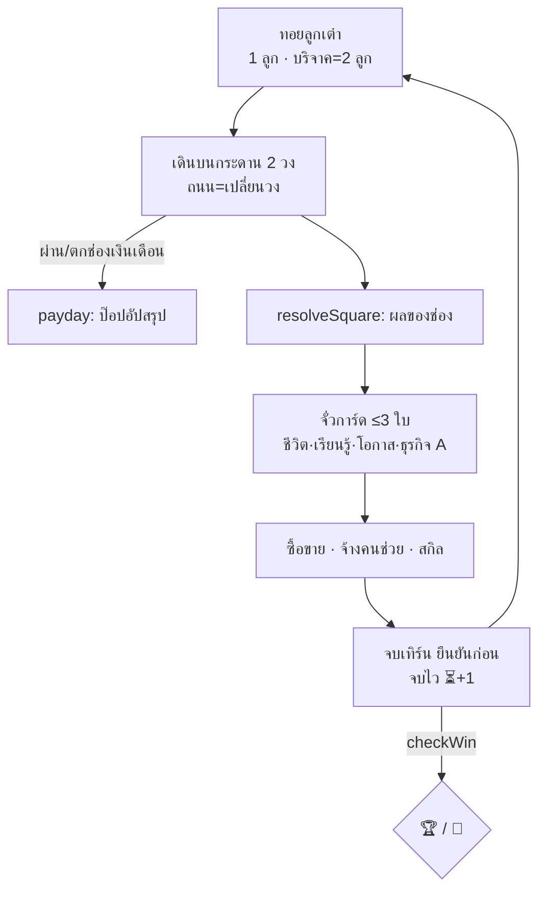
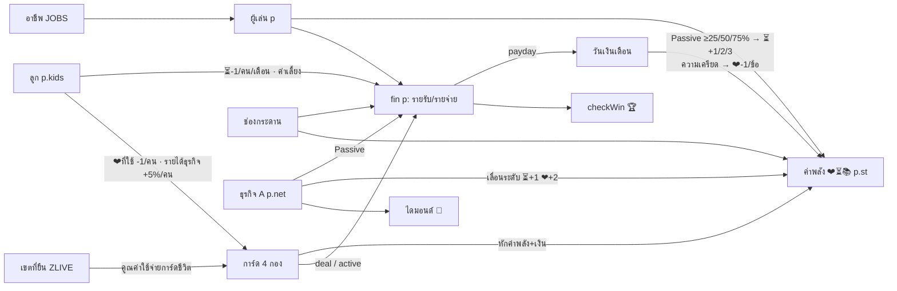

# graphify.md — แผนที่ระบบ "เกมอิสรภาพทางการเงิน"

> เอกสารนี้คือ "กราฟความรู้" ของเกม: ระบบอะไรต่อกับอะไร ฟังก์ชันอยู่บรรทัดไหน ตัวเลขสมดุลมาจากไหน
> ใช้อ่านก่อนแก้เกมทุกครั้ง (ทั้งทีมงานและ AI) จะได้ไม่ต้องไล่โค้ด 1,800 บรรทัดใหม่
> อัปเดตล่าสุด: 14 พ.ย. 2026 · ไฟล์หลัก `index.html` (ไฟล์เดียว) + โฟลเดอร์ `img/`

---

## 1. ภาพรวมเกม (1 นาที)

- บอร์ดเกมบนเว็บ 6 ผู้เล่น (คน + บอท เล่นเครื่องเดียว) ผสม **เศรษฐี + Cashflow + ตลาดหุ้น/สินค้า + ธุรกิจเครือข่าย (ธุรกิจ A)**
- ทุกคนสุ่มได้ **อาชีพ** (8 อาชีพ) → เงินเดือน เงินเก็บ รายจ่าย หนี้ ค่าเลี้ยงลูก ค่าพลังเริ่มต้นต่างกัน
- **ชนะ Lv.1 🏆** Passive > รายจ่ายรวม (เกมเล่นต่อ) · **ชนะ Lv.2 💎** ธุรกิจ A ถึงไดมอนด์ (จบเกม สรุปอันดับ)
- 1 เทิร์น = 3 นาที: ทอยเต๋า → เดิน → ผลช่อง → จั่วการ์ด ≤3 ใบ จาก 4 กอง → ซื้อขาย/จัดการเงิน → จบเทิร์น (ยืนยันก่อน)

---

## 2. กราฟระบบ (อะไรส่งผลต่ออะไร)

---

## 3. แผนที่โค้ด (index.html) — หมวด → ฟังก์ชันสำคัญ (เลขบรรทัดโดยประมาณ)

| หมวด | บรรทัด | ฟังก์ชัน / ค่าคงที่หลัก |
|---|---|---|
| CSS ธีม Storybook + FX | 1–510 | `.board` `.cell` `.tok.pic` `.modal.cardflip` `.bigdie` `.fxb` `.endbtn` |
| DATA | 512 | `JOBIMG` `ZONES` `ZPROPS` `SQ_MAP` `RING_LEN` `ASSETS` `LIVING` `ZLIVE` `lifeCost()` `netCard()` `NEWS` |
| ฐานข้อมูลแก้ได้ | 634 | `DEFAULT_DB` `DBCOLS` `netNeedDef` `oppNeedDef` `EFFTXT` สกิล `skV` `skHas` |
| สมดุล + migration | 667 | `STATVAL` `statCost` `balanceDB` `lifeNoDrain` `loadDB` `applyDB` `lifeApply` |
| HELPERS | 743 | `B()` จัดรูปเงิน · `TURN_MS` · `cp()` `log()` `toast()` `save()` `draw(k)` |
| การเงิน + ธุรกิจ A | 767 | `NET_RANKS` `NET_BRACKETS` `netRankCheck` `kidBoost` `dealCf` **`fin(p)`** `settle` `pay` **`adj(p,d)`** |
| MODAL | 846 | **`ask()`** / `choose()` (บอทข้ามป๊อปอัป → log อย่างเดียว) |
| FX | 868 | `diceAnim` `fxFloat` `fxBanner` `fxCoins` `FXT` (trail/hop) |
| SETUP | 885 | `showSetup` `RULES` (ข้อความกติกา) `newGame` `resume` |
| TURN FLOW | 949 | `confirmEndTurn` `rollTurn` `pickPile` `hireHelp` `endTurn` `timeUp` **`payday(p)`** `checkWin` `endGame` |
| SQUARES | 1141 | `needBox` (ตารางมี/ต้องใช้) **`buyFlow()`** (ซื้อ+กู้+หักค่าพลัง) `resolveSquare` |
| ตลาดกลาง | 1203 | `assetsOf` `moveAsset` `bankOffers` `marketSquare` `joblessHit` `forcedPay` (กู้/ขาย 50%) |
| CARDS | 1299 | `KIDMAX=4` `lifePreview` `lifeCard` `learnCard` `oppCard` |
| ตลาดหุ้น/สินทรัพย์ | 1388 | `trade` `loan` `payDebt` `sellBank` `tradeUI` |
| BOTS | 1453 | `botWants` `botRoad` `botPile` `botInvest` |
| RENDER | 1474 | **`render()`** `cellBody` `cellInfo` `renderFin` `statPanel` `renderNet` `renderMkt` `renderPlayers` |
| SETTINGS (แก้ DB) | 1697 | `renderSettings` `dbMove` (ย้ายการ์ดข้ามกอง) `dbImport/Export` CSV |

**จุดศูนย์กลาง (แก้ตรงนี้กระทบทั้งเกม):** `fin()` · `adj()` · `buyFlow()` · `payday()` · `ask()` · `render()` · `balanceDB()`

---

## 4. ข้อมูลหลัก

### State `S` (localStorage `ffgame-v8`)
`jobs` `players[]` `round` `cur` `phase`(roll/card/free/busy) `props{cell:{o,l}}` `prices` `hist` `decks` `listings` `log` `dice` `winner` `turnEnd` `ann`

### ผู้เล่น `p`
`job` `salary` `cash` `exp{tax,home,car,card,living,extra}` `debt` `loan` `dep`(เงินฝากประจำ) `active` `deals[{t,ty,cost,cf,act}]` `stocks` `skills`
`kids` `kidCost` `net{on,rank,legs{A..F},ppv,pas}` `ring`(o/i) `pos` `jobless` `charity` `st{h,t,k}` `badge1` `badge2` `hired`

### ฐานข้อมูลการ์ด `DB` (localStorage `ffdb-v1`, `DB.ver`=11)
| กอง | คอลัมน์สำคัญ |
|---|---|
| jobs | n sal cash tax home car card living **kc**(ค่าเลี้ยงลูก/คน) h t k |
| life | t cash cpct spct mexp kid h tt k act pas **opt acc perkid** nt nh nk sp |
| learn | t ty cost nt nh nk kg (ความรู้ = เกณฑ์ขั้นต่ำ ไม่หัก) |
| opp | t ty(re/biz/fund/scam/ipo/gold/netinv/buyer/refi) cost **cf(Passive) act(Active)** nt nh nk |
| net (ธุรกิจ A) | t leg pv cost cat A P nt nh nk |
| skills | key name kind(passive/active) eff val uses |

---

## 5. กติกาตัวเลข & สมดุล

- **สูตรสมดุลการ์ด:** ผลตอบแทน/เดือน = 10% × (เงินลงทุน + มูลค่าค่าพลัง) · ⏳=฿10,000 ❤=฿10,000 📚=฿5,000
- **ธุรกิจ A ง่ายกว่า 20%:** การ์ดสร้างสายงานใช้เงินน้อย (10% ของ P, ฿200–3,000) แต่ใช้ค่าพลังมาก (⏳≤4 ❤≤3 📚≤6)
- **การหักค่าพลัง:** ชีวิต/โอกาส/ธุรกิจ A/ทอง/IPO หัก ⏳❤📚 จริง · การ์ดเรียนรู้ + อสังหาฯบนกระดาน 📚 = เกณฑ์ขั้นต่ำ
- **กองชีวิต:** แหล่งเติม ❤⏳ ไม่หักค่าพลัง จ่ายเงินแทน · ไม่บังคับ ยกเว้น `acc=1` (อุบัติเหตุ) และลูกคนที่ 1–2
- **ค่าครองชีพเขต (`ZLIVE`)** คูณค่าใช้จ่ายการ์ดชีวิต: เกษตร .7 · อุตสาหกรรม .8 · ชุมชน .85 · ท่องเที่ยว 1.0 · การเงิน 1.3 · ธุรกิจ 1.4 · ช้อปปิ้ง 1.5 · ที่พักหรู 1.7
- **วันเงินเดือน:** รายรับ − รายจ่าย · ❤ สุ่ม −1..+1 −1/ความเครียด (รายรับไม่พอ, หนี้>3×เงินเดือน, ⏳≤2, ตกงาน) · ⏳ +1..3 −1/ลูก + โบนัส Passive · 📚 −0..1
- **ตกงาน:** ❤−2 + สถานะ 2 เดือน (ได้แค่ Passive − รายจ่าย ไม่พอ → กู้/ขาย 50%)
- **แหล่ง ⏳:** ช่องพักผ่อน 🌿 (6 ช่อง) · การ์ดชีวิต · จ้างคนช่วย ฿10,000=+1/เทิร์น · Passive% · เลื่อนระดับธุรกิจ A · จบเทิร์นไว
- **ลูก:** สูงสุด 4 · ค่าเลี้ยงตามอาชีพ (~7% เงินเดือน) · ⏳−1/คน/เดือน · ❤ที่การ์ดใช้ −1/คน · รายได้ธุรกิจ +5%/คน
- **เงินกู้:** ดอกเบี้ย 2%/เดือน (`LOAN_R`, เดิม 10%) · กู้ได้ทุกการ์ดที่ซื้อ แต่ค่าพลังต้องครบ · เพดาน `loanLim(p)` = max(฿400,000, 12×เงินเดือน) เกิน = ล้มละลาย · บอทกู้ซื้อเมื่อ cf > ดอกเบี้ย×2
- **ฝากประจำ:** ดอกเบี้ย 0.25%/เดือน (`DEP_R`) นับเป็น Passive (`fin().depI`) · เงินสดติดลบ `settle()` ถอนเงินฝากก่อน แล้วค่อยกู้ (มี `ruleNote`)
- **กองทุนรวม** (`ASSETS` k:'fund', 1 ล็อต = 1,000 หน่วย, NAV เริ่ม ฿10, ปัด 2 ตำแหน่ง `roundP`, ค่าธรรมเนียม 1% เท่าหุ้น): MMF v.002 d.0015 · BOND v.008 d.0025 · DIVF v.035 d.002 ปันผล ฿0.04/หน่วย · SET50 v.045 d.005 · GLOB v.055 d.006 · GOLDF v.04 d.003 — `d` = ผลตอบแทนเฉลี่ย/รอบ (สินทรัพย์อื่นใช้ .004) · ซื้อขายในแท็บธนาคาร ไม่แสดงในแท็บเทรด

---

## 6. ประวัติ migration ฐานข้อมูล (`loadDB`)
| ver | การเปลี่ยนแปลง |
|---|---|
| 4 | `balanceDB` สูตร 10% + เติมช่องว่าง |
| 5 | การ์ดโอกาสแยก Active/Passive + การ์ดใหม่ 3 ใบ |
| 6 | การ์ดชีวิตเพิ่มเวลา 6 ใบ |
| 7 | การ์ดธุรกิจกองโอกาสใช้ ❤1 |
| 8 | ธุรกิจ A: เงินน้อย ค่าพลังมาก |
| 9 | กองชีวิตไม่หักค่าพลัง (`LIFE_FIX`, `lifeNoDrain`) |
| 10 | ช่อง `acc` (อุบัติเหตุบังคับรับ) |
| 11 | การ์ดค่าใช้จ่ายลูก 5 ใบ (`perkid`) + `jobs.kc` |

> เพิ่ม migration ใหม่: ต่อบล็อก `if(!(DB.ver>=N)){…;DB.ver=N;save}` ไว้**หลัง**บล็อกก่อนหน้าเสมอ และเปลี่ยน `DEFAULT_DB.ver=N`

---

## 7. ภาพ (โฟลเดอร์ `img/` — สร้างจาก Canva)
| ไฟล์ | ใช้ที่ |
|---|---|
| `back-life/learn/opp/net.webp` | หลังการ์ดตอนพลิก + รูปกองการ์ด — ฉากเมืองยุคใหม่ ไม่มีคน ไม่มีตัวหนังสือ, โลโก้ทีมวางบนป้ายวงกลมในฉาก (life=กระจกร้านกาแฟ, learn=ผนัง, opp=ยอดตึก, net=ผนังห้อง coworking) — โลโก้สีเทากลาง #80848a ทุกภาพ, วางด้วย tools/logofit.py (หาวงรีป้ายจริง + ตามมุมมอง + เงาแสงป้าย) |
| `center.webp` | พื้นหลังกลางกระดาน |
| `zone-o0..o3, i0..i3.webp` | ไอคอนเขตในช่อง + ภาพในป๊อปอัปช่อง |
| `head-0..7.webp` / `pawn-0..7.webp` | หน้าตัวหมาก / ตัวเต็มตามอาชีพ (ลำดับ = `JOBIMG`) — ตัดจากภาพยืนตรงมองกล้อง |
| `npc-std.webp` | NPC ยืนตรงมองกล้อง (สำรองไว้ใช้) |
| โลโก้ทีม | ฝังใน CSS `--logo` (สีเปลี่ยนได้ รูปทรงห้ามเปลี่ยน) |

| `c{0-7}-{happy,shock,sad,work,thumb,think,angry,wave}.webp` | ตัวละคร 8 อาชีพ × 8 ท่า พื้นใส (ตัดจากภาพ Canva) |

**ท่าทาง ↔ เหตุการณ์** (`ask({pose})` แสดงตัวละครมุมขวาบนของป๊อปอัป เฉพาะผู้เล่นคน):
วันเงินเดือนบวก=happy / ติดลบ=sad · การ์ดอุบัติเหตุ=shock · ลูก=happy · ช่องฟุ่มเฟือย=sad · ซื้อได้=thumb / ค่าพลังไม่พอ=think · ตกงาน=sad · เงินไม่พอต้องกู้/ขาย=angry · ยืนยันจบเทิร์น=wave · แบนเนอร์ "ตาของ…"=wave · หน้าตัวหมาก=head จากท่า thumb
**NPC เจ้าหน้าที่ธนาคาร** `npc-{pose}.webp` — `ask({npc})` แสดงในป๊อปอัปที่ไม่มีท่าผู้เล่น: ข้อมูลช่อง/แจ้งเตือนทั่วไป=work · ตลาดกลาง=thumb · ข่าวตลาด=shock · กติกา=wave · สุ่มอาชีพ/ชนะ=happy · หมดเวลา=think · `npc:false` = ไม่แสดง
**สไตล์ตัวละคร (v2, 14 พ.ย.)**: anime วาดมือ สัดส่วนจริง ออก manhwa นิดๆ (ไม่ใช่ chibi/Ghibli) · NPC = เจ้าหน้าที่ธนาคารหญิง ผมบ็อบ เบลเซอร์แดง #be1e2d · ชาย: ส่งของ วิศวกร นักบิน แพทย์ ผู้จัดการ · หญิง: ครู พยาบาล ทนาย · ผิวขาวทุกตัว · script ตัด/แยกท่า: `tools/chars2.py` (แยกตาม component; ถ้าท่าติดกันใช้แบ่งกริด 4×2) · วางโลโก้: `tools/logoput.py` · ไฟล์ต้นฉบับที่เลิกใช้ใน Downloads ตั้งชื่อนำหน้า `bin_`

---

## 8. วิธีทดสอบ
- `node --check` สคริปต์ที่ดึงจาก `<script>` สุดท้าย
- Playwright + Chrome: `sim3.py` (บอทล้วน 10 รอบ ต้องได้ `errors []`), `sim2.py` (จนมีคนได้ 🏆)
- ทดสอบป๊อปอัปด้วย `void lifeCard(...)` (ต้องมี `void` ไม่งั้นค้างรอ modal)

## 9. ข้อควรระวัง
- `render()` สร้างกระดานใหม่ทุกครั้ง → แอนิเมชันที่ต้องต่อเนื่องใช้ `FXT` + `animation-delay` ติดลบ
- บอทไม่เห็นป๊อปอัป: `ask()` คืนค่า `bot` ทันที → ทุก `choose()` ต้องใส่ `bot:` ที่สมเหตุสมผล
- ชื่อการ์ดที่มีตัวเลขเงิน: อย่าใส่ราคาในชื่อ (ราคาจริงคูณค่าครองชีพเขต)
- กลางกระดานบนมือถือแคบ: `.center` ใช้ `justify-content:safe center` + scroll

## 10. UI v3 (14 พ.ย.) — มือถือเป็นหลัก
- **ป๊อปอัป**: ตัวละคร/NPC ตัวใหญ่ยืนทับขอบบนป๊อปอัปแบบ JRPG (`#ovfig` ใน `.mwrap`, `.ov.withfig`, สูง `--fh` = 40vh, ทับ `--ovl` 70px) · จอแนวนอนเตี้ย ยืนข้างป๊อปอัป
- **ชิปค่า**: ไม่มีกรอบวงกลมแล้ว — แผงขาวแบ่งช่องเส้นบาง (`.chips`), วันเงินเดือนเป็นบัญชีแนวตั้ง (`chips(a,'ledger')`) + แถว "คงเหลือเดือนนี้", ค่าพลัง 3 ช่อง (`'stats'`)
- **กระดาน**: `.board` เป็น container (cqw) · หมากเป็นหน้าตัวละครขนาด ~7.6cqw (ช่องละ ~8.3cqw) ซ้อนกันได้ · ช่องขอบซ้าย/ขวาจัดหมากเข้าด้านใน · ขนาดกระดาน = min(760, 100dvh−96)
- **จอแนวนอนเตี้ย (≤620px สูง)**: กระดานซ้าย แท็บข้อมูลขวา
- **ตรงกลาง**: `.center.ph-{phase}` · ช่วงจั่วการ์ด ตรงกลางขยายทับวงใน (`ph-card`) กองการ์ดใหญ่ขึ้น · ปุ่มทอยใหญ่ (`.rollbtn`) · container query ซ่อนบรรทัดรองเมื่อพื้นที่เตี้ย
- **หัวใจหมด** = ป่วยหนัก (ค่ารักษา 30% เงินเดือน, ⏳−2, ❤→3) ไม่ใช่ตกงาน (`p._sick` → แสดงในวันเงินเดือน)
- DB ver 12: แทนคำ "แอมเวย์/Amway" → "A"
- **กติกาเสริม** `GRULE={sickAtZeroHeart:false}` — ปิด "หัวใจหมด=ป่วยหนัก" ไว้ก่อน (โค้ดยังอยู่ เปิดได้เมื่อทำโหมดยาก)
- **กล่องแจ้งกติกาอัตโนมัติ** `ruleNote(p,หัวข้อ,สาเหตุ)` → `#rnotes` มุมบน แตะปิด/หายเอง 9 วิ · ใช้กับ: กู้อัตโนมัติ (settle), ค่ารักษา ❤≤2, ล้มละลาย, ป่วยหนัก(ถ้าเปิด) — เพิ่มกติกาอัตโนมัติใหม่ให้เรียก ruleNote ทุกครั้ง
- **เข็มระดับธุรกิจ A** `img/rank-0..7.webp` (สมาชิก=ทองแดง, ซิลเวอร์, โกลด์, แพลทินัม=ดาว, รูบี้=แดง(ย้อมจากมรกต), เพิร์ล=ชมพูมุก(ย้อมจากแพลทินัม), เอเมอรัลด์, ไดมอนด์) โลโก้เทา #80848a กลางเข็ม · `rankPin(p)` แสดงข้างชื่อผู้เล่น (ผ่าน badges) + แท็บธุรกิจ A
- โลโก้ทุกภาพใช้ mask ขอบนุ่ม (anti-alias) สร้างจากไฟล์โลโก้ต้นฉบับ
- **ฉากสนทนาแบบ JRPG/VN** (แทนตัวละครเต็มตัวเดี่ยว): ใน `ask()` สร้าง `.duo` = ภาพครึ่งตัว `.bust.L` ผู้เล่น (กลับซ้าย-ขวาให้หันขวา, ท่า=pose หรือ think) + `.bust.R` เจ้าหน้าที่ธนาคาร (npc ตามกติกาเดิม) · คนพูด `.spk` สว่าง อีกคนหรี่+ย่อ · ถ้ามี pose = ผู้เล่นพูด ไม่งั้น NPC พูด · ป้ายชื่อใต้ภาพ · จอแนวนอนเตี้ย: ภาพอยู่ซ้าย/ขวาของป๊อปอัป
- **ซูมกระดาน 2 นิ้ว** (`#bwrap` + `BZ`, `boardZoom(s,cx,cy)`): 100–300% · ซูมแล้วลากนิ้วเดียวเลื่อนได้ · แตะสองครั้ง/ปุ่ม ⟲ กลับ 100% · คอมพิวเตอร์ Ctrl+ล้อเมาส์บนกระดาน · ลากแล้วไม่นับเป็นการแตะช่อง · viewport อนุญาตซูมทั้งหน้า (max-scale 5)
- **ขนาดตัวอักษร** ปุ่ม A−/A+ (85/100/115/130/150%) เก็บใน localStorage `ff-tz` · ใช้ CSS `zoom:var(--tz)` กับแผงข้อมูล เนื้อหาป๊อปอัป กล่องแจ้ง หน้าตั้งค่า + ชื่อช่องบนกระดาน · คีย์ลัด Ctrl+Alt+= / Ctrl+Alt+-
- **ปุ่มเต็มจอ** `#btnFS` (Fullscreen API, iPhone แนะนำ "เพิ่มไปยังหน้าจอโฮม")
- **กล้องซูมตามตัวหมาก** (`CAM`, `camOn/camFollow/camOff`, ปุ่ม `#btnCam` เก็บ `ff-cam`): ตอนเดินใน `rollTurn` ซูมให้ช่องกว้าง ~74px (1.35–2.6 เท่า) กลางจอที่ตัวหมาก เลื่อนตามทีละก้าว (transition .32s) · เดินจบค้าง 0.55 วิ แล้วถอยกลับภาพรวมก่อน `resolveSquare` · ไม่ทำงานเมื่อย่อแผนที่/reduced-motion/autopilot · ช่องมี `data-k`
- **กล้องซูมตาม: ปิดแล้ว** (`CAM.on=false`, ซ่อน `#btnCam`) — ผู้เล่นเวียนหัว
- **ช่องวงนอกแนวยาว** แบบเกมเศรษฐี: แทร็กแถว/คอลัมน์นอกสุด 1.75fr ที่เหลือ 1fr → ช่องวงนอกยาวขึ้น ~37% ชื่อได้ 3 บรรทัด, วงในเล็กลง ~11%
- **เลย์เอาต์ 2 คอลัมน์ (≥900px กว้าง)**: กระดาน = min(760, 100dvh−96, 100%−370) แผงข้อมูลขวา ≥350px เลื่อนในตัวเอง (sticky) → จอ 4:3 เช่น Fold8 จอใน แนวนอน ไม่ตกขอบ
- **มุมมองกึ่ง 3D** (`V3`, `v3Update/toggleV3`, ปุ่ม `#btnV3`, เก็บ `ff-3d`, ค่าเริ่มต้น=เปิด): กระดานเอียง rotateX 52° หมุน rotateZ ให้ฝั่งที่ผู้เล่นอยู่มาใกล้ (หมุนเฉพาะตอนเปลี่ยนตา/เปลี่ยนฝั่ง ไม่หมุนระหว่างเดิน) · scale 1.6 + เลื่อนแนวนอน `--tx` ให้ช่องผู้เล่นอยู่กลาง · แผง HUD แบนลอยด้านบน (`#hud`) แทนกล่องกลางกระดาน · ช่วงจั่วการ์ด HUD ขยายเต็มเป็นโต๊ะการ์ด (`.cardtime`) · หมากเป็นภาพเต็มตัว `pawn-*.webp` ยืนตั้งฉาก + ฐานสีผู้เล่น · ช่องวงนอก 2.3fr ชื่อ/ไอคอนหมุนหันออกด้านนอก (`data-side`)
- ภาพประกอบช่องในอนาคต: ทำเป็นไดโอรามาไอโซเมตริกมองจากบน (ดูได้ทุกทิศเมื่อกระดานหมุน) ไม่มีตัวหนังสือ สัดส่วนช่องวงนอก ≈ 1:2.3
- **3D v8 (ช่องจัตุรัส)**: ใน 3D ใช้กริดเท่ากันทุกแถว (ทุกช่องจัตุรัส) · กระดานวาดใหญ่จริง `width = --S × กว้างกรอบ` (S = clamp(1.35, 760/กว้างกรอบ, 2.1) → ช่องฝั่งใกล้ ~55–80px) แทนการ scale() เพื่อให้ตัวอักษรคม · เลื่อนแนวนอนตามช่องผู้เล่นด้วยการหมุนเวกเตอร์ (dx,dy) ตามมุม `--ang` · `--ty:-27%`
- ภาพประกอบช่อง: **สัดส่วน 1:1 (จัตุรัส)** ทุกช่อง ไดโอรามาไอโซเมตริก ไม่มีตัวหนังสือ
- หมาก 3D v9: ขนาดตามช่อง (cqmin) ยืนบนฐานวงรีสีผู้เล่น · คนที่ถึงตาใหญ่ขึ้น ~1.4 เท่า + แสงทอง + ฐานเรืองแสง
- 3D v10: หมากใหญ่ขึ้น (คนอื่น ~1.5×ช่อง, คนถึงตา ~2.1×ช่อง) · ตัวละครวาดเป็น ::before ทับฐานสี (::after) ฐานไม่ทับขาแล้ว · เลื่อนตามผู้เล่นไม่จำกัดขอบ (มุมกระดานไม่ตกขอบ) · ลากนิ้ว/เมาส์เลื่อนกระดาน 3D ได้ (--ux/--uy) ดับเบิลคลิกกลับกลาง · รีเซ็ตเมื่อหมากย้าย/เปลี่ยนตา
- กันจอกระพริบ: `setBoard()` เทียบ HTML ทีละช่องแล้วแทนเฉพาะช่องที่เปลี่ยน (เดิน 4 ก้าวแทน ~11 โหนด แทนที่จะสร้างทั้งกระดานใหม่ทุกก้าว) · ตอนเดินใน 3D หมากคนถึงตายังขนาดใหญ่ (คง .cur ระหว่าง hop)
- เดินลื่น 60fps (3D, ผู้เล่นคน): `walkStart/walkTo/walkEnd` ใช้ตัวละคร .walker ลอยในกระดานเลื่อน left/top แบบ linear ช่องละ STEP_MS=640ms + ท่าเดินโยกตัว · กล้องเลื่อนตามด้วยความเร็วเดียวกัน (linear) · ซ่อนหมากในช่องระหว่างเดิน · บอทยังเดินเร็วเหมือนเดิม
- 3D v11: `v3Center()` วัดตำแหน่งช่องผู้เล่นบนจอจริง (หลังแปลงมุมมอง) แล้วเลื่อนให้อยู่กึ่งกลางแนวนอน และ 62% ของพื้นที่ใต้แผงบน (secant 3 รอบ) — ค่าเริ่มต้นตามภาพตัวอย่างผู้ใช้ · บอทเดิน กล้องตามเร็ว (.fastcam 0.22s) · ภาพครึ่งตัวในป๊อปอัปเล็กลง ~30% (--fh 22vh) ให้คมชัด
- หน้าเลือกกองการ์ด: `cardInfo(p)` ตัวละครเต็มตัว (ท่า thumb / think ถ้าเงินติดลบ / sad ถ้าเวลา≤2) + เงินสด คงเหลือ/เดือน หนี้ธนาคาร + แถบ Passive/รายจ่าย + ❤⏳📚 · โหมด 2D ซ่อนตัวละครและแถบเป้าหมายเพราะพื้นที่เล็ก
- กล้อง 3D v12: `v3Center` คำนวณจากสมการภาพฉาย (perspective, perspective-origin, rotateZ, rotateX) ไม่วัดจากจอระหว่างแอนิเมชันแล้ว (ตัวเก่าวัดตอนกำลังเลื่อน → กล้องมั่ว) · บอทเดินช่องละ 240ms กล้อง .2s ease-out ตามทัน
- **ROI ธุรกิจ/อสังหาฯ ตามเขต** `ZROI` (ต่อเดือน): o0 6 · o3 6.5 · o1 7 · o2 7.5 · i0 6.5 · i1 7 · i2 7.5 · i3 8 — ช่องบนกระดาน cf = ดาวน์×ROI (mkProp) · การ์ดโอกาส re/biz คิดรายได้ตอนจั่ว = ทุน×ROI ของเขตที่ผู้เล่นยืน (แบ่ง Active/Passive ตามสัดส่วนเดิม) · ความรู้ที่ต้องใช้ `bizNeedK(cost,roi)` = clamp(ceil(cost/60000),1,3) × (1 + (ROI−6)/2×1.5) (×1–2.5) สูงสุด 10 · fund/scam/ipo/gold ไม่เปลี่ยน · ฐานหมาก 3D อยู่เหนือระนาบกระดานแล้ว (ไม่ถูกตัดครึ่ง)
- **เต็มจอพอดีหน้าจอจริง** (`body.fs`, ตั้งใน `fsSync()` ทั้ง Fullscreen API และ `pseudofs`): หน้าเว็บสูง = 100dvh ไม่มีเลื่อนทั้งหน้า · header เตี้ยลง · เลิกจำกัด 760px · จอแนวนอน: กระดานกินพื้นที่ที่เหลือทั้งหมด แผงข้อมูลขวา clamp(300px,30vw,480px) เลื่อนในตัว (`.panel` overflow auto) · จอแนวตั้ง: กระดานบน 1.4 ส่วน แผงล่าง 1 ส่วน · ซ่อน legend · 2D = จัตุรัสใหญ่สุดที่พอดี (`container-type:size` ที่ section แรก, `min(100cqw,100cqh-40px)`) · 3D = `#bwrap` เต็มพื้นที่ (ไม่ล็อก aspect-ratio) และ `perspective` โตตามขนาดกระดาน (820px × กว้างกระดาน/1026) ภาพเหมือนเดิมแต่ใหญ่ขึ้น · `fitScreen()` วาดกระดานใหม่ (debounce 180ms) เมื่อเข้า/ออกเต็มจอ หมุนจอ หรือ resize (ข้ามถ้ากำลังเดิน `WALK`) · โหมดย่อแผนที่ (`.mapmin`) ในเต็มจอใช้เลย์เอาต์เดิม + เลื่อนได้

## โหมดออนไลน์ (Firebase) — เฟส 1–3
- ตั้งค่า: `FB_CONFIG` (ค่าจาก Firebase console รวม `databaseURL`) · `FB_FACEBOOK` เปิดเมื่อตั้งค่า Facebook แล้ว · SDK โหลดจาก gstatic เวอร์ชัน `FBV`
- ปุ่ม "เล่นออนไลน์" โผล่เมื่อมี `FB_CONFIG` หรือเปิดด้วย `?mock=1` (backend จำลองใน localStorage ใช้ทดสอบหลายแท็บ)
- ล็อกอิน: Google · Facebook · อีเมล/รหัสผ่าน (สมัคร/ลืมรหัส) · แขก (ผูก Google ทีหลังได้) · `localStorage fg-online=1` = เปิดเว็บแล้วเข้าโหมดออนไลน์ทันที
- ข้อมูล: `users/{uid}{name,room}` · `rooms/{5หลัก}{host,status:lobby|play|end,n(2–6),seats{i:{t:h|b,uid,name}},mem{uid:seat},on{uid}(presence),left{uid},st{z,v,by},q/a(ถามข้ามเครื่อง),win{name,job,rank}}` · กฎ: `database.rules.json`
- กลับเข้าห้อง: ล็อกอิน → อ่าน `users/{uid}/room` → ห้องยังเล่นอยู่ = เข้าต่อ · ห้องจบแล้ว = แจ้งผลแล้วล้าง · ลิงก์เชิญ `?room=12345`
- ซิงก์: เครื่องที่ "ถือตา" (`onDriverUid`: ผู้เล่นที่ถึงตาถ้าออนไลน์ / ไม่งั้นเจ้าของห้อง / ไม่งั้นคนแรกที่ออนไลน์) รันกติกา แล้ว `save()` → `onSave` ส่ง S (ตัด view, log เหลือ 40, gzip+base64) ขึ้น `st` · เครื่องอื่น `onState` รับมาแสดง · `canAct()` ต้อง `onMine()` · บอทและการหมดเวลาของคนที่หลุดรันที่เครื่องถือตา (`onDrive`, `iDrive`) · ผู้เล่นกด "ออกจากเกม" → บอทเล่นแทน
- `choose({actor})` ที่ actor เป็นคนอีกเครื่อง → `onRemoteChoose` ส่งคำถามไปเครื่องนั้น (รอ 90 วิ / ออฟไลน์ = ตอบปฏิเสธแทน)
- คุยด้วยเสียง: ตัดออก ใช้ Discord แทน (เจ้าของตัดสิน 2026-11-14) · ยังไม่ทำ: การ์ด/ป๊อปอัปของคนอื่นยังไม่แสดงบนเครื่องผู้ดู (เห็นผ่านบันทึกเกม)

## ออนไลน์: เล่นพร้อมกัน (S.par=1)
- รอบ = `S.rp`: `'h'` ผู้เล่นคนทุกคนเล่นพร้อมกัน คนละ 3 นาที (`q.tEnd`) → `'b'` บอท + คนที่ติดสถานะ Bot เล่นทีละตัวที่เครื่องหัวห้อง (`S.bq`) → `parRoundEnd` (ข่าวมีผล, คืนการ์ด, `endRound`) → `parStartRound`
- หัวห้อง = `parMasterUid()` (เจ้าของห้อง ถ้าออนไลน์ / ไม่งั้นคนแรกที่ออนไลน์) · `parCheck` ทุกคน done/หลุด/เกินเวลา 15 วิ → `parBots`
- ระหว่าง 'h': เครื่องตัวเองตั้ง `S.cur`=ตัวเอง (`parLocalTurn`) · ส่งตัวละครขึ้น `p/{idx}` (`parPushMe` เก็บ ph/pk/fc ไว้กลับเข้าห้องกลางรอบ) · ที่ดิน `pr/{ช่อง}` จองด้วย transaction ใครยืนยันก่อนได้ (`parClaim` ผ่าน `buyFlow({pre})`) · ค่าผ่านทาง/ซื้อขายกับคนอื่น → `led/{id}` เครื่องเจ้าของตัวละครผู้รับเป็นคนบวก (`parApplyLed`) · ข่าว (mnews + ช่องข่าว) → `nq` มีผลตอนจบรอบ (`parApplyNews`) · บันทึก `lg`
- การ์ด: หัวห้องแจกเข้ามือ `q.hand` ตอนเริ่มรอบจากกองเดียวกัน (`PAR_HAND`) ไม่ซ้ำกัน · `draw()` หยิบจากมือก่อน · ใบที่เหลือคืนก้นกอง
- สถานะ Bot: หมด 3 นาทีโดยไม่ได้ทอย (`q.acted`) → `q.afk` + `afk/{uid}` · ช่วงบอทใส่ `q._afkb` (ทอยให้ ตอบ "ไม่" ทุกคำถาม ไม่จั่วการ์ด) · หน้าจอเทา `#afkov` ปุ่ม "ปลดสถานะ Bot" (`parUnafk` ทันรอบนี้ถ้ายังเหลือเวลา)
- จบเกม Lv.2: หัวห้องตัดสิน (`checkWin` เครื่องอื่นไม่จบเกมเอง)
- กฎ Firebase เพิ่ม p, pr, led, nq, lg, afk (ต้องกด Publish ใหม่)

## บันทึกการแก้ไข
| วันที่ | ใคร | แก้อะไร |
|---|---|---|
| 14 พ.ย. 2026 16:30 | Claude (บัญชีแก๊ง) | เต็มจอให้เกมพอดีขนาดหน้าจอจริง (ดูหัวข้อ "เต็มจอพอดีหน้าจอจริง" ข้อ 10) · ทดสอบ 1920×1080, 1440×900, 1106×835, 1280×720, 844×390, 390×844 · sim3 errors [] |
| 14 พ.ย. 2026 16:45 | Claude (บัญชีแก๊ง) | **แผงข้อมูลเป็นหลัก**: จอแนวนอนแบ่งคอลัมน์ แผนที่ 1 : แท็บข้อมูล 1.5 (โหมด 3D = 1 : 1.9 ด้วย `.layout:has(.bwrap.v3d)`) ทั้งหน้าปกติ ≥900px, มือถือแนวนอนเตี้ย และเต็มจอ · เต็มจอแนวตั้ง แผนที่ 1 : แผง 1.15 · `#panel` เป็น container `panel`: ≥620px รายชื่อผู้เล่น/รายการหุ้นเป็นกริดหลายคอลัมน์, ≥960px งบการเงินแบ่ง 2 คอลัมน์ (การ์ดทรัพย์สิน/หนี้สินคู่กัน) · `.tiles` `.stp` ใช้ auto-fit ไม่ล้นเมื่อขยายตัวอักษร · `.mi1/.mi2` ตัดบรรทัดได้ · สแกนข้อความซ้อน/ล้นทุกแท็บ × ตัวอักษร 85/100/150% × 9 ขนาดจอ = ไม่พบ · sim3 errors [] |
| 14 พ.ย. 2026 18:45 | Claude (บัญชีแก๊ง) | จอแนวนอน: แผนที่กว้างขึ้น 20% (สัดส่วนแผนที่ 1 → 1.2 · 3D = 1.2 : 1.9 · 2D = 1.2 : 1.5 · ความกว้างต่ำสุดแผนที่ ×1.2: 312/240/288px) ทั้งหน้าปกติ มือถือแนวนอน และเต็มจอ · สแกนข้อความซ้อน/ล้นไม่พบ · sim3 errors [] |
| 14 พ.ย. 2026 19:20 | Claude (บัญชีแก๊ง) | **แท็บธนาคาร** (`renderBank`, `bankDo`, `TAB='bank'`): สรุปเงินสด/หนี้/เงินฝาก/ดอกเบี้ยสุทธิ · เงินกู้ กรอกจำนวนเองได้ + ปุ่มลัด (10k/50k/100k/สูงสุด) · ชำระคืนตามจำนวนที่กรอก/ครึ่งหนึ่ง/เท่าเงินสด/ปิดหนี้ทั้งหมด · แถบใช้วงเงินเทียบเพดานล้มละลาย · ฝากประจำ 0.25%/เดือน ฝาก/ถอน/ถอนทั้งหมด · ตารางกองทุนรวม 6 กอง (ใช้ `mrow()` ร่วมกับตลาดหุ้น) · ดอกเบี้ยเงินกู้ 10% → 2%/เดือน · ปุ่มกู้ +10k/คืน 10k ในงบการเงินเปลี่ยนเป็นลิงก์ไปแท็บธนาคาร · งบการเงินแสดงเงินฝาก/กองทุนแยกหมวด · เซฟเก่า `resume()` เติมราคากองทุน + `dep:0` · ทดสอบ: ธุรกรรมทุกแบบ, ถอนเงินฝากอัตโนมัติ, สแกนข้อความซ้อน 7 แท็บ × 3 ขนาดตัวอักษร × 6 จอ, sim3 errors [] |
| 14 พ.ย. 2026 20:30 | Claude (บัญชีแก๊ง) | **แท็บ "ตลาดหุ้นและสินค้า" → "เทรด"** · เลิกซื้อเป็นล็อต: แตะชื่อหุ้น/สินค้า/กองทุน (`.mi1.tap` → `tradeDlg(s)`) → เลือกซื้อ/ขาย → กดปุ่มจำนวนหน่วย +100,000 / +10,000 / +1,000 / +100 (สินค้าโภคภัณฑ์ +100/+10/+1, `TSTEP`) · ล้าง · ขายทั้งหมด → คำนวณสด มูลค่า + ค่าธรรมเนียม 1% = รวมจ่าย/ได้รับสุทธิ เงินสดก่อน→หลัง กำไร/ขาดทุน → กดยืนยัน · ซื้อเกินเงินสดกู้อัตโนมัติได้ แต่ห้ามเกินเพดานหนี้ (ปุ่มยืนยันปิด) · ใช้กับกองทุนในแท็บธนาคารด้วย · **ธนาคาร: กู้/ชำระไม่ให้กรอกเอง** ใช้ปุ่ม +100,000/+10,000/+1,000/+100 สะสมยอด (`BK`, `bkAdd`) จำกัดไม่เกินวงเงิน (กู้) / หนี้คงเหลือและเงินสด (ชำระ) แล้วกดยืนยัน · ฝาก/ถอนยังกรอกเองได้ · `trade()` เดิมยังอยู่ (ไม่มีปุ่มเรียกแล้ว) · sim3 errors [] |
| 14 พ.ย. 2026 21:10 | Claude (บัญชีแก๊ง) | **เพิ่มเหล็ก + คริปโต 4 ตัว** · STEEL (ตัน, ฿22,000, v.07) ในหมวดสินค้าโภคภัณฑ์ · คริปโต `k:'cry'` BTC/ETH/SOL/DOGE หน่วย "เหรียญ" ซื้อเป็นเศษได้ (`st` ปุ่มต่อเหรียญ เช่น BTC +1/+0.1/+0.01/+0.001, `QR()` ปัด 6 ตำแหน่ง) ไอคอนเหรียญวาดด้วย CSS (`MICO`, `.cico`) · **ราคาคริปโตใช้ราคาจริง** ปิดสิ้นเดือน ต.ค. 2016 → ต.ค. 2026 (`CRY`, USD × `CRY_FX`=35 บาท; BTC/ETH/SOL จาก digrin.com, DOGE จากผลตอบแทนรายเดือน PortfoliosLab + ค่าก่อนปี 2021 โดยประมาณ) · เริ่มเกม `cryInit()` สุ่มเดือนเริ่ม `S.cm0` (มีข้อมูลจริงต่ออย่างน้อย 60 เดือน) · จบรอบ `S.cmo++` = เดือนถัดไป (1 รอบ = 1 เดือน) · ข้อมูลหมดแล้วสุ่มเดินต่อด้วย v/d · SOL ก่อน เม.ย. 2020 = ยังไม่เข้าตลาด (กดซื้อไม่ได้ + log ตอนเข้าตลาด) · ไม่บอกปีจริงระหว่างเล่น เฉลยใน log ตอนจบเกม (`cryReveal`) · ป้าย "ตั้งแต่เริ่ม ×N/±%" เทียบ `S.cryBase` · แท็บเทรดแบ่งหัวข้อ หุ้น / สินค้าโภคภัณฑ์ / คริปโต · เซฟเก่า `resume()` เรียก `cryInit()` · ทองคำหน่วย "บาท" · sim3 errors [] |
| 14 พ.ย. 2026 22:30 | Claude (บัญชีแก๊ง) | **หุ้น + สินค้าโภคภัณฑ์อิงราคาจริง** ช่วงเวลาเดียวกับคริปโต (`S.cm0`/`S.cmo`, 1 รอบ = 1 เดือน) · ชื่อในเกมยังเป็นชื่อสมมติ จับคู่ (`MKT_REAL`): ไทยเทค=Apple · พลังงานไทย=ExxonMobil · ธนาคารสยาม=JPMorgan · อาหารไทย=McDonald's · กองทรัสต์อสังหาฯ=Realty Income · สตาร์ทอัพโกรว์=Tesla · ทอง=COMEX · น้ำมัน=WTI · ข้าว=ข้าวขาวไทย 5% (IMF) · เหล็ก=PPI Iron&Steel สหรัฐ · ราคาในเกม = `a.p` × ราคาจริงเดือนนี้ ÷ ราคาจริงเดือนเริ่มเกม × `S.adj` (ข่าวตลาดสะสม) (`MKT`, `mktP`) — คงราคาเริ่มเดิมของเกมไว้เพื่อสมดุล · ปันผลต่อหุ้นโตตามราคา (yield คงที่ = ค่าเดิม, `a.d0`, `syncDiv()`) · ข้อมูลหมดแล้วสุ่มเดินต่อ (GROW ล้มละลายได้เฉพาะช่วงสุ่ม) · เฉลยคู่ชื่อจริง + ช่วงเวลาใน log ตอนจบเกม · เซฟเก่า: `S.mkOn` ไม่มี → ตั้ง `S.adj` ให้ราคาต่อเนื่อง · กองทุนรวมยังสุ่มเหมือนเดิม · แหล่ง: digrin.com (หุ้น adjusted close), officialdata.org (ทอง ต้นเดือน→เลื่อนเป็นสิ้นเดือนก่อน), FRED (MCOILWTICO, PRICENPQUSDM, WPU101) · sim3 errors [] |
| 14 พ.ย. 2026 23:20 | Claude (บัญชีแก๊ง) | **แก้บั๊ก**: กองทุนรวม 6 กองหายจาก `ASSETS` ตั้งแต่ตอนเพิ่มคริปโต (21:10) — ใส่กลับแล้ว · **กองทุนอิงราคาจริง** (อยู่ใน `MKT` เหมือนหุ้น): ตลาดเงิน=BIL · ตราสารหนี้=AGG · หุ้นปันผล=VYM · ดัชนี SET50=THD (iShares MSCI Thailand) · หุ้นโลก=ACWI · ทองคำ=GLD (adjusted close รายเดือน digrin.com) · **ข่าวตลาดในกองโอกาส** `OPP_NEWS` 40 ใบ (หุ้น/กองทุน/คริปโต/สินค้า อย่างละ 10 = ดี 5 ร้าย 5, `ty:'mnews'`) ต่อท้าย `OPP` ตอนโหลด (ไม่อยู่ใน DB จึงไม่ต้อง migration และไม่โผล่ในหน้าตั้งค่า) · `oppCard` → `mnewsCard`: `shockPrices(e)` เปลี่ยนราคา % และเก็บใน `S.adj` (คริปโตด้วย: `cryP` × adj) ราคาข่าวจึงติดไปกับราคาจริงเดือนต่อไป · ป๊อปอัปแสดงผลกระทบพอร์ตของผู้เล่นทุกคน · การ์ดสินค้า 4 ใบมี `cash` ทุกคนได้/จ่าย ±฿1,000–2,000 (จ่ายผ่าน `pay()` + `ruleNote`) · สินทรัพย์ที่ยังไม่เข้าตลาด (SOL) ข้าม · กองโอกาสตอนนี้ 23+40 = 63 ใบ · ทดสอบเปิดครบ 40 ใบด้วยบอท + sim3 errors [] |
| 14 พ.ย. 2026 23:50 | Claude (บัญชีแก๊ง) | **ใบเตือน 🟨**: หยุดช่องตกงานในรอบที่ 1–5 (`S.round<=5`) ไม่ตกงาน แต่ติดสถานะ `p.warn=2` → `fin()` เงินเดือน ×0.5 ในวันเงินเดือน 2 ครั้งถัดไป (payday ลด `warn` ทีละ 1) · ไม่หักหัวใจ · สกิลประกันรายได้ยังใช้กันได้ก่อน · `ruleNote` แจ้งเหตุผล · ไอคอนใบเหลืองที่ `badges()` + ป้าย "🟨 โดนใบเตือน N" ในแท็บผู้เล่น/งบการเงิน + บรรทัดเงินเดือนขีดฆ่าเต็ม→ครึ่ง · รอบที่ 6 ขึ้นไปตกงานตามเดิม · กติกาในหน้ากติกาอัปเดตแล้ว · sim3 errors [] |
| 2026-11-14 | Claude (กนก) | จอแนวตั้ง: ตัวละคร 3D ย่อตามพื้นที่ใต้ HUD (`--fs` คำนวณใน v3Center, ใช้กับ standee + walker) ไม่ล้น/ไม่โดนแถบบัง · fullscreen แนวตั้งให้แผนที่สูงขึ้น (แถวแผนที่ min(100vw+30px, 64dvh)) · ช่วงจั่วการ์ด กองการ์ด/รูปตัวละครจำกัดตามความสูงแผนที่ (`--bh`) และ HUD เลื่อนได้ถ้าล้น |
| 2026-11-14 | Claude (กนก) | แท็บข้อมูลไม่สลับตามบอท: `viewFollow()` ตอนเปลี่ยนตา — ตาคน → ดูคนนั้น, ตาบอท → คงผู้เล่นคนไว้ · ผู้เล่นกดดูบอท/คนอื่นเอง (`S.viewPick=1`) จะค้างไว้จนถึงตาคนถัดไป · เริ่มเกมดูผู้เล่นคนแรกที่ไม่ใช่บอท |
| 2026-11-14 | Claude (กนก) | โหมดออนไลน์เฟส 1–3: ล็อกอิน (Google/Facebook/อีเมล/แขก) · ล็อบบี้เลขห้อง 5 หลัก 2–6 ที่นั่ง คน/บอท · กลับเข้าห้องเดิม/แจ้งห้องจบ · ซิงก์เกมแบบเครื่องถือตา · ถามข้อเสนอซื้อขายข้ามเครื่อง · `database.rules.json` · ซ่อนปุ่มจนกว่าจะใส่ `FB_CONFIG` (ทดสอบด้วย `?mock=1`) · แก้ #gameView ที่โผล่ใต้หน้าตั้งค่า |
| 2026-11-14 | Claude (กนก) | ใส่ `FB_CONFIG` โปรเจกต์ financegame-5f97e (databaseURL สิงคโปร์) → ปุ่มเล่นออนไลน์เปิดใช้ · ตัดแผนระบบไมค์ ใช้ Discord แทน |
| 2026-11-14 | Claude (กนก) | แจ้งเตือน (toast) ย้ายไปกลางบนจอ ตัวใหญ่ขึ้นตามขนาดจอ แตะเพื่อปิด แสดง 3.2 วิ · หน้าออนไลน์: บันทึกชื่อแล้วคำทักทายเปลี่ยนตาม |
| 2026-11-14 | Claude (กนก) | แก้เข้าห้องแล้วขึ้น "เต็มแล้ว": transaction ของ Firebase เรียกครั้งแรกด้วยค่า null (ยังไม่มีแคช) โค้ดเดิมยกเลิกทันที → ตอนนี้คืน null ให้มันอ่านค่าจริงแล้วเรียกซ้ำ · ตรวจผลจองที่นั่ง/สร้างห้องจากค่าที่บันทึกจริง · backend จำลองเลียนพฤติกรรมนี้ด้วย |
| 2026-11-15 | Claude (กนก) | แก้ออนไลน์: จบเทิร์นแล้วอีกเครื่องเล่นไม่ได้จนหมด 3 นาที — สาเหตุน่าจะเป็นสถานะออนไลน์หายตอนมือถือสลับแอป/เน็ตกระตุก (onDisconnect ลบแล้วไม่ตั้งกลับ) ทำให้อีกเครื่องคิดว่าเจ้าของห้องหลุดแล้วยึดตาไปจับเวลาเอง → ตั้งสถานะใหม่ทุกครั้งที่ต่อกลับ (`.info/connected`) · หลุดไม่เกิน 25 วิยังถือว่าออนไลน์ (`onLive`) · ตาของเราไม่รับสถานะตาเดิมจากเครื่องอื่น (`st.h`) · ตรวจผู้ถือตาทุก 4 วิ |
| 2026-11-15 | Claude (กนก) | ออนไลน์เล่นพร้อมกัน: ผู้เล่นคนทุกคนเล่นพร้อมกันคนละ 3 นาที → รอผู้เล่นอื่น → รอ Bot → แจ้งเริ่มรอบใหม่ · ที่ดินใครยืนยันก่อนได้ · ข่าวมีผลตอนจบรอบ · การ์ดแจกจากกองเดียวไม่ซ้ำ · สถานะ Bot + หน้าจอเทา + ปุ่มปลด · โอนเงินข้ามเครื่องผ่าน led · กลับเข้าห้องกลางรอบได้ · แก้หมดเวลาตอนมีป๊อปอัปแล้วค้าง · ป๊อปอัปข่าวไม่ขึ้นหัว "จบเกม" |
| 2026-11-15 | Claude (กนก) | ภาพใหม่จาก Gemini (ตัดพื้นหลัง rembg → 256px webp): `sq-news` (ช่องข่าวบนกระดาน + ป๊อปอัปข่าวดี), `sq-crisis` (ป๊อปอัปข่าวร้าย), `sq-net` (แท็บธุรกิจ A ก่อนสมัคร) · `newsImg()` |
| 2026-11-15 | Claude (กนก) | ไอคอนสินทรัพย์ใหม่จาก Gemini: `as-oil`, `as-rice`, `as-steel` (แถวในแท็บเทรด), `as-crypto` (หัวหมวดคริปโต — แถวคริปโตยังใช้เหรียญสีของแต่ละตัว) · หัวหมวดหุ้น/สินค้า/คริปโตใช้ภาพแทนอีโมจิ (`.mghi`) |
| 2026-11-15 | Claude (กนก) | หลังการ์ดข่าว `back-news.webp` (ภาพ Gemini ห้องข่าวการเงิน, 560×840, โลโก้ทีมสีเทา #80848a วางด้วย logoput.put, เบลอตัวหนังสือจิ๋วบนจอ) · ป๊อปอัปข่าว (kind news) พลิกการ์ดเหมือนกองอื่น |
| 2026-11-15 | Claude (กนก) | พื้นหลังหน้าออนไลน์ (ล็อกอิน/หน้าหลัก/ล็อบบี้): `online-hero.webp` 1920px (แนวนอน) + `online-hero-tall.webp` (มือถือแนวตั้ง) ภาพ Gemini · กล่องโปร่งแสง+เบลอ · header อยู่เหนือพื้นหลัง |
| 2026-11-15 | Claude (กนก) | พื้นหลังออนไลน์เพิ่ม `online-hero-43.webp` (ครอปจากภาพแนวนอน ใช้จอแนวนอน ≤3:2 เช่น iPad 4:3) และ `online-hero-34.webp` (ครอปจากภาพแนวตั้ง ใช้จอแนวตั้ง ≥2:3 เช่น iPad/Fold จอใน) เลือกด้วย aspect-ratio media query |
| 2026-11-15 | Claude (กนก) | พื้นหลังออนไลน์เพิ่ม 21:9: `online-hero-219.webp` (จอแนวนอน ≥20:9) · `online-hero-921.webp` (มือถือแนวตั้ง ≤9:20) |
| 2026-11-15 | Claude (กนก) | ภาพข่าวตามหมวด 8 ภาพ `news-{st,fd,cy,cm}-{g,b}.webp` (ป๊อปอัปข่าวในกองโอกาส เลือกตาม c.cat/c.tone · `newsImg(bad,cat)` · ช่องข่าวตลาดใช้ sq-news/sq-crisis เดิม · news-st-b กลับซ้ายขวาให้แท่งกราฟลดลง) · ไอคอนใบเหลือง `ic-warn.webp` แทน 🟨 (ป้ายข้างชื่อ, ป๊อปอัปใบเตือน, แท็บผู้เล่น/งบ · `.icw`) |
| 2026-11-15 | Claude (กนก) | ช่องบนกระดานไม่แสดงชื่อแล้ว (กดช่องดูเอง · มี title/aria-label) · ภาพฉากอยู่ส่วนบนของช่อง ตัวละครยืนส่วนล่าง (2D: บน/ล่าง · 3D: ฝั่งเข้าหากลางกระดาน/ฝั่งขอบนอก ตาม data-side) · เตรียม `PROPIMG` สำหรับภาพประจำช่อง `img/prop-<รหัสช่อง>.webp` (ยังไม่มี ใช้ภาพเขตไปก่อน) |
